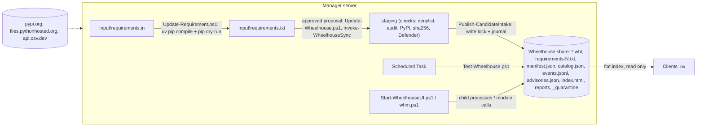
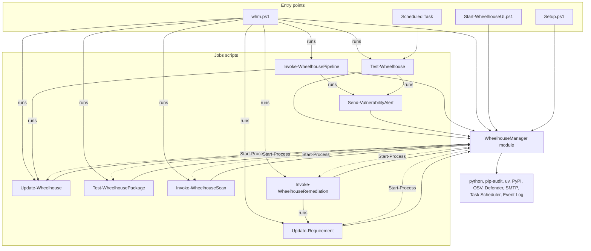

# Wheelhouse Manager - Architecture

This is the maintainer's reference: how the code is built, why it is built that way, the rules
it must keep, and how to change it safely. It is written for developers and for AI coding agents.
For what the tool does and how to operate it, read [README.md](README.md); for planned work, read
[REFACTOR_PLAN.md](REFACTOR_PLAN.md). `CLAUDE.md` is the short version of sections 4, 13 and 14.

**Before changing code, read [section 4 (invariants)](#4-invariants) and
[section 13 (Windows PowerShell 5.1 rules)](#13-windows-powershell-51-rules).** Most past bugs
were violations of one of them.

Contents

1. [System overview](#1-system-overview)
2. [Repository layout](#2-repository-layout)
3. [Runtime layout and data stores](#3-runtime-layout-and-data-stores)
4. [Invariants](#4-invariants)
5. [Layers and dependency rules](#5-layers-and-dependency-rules)
6. [Module internals](#6-module-internals)
7. [Scripts](#7-scripts)
8. [Module function reference](#8-module-function-reference)
9. [Core flows](#9-core-flows)
10. [Web UI](#10-web-ui)
11. [Data contracts](#11-data-contracts)
12. [Errors, fail-closed behaviour and exit codes](#12-errors-fail-closed-behaviour-and-exit-codes)
13. [Windows PowerShell 5.1 rules](#13-windows-powershell-51-rules)
14. [Tests and CI](#14-tests-and-ci)
15. [How to extend](#15-how-to-extend)
16. [Workflow traces](#16-workflow-traces)
17. [Known gaps and glossary](#17-known-gaps-and-glossary)

---

## 1. System overview

The product maintains an offline pip/uv package index - a folder of `.whl` files on a share,
the *wheelhouse* - for Windows clients that may not reach PyPI.

| Part | Code | Runs on | Coupling |
|---|---|---|---|
| Client install | `Client Install\UV_Installer.ps1`, `Client Install\Startup_UV.ps1` | Clients (deployment tool, GPO startup script as SYSTEM) | Reads the wheelhouse path only. Standalone scripts, no module. `Startup_UV.ps1` must not be changed. |
| Manager | `Setup.ps1`, `whm.ps1`, `Jobs\` | One manager server | Owns every file in the wheelhouse. |



Technology: PowerShell targeting **Windows PowerShell 5.1** (also runs on 7), one script module,
plain HTML/JS/CSS for the UI (no build step), Pester 5+ tests. External tools: `python` (pip,
pip-audit), `uv`, Defender cmdlets (`Start-MpScan`, `Get-MpThreatDetection`, `Get-MpThreat`),
`Send-MailMessage`.

---

## 2. Repository layout

```
.github/workflows/powershell-tests.yml   CI (section 14)
Client Install/UV_Installer.ps1          uv binaries + System32 hardlinks; Start-ProductInstall, Test-VersionStamp, Write-InstallLog
Client Install/Startup_UV.ps1            machine env vars + %ProgramData%\uv\uv.toml (frozen)
Client Install/Test-PythonEnvironment.ps1  optional client check against advisories.json (standalone)
Setup.ps1                                deploys the manager (section 7.1)
whm.ps1                                  one command for everything (section 8.18)
Jobs/
    Invoke-WheelhousePipeline.ps1        orchestrator: Update-Wheelhouse.ps1 -> Send-VulnerabilityAlert.ps1
    Update-Requirement.ps1               resolve: requirements.in -> requirements.txt (sets aside what cannot be resolved)
    Update-Wheelhouse.ps1                the update run (thin: Invoke-WheelhouseSync does the work)
    Invoke-WheelhouseRemediation.ps1     fix a vulnerable published version -> remediation proposal
    Test-Wheelhouse.ps1                  scheduled re-check of everything published + alert
    Test-WheelhousePackage.ps1           audit all / chosen pins, no alert (UI "Audit")
    Invoke-WheelhouseScan.ps1            Defender scan of all / chosen wheels (UI "Scan")
    Send-VulnerabilityAlert.ps1          alert builder: email or HTML file
    Start-WheelhouseUI.ps1               starts the UI server
    WheelhouseManager/
        WheelhouseManager.psd1           manifest; FunctionsToExport must list every function
        WheelhouseManager.psm1           sets $script:ManagerRoot, dot-sources Functions\*.ps1
        Functions/<Domain>.ps1           all logic (section 8)
        Web/index.html, app.js, style.css
Tests/WheelhouseManager.Tests.ps1        every test (section 14)
PSScriptAnalyzerSettings.psd1            excluded rules (with reasons)
Images/*.png                             web UI screenshots used by the README (one per tab)
README.md / ARCHITECTURE.md / REFACTOR_PLAN.md / CLAUDE.md / LICENSE
```

`Jobs\` is deployed as one unit: scripts import the module and find each other through
`$PSScriptRoot`. The UI serves `Web\` relative to the module folder.

---

## 3. Runtime layout and data stores

### 3.1 Manager root (`$script:ManagerRoot`, default `C:\WheelHouseManager`)

The module computes it as two levels above `Jobs\WheelhouseManager`. In a repository checkout it
is the repo root; tests pass explicit paths (`-ManagerRoot`, `-StagingRoot`, `-SettingsPath`,
`-Path`/`-DenylistPath`) instead of relying on it.

| Path | Owner (writes) | Format | If damaged |
|---|---|---|---|
| `config\settings.psd1` | Setup.ps1, `Set-WheelhouseSetting` (UI) | psd1, keys sorted, written atomically | Warning, defaults are used (`Get-WheelhouseSetting`) |
| `config\denylist.json` | `Add-/Remove-WheelhouseDenylistEntry` | JSON array (section 11) | **Throws** - never read as empty |
| `config\waivers.json` | `Add-/Remove-WheelhouseWaiver` (UI, under the write lock) | JSON array (section 11) | **Throws** - never read as empty |
| `Input\requirements.in` | User, `Set-RequirementInText` (UI), `Add-RequirementInLine` (UI expedite), `Set-RequirementInSpec` (remediation), `Clear-RequirementInFile` (after a successful `Update-Requirement.ps1` of the configured file), `Reset-WheelhouseInput` (UI start) | pip requirements, unpinned allowed | uv fails |
| `Input\requirements.txt` | Update-Requirement.ps1 (move of the candidate file), `Remove-RequirementTxtPin` (UI remove / Remove All / publish `leave_out`), `Clear-PublishedRequirementTxt` (after an update that published every pin), `Reset-WheelhouseInput` (UI start) | uv output with `# via` annotations, exact pins | Unsupported lines are skipped with a warning |
| `Input\requirements.status.json` | `Write-RequirementResolveStatus` (Update-Requirement.ps1), `POST /api/requirements/problems/remove` | `set_aside[]` and a failed resolve (section 11); removed when empty | Read as no status |
| `Input\proposal.json`, `Input\proposal-history.jsonl` | `Save-WheelhouseProposal` | current proposal / one line per change (section 11) | `proposal.json` damaged -> **throws** |
| `Input\requirements.candidate.txt` / `.rejected.txt` / `.constraints.tmp` | Update-Requirement.ps1 | transient / last rejected result / denylist as `!=` constraints | - |
| `staging\<guid>\` | `Invoke-CandidateIntake` | downloads of one intake call; deleted in `finally` | - |
| `state\background-audit.json` | `Start-WheelhouseBackgroundAudit` | `via`, `pid`, `started_utc` of the weekly check started because audits were old (9.3a); one at a time, ignored after 6 h | - |
| `state\integrity-<id>.json` | `Get-WheelhouseIntegrityProblem -CachePath` | size, timestamp and sha256 of every wheel last verified, per wheelhouse; on the manager server so the share's writers cannot vouch for a file | Warning, rebuilt |
| `logs\ui\job<N>-step<M>.out.txt` / `.err.txt` | `Start-WheelhouseUiJobStep` | child stdout/stderr | - |

### 3.2 Wheelhouse (`WheelhousePath`)

| Path | Owner (writes) | Notes |
|---|---|---|
| `*.whl` | `Publish-StagedWheel` (called by `Publish-CandidateIntake`), `Remove-WheelhousePackage` (move/delete), `Restore-WheelhousePackage` (move back) | Served to clients. `*.whl.partial` exists only during a publish. |
| `requirements.txt` (legacy group 0), `requirements-<N>.txt` | `Add-RequirementToGroupFile` (append), `Remove-RequirementFromGroupFile` (atomic rewrite) | Other names (`requirements-torch.txt`) are not groups. Never rewritten wholesale - clients install from them (`uv pip install -r`), so they stay stable and remain the source of group membership. |
| `manifest.json` | `Save-WheelhouseManifest` (worker, remove, restore) | JSON array, atomic write. Damaged -> **throws**. |
| `catalog.json` | `Update-WheelhouseCatalog`, `Set-WheelhouseCatalogState`, `Invoke-WheelhouseSync` (all under the write lock) | Per-version state and latest check results (section 11). Derived: reconciled from manifest, group files and quarantine on every write. Damaged -> **throws** (delete it to rebuild; check results start again). |
| `events.jsonl` | `Write-WheelhouseEvent` (under the write lock) | Append-only history, one JSON object per line. Unreadable lines are skipped with a warning. |
| `.journal\*.json` | `New-/Remove-WheelhouseJournal` | Intent of a publish/remove/restore in progress; a leftover is finished by `Repair-WheelhouseJournal`. Unreadable -> **throws**. |
| `.wheelhouse.lock` | `Enter-WheelhouseLock -Kind write` | Write lock: exclusive, delete-on-close; content `pid=... user=... started=...`. Held only while files change. |
| `.wheelhouse-sync.lock` | `Enter-WheelhouseLock -Kind sync` | Held for a whole `Invoke-WheelhouseSync` run - one update at a time. |
| `_quarantine\quarantine.json`, `_quarantine\<id>\*.whl` | Remove (`-Quarantine`) / Restore | Damaged record file -> **throws** |
| `_replaced\<yyyyMMdd_HHmmss>\*.whl` | `Publish-OverwriteIntake` | The previous copy of a published wheel an overwrite replaced (same sha256). Never read back by the tool. |
| `_untracked\<yyyyMMdd_HHmmss>\*.whl` | `Move-UntrackedWheelFile` (`AutoQuarantine`) | Wheels found in the folder but not in the manifest, moved out of the index. Never read back by the tool. |
| `reports\` | Every run | Retention by `Remove-ExpiredReport` (`Log_*.txt`, `Report_*.json`, `Alert_*.html`) |
| `reports\audit-sets\<Stage>\published-<n>.txt` | `Invoke-PublishedAudit` | The pins of each batched audit of published versions, kept so an `Error` result can be recorded against them. |
| `advisories.json`, `index.html` | `Export-WheelhouseAdvisory` / `Export-WheelhouseIndexPage` (every catalog save) | Versions to avoid, for `Test-PythonEnvironment.ps1` / a static page for users. Rewritten, never read by the manager. |
| `reports\osv-cache.json` | `Get-VulnerabilitySeverity` | Advisory ID -> severity, refreshed after 7 days. Not removed by retention. Damaged -> rebuilt with a warning (it is only a cache). |

---

## 4. Invariants

Each rule says where it is enforced. Breaking one is a bug even if tests pass.

1. **Nothing reaches the wheelhouse folder unchecked.** Downloads go to the staging folder and
   are copied to the share only by `Publish-StagedWheel`, after every intake check, as
   `<file>.partial` + hash re-check + rename. *Why:* clients read the folder directly (flat
   index); a half-checked or half-written file would be installable. *Where:* `Intake.ps1`.
2. **Staging is under the manager root, not `%TEMP%`.** `%TEMP%` can be an 8.3 short path
   (`AVYPO~1`), Defender reports long paths, and matching is by substring - a detection could be
   missed and the scan reported as clean. *Where:* `Invoke-CandidateIntake -StagingRoot` default.
3. **Group files only list pins whose wheel is published.** Intake is transactional per package:
   `Publish-CandidateIntake` copies the files, then `Complete-WheelhousePublishJournal` records
   them in the manifest and only then appends the pins of packages whose wheels all arrived. Pins
   already listed but without a wheel are fed back through intake. *Where:* `Intake.ps1`, `Journal.ps1`.
4. **The manifest only gains entries intake returns as `Published`** (verified against PyPI's
   sha256). The single exception is first-time setup (manifest empty at start): the wheels
   already in the folder are adopted by `Merge-WheelhouseManifest -PreRunFiles @()`. Untracked
   wheels are otherwise never added. New group numbers are max+1.
5. **Fail closed.** An audit is `Passed`/`Vulnerable`/`Error`; `Error` is never treated as clean.
   A Defender scan is `Clean`/`Threat`/`Error`; `Error` is never clean. Unverifiable PyPI data
   rejects at intake and is an error in the scheduled check. A damaged manifest, denylist or
   quarantine record throws. (Settings are the exception - see 3.1.)
6. **One writer at a time, for as short as possible.** Every change to the manifest, group files,
   catalog, quarantine or history happens under the write lock, taken with `Open-WheelhouseWrite`
   (lock + journal repair) and held only while files change. Code that holds it already passes
   `-LockHeld`. Long work (audits, downloads, scans) runs without it, and whatever a writer read
   before is read again under the lock (the manifest and the denylist in `Publish-CandidateIntake`).
   `Invoke-WheelhouseSync` also holds the sync lock for its whole run, so two updates never plan
   from the same state. UI actions fail at once if the write lock is busy (`TimeoutSeconds 0`);
   the update and the checks wait up to 300 s.
7. **Removal is ordered and undoable.** Denylist -> quarantine record -> group files -> manifest
   -> move files; each step pushes an undo; a failure replays them in reverse. Deleting files is
   the last, non-undoable step, outside the undo `try`. *Why:* clients must never see a pin
   without a wheel, and a partial failure must not lose data.
8. **The denylist only blocks more.** `Invoke-CandidateIntake` rejects a denylisted pin before
   anything else. Remove/quarantine add `name==version` automatically (`source` `removed` /
   `quarantined`); restore lifts only the `quarantined` entry.
9. **Pinned groups use `--no-deps --only-binary=:all:`** for audit and download: exactly the
   pinned versions are checked and fetched, nothing unpinned is pulled in. pip stops at the first
   unresolvable pin, so `Invoke-PipPinRetry` drops the pin named in "No matching distribution
   found for X" and retries.
10. **Module functions never run `Jobs\*.ps1`.** A script run from a module function executes in
    module scope and breaks `$script:` state. The module returns parameters
    (`Get-VulnerabilityAlertParameter`) and the calling script runs the alert; the UI uses
    `Start-Process` child processes.
11. **Functions `throw`, scripts `exit`** - with the codes from `Get-WheelhouseExitCode`
    (section 12).
12. **Native commands go through `Invoke-NativeCommand`** (stderr merged into stdout as text) so
    5.1's transcript records pip's error lines.
13. **The worker sends no alerts.** It emits `Wheelhouse.AuditResult` and `Wheelhouse.Notice`
    objects; the pipeline (or the scheduled check) alerts once.
14. **Restrictions apply to wheelhouse packages only.** `Confirm-PythonAndTooling` upgrading
    pip/pip-audit on the manager is intended and outside cooldown/audit.
15. **UI input never reaches a command line unvalidated.** Names, versions and file names match
    strict patterns *and* exist in the manifest; `ConvertTo-UiArgument` refuses quotes.
16. **Defaults live only in `Get-WheelhouseDefaultSetting`.** Scripts resolve parameters with
    `Resolve-WheelhouseParameter`; nothing else hard-codes a default.
17. **Multi-step changes are journaled.** Publish, remove and restore write a journal before their
    first step and delete it after the last. `Repair-WheelhouseJournal` (run by every
    `Open-WheelhouseWrite`) finishes a leftover by rolling forward with idempotent `Complete-*`
    functions - the same ones the normal publish and restore paths use. A journal it cannot read
    or finish stops every writer until someone looks.
18. **The catalog is derived, the history append-only.** `Sync-WheelhouseCatalog` can rebuild state,
    files and groups from manifest, group files and quarantine at any time; only check results and
    history live in the catalog/events alone. A failed audit or scan never refreshes `last_run`,
    `last_ok` or a status (`Update-CatalogAuditResult` / `Update-CatalogScanResult`).
19. **Names, versions and wheel file names from outside are validated in one place** -
    `Test-WheelhousePackageName`, `Test-WheelhousePackageVersion`, `Test-WheelhouseWheelFileName`,
    `ConvertTo-WheelhousePin` (Common.ps1).
20. **The share is never virus-scanned by this tool.** The file server's own antivirus does that.
    Defender runs on this server only for local files: staged downloads at intake, and on-demand
    scans of hash-checked local copies (`Invoke-WheelhouseCopyScan`). *Why:* Defender reads network
    paths as the computer account and a policy can skip network files, so a scan of the share could
    report Clean without reading anything.
21. **Wheels removed or changed on the share are detected, not ignored.** The integrity check
    classifies them (`Missing`, `Modified`); with `AutoQuarantine` (default on, `-AutoQuarantine
    On|Off` per run) `Resolve-WheelhouseIntegrityProblem` takes a missing version out (pins and
    manifest, denylisted) and quarantines a modified one as evidence; without it the update stops
    and the scheduled check only reports. `Unreadable` and `Malformed` always stop the run.
22. **Never assign to a script variable named like a validated parameter.** Variable names are
    case-insensitive and the parameter's `Validate*` attribute rejects the value; at script level
    that error does not stop the script (this silently disabled automatic quarantine once). A test
    checks every script. Inside functions the same clash with a typed parameter (`[object[]]$Finding`
    vs. a local `$finding`) silently wraps the value in an array - name locals differently.
23. **A vulnerability is a tracked finding with a deadline.** `Update-CatalogAuditResult` keeps one
    finding per advisory on the record (`Update-CatalogRecordFinding`): `first_seen` never moves, the
    due date is `first_seen` + `DueDays<Severity>`, a failed severity lookup never replaces a known
    severity, and an unknown severity counts as High. Severity comes from OSV
    (`Get-VulnerabilitySeverity`, only the advisory ID is sent) before the write lock is taken.
24. **Alerts are stateful.** Each finding records the level last alerted (`notified`). The weekly
    check alerts a finding when it is new, becomes overdue (again every `OverdueReminderDays`), loses
    its waiver, or is resolved - and marks it only after the alert was delivered
    (`Set-CatalogFindingNotified`), so a failed delivery is retried. Notices and failed checks are
    alerted on every run.
25. **A waiver accepts one advisory for one exact version until a date** (at most `WaiverMaxDays`).
    There is no blanket waiver. Waived findings are not alerted and do not make the exit code 1; an
    expired or removed waiver makes the finding alertable again.
26. **Automatic actions quarantine, never delete, and are always alerted.** Under `AutoQuarantine`:
    missing/changed wheels (invariant 21), published versions with an OSV malicious-package advisory
    (`MAL-*`, `Resolve-MaliciousPackage`; a waived one is left alone) and wheels in the folder that
    the manifest does not know (`Move-UntrackedWheelFile`, moved to `_untracked\`; never on
    first-time setup, which adopts them).
27. **Nothing new is merged without an approved proposal for exactly that requirements.txt.**
    `Invoke-WheelhouseSync` runs `Resolve-WheelhouseProposalForPublish` once the merge plan adds
    something; refused -> exception with `Data['WheelhouseAwaitingApproval']` (exit 1, nothing
    written). `ApprovalMode` decides who may approve; approver and requester are recorded in the
    proposal history and in every `Published` event.
28. **A fix replaces in place.** A remediation proposal's changed pins go into the group files that
    list the vulnerable version (swap, never a second group), and the vulnerable version is
    quarantined only when no group lists it any more and its replacement is published.

29. **The weekly check hashes every wheel; updates may skip unchanged ones.** `Invoke-WheelhouseSync`
    runs `Assert-WheelhouseIntegrity -Quick` (a file whose size and modification time match its
    last verification is not hashed; missing files always count); `Test-Wheelhouse.ps1` hashes
    everything and refreshes the cache. The cache never lives on the share.

30. **A package is never published without the pins it needs; a published one is never removed for
    a dependency.** `Invoke-WheelhouseSync` checks every group before it publishes any, then holds
    back (category `dependency`) each verified package whose dependency - from the `# via`
    annotations of `requirements.txt` (`Read-RequirementDependent`) - was rejected in any group,
    up the chain (`Get-DependentRejection`). *Why:* clients resolve from the whole share with
    `no-index`; a parent without its dependency fails to install, or silently gets an older,
    possibly vulnerable, version. Once published, a parent stays when its dependency later fails
    a check (it is installed on clients and the fix is the dependency's new version); findings,
    notices and the UI name it instead (`Get-CatalogDependent`, from the `requires[]` the catalog
    reads once from each wheel's METADATA). Without annotations (`--no-annotate`) nothing is held
    back and the run warns. The Add tab keeps the same rule when you choose what to publish:
    unticking a package unticks the packages that need it (`needs`), so a left-out pin never
    leaves a parent without it.

31. **One resolve reports every problem; nothing is lost silently.** `Update-Requirement.ps1`
    sets aside each requirement uv cannot resolve (`Invoke-RequirementResolve`) instead of failing
    on the first, records them with their reason in `requirements.status.json` (`set_aside`) and
    the Add tab lists them until they are removed or asked for again. A pin is only excluded by a
    `name!=version` constraint when pip found it unusable. An overwrite (`-OverwritePackage`)
    never changes what clients get: the new copy must hash to the manifest's sha256, and the old
    copy is moved to `_replaced\`, never deleted.

---

## 5. Layers and dependency rules



- Scripts are thin: parameters -> `Resolve-WheelhouseParameter` -> `Start-WheelhouseRun` ->
  `try { ... } catch { exit code } finally { Stop-WheelhouseRun }` -> output objects -> `exit`.
  The update run itself is a module function (`Invoke-WheelhouseSync`); the checks record their
  results with `Update-WheelhouseCatalog -Update { param($catalog) ... }`.
  `Update-Requirement.ps1` and `Send-VulnerabilityAlert.ps1` skip `Start-WheelhouseRun` (they may
  run without a wheelhouse) and log to the console only.
- Only orchestrating scripts call other scripts, with `&` (in-process, so result objects are
  returned).
- `Write-Log` writes to the host (console + transcript) only, never to the output stream - result
  objects stay clean.
- Within the module, files are domains, not layers: any function may call any other. Keep I/O
  wrappers small and mockable (`Invoke-MpScan`, `Get-PyPIReleaseInfo`, `Invoke-NativeCommand`,
  `Get-WheelhouseThreatDetection`).

---

## 6. Module internals

**Loading.** `WheelhouseManager.psm1` sets `$script:ManagerRoot` and dot-sources `Common`,
`Settings`, `Requirements`, `Resolve`, `Manifest`, `Catalog`, `Dependency`, `Journal`, `Audit`, `Vulnerability`, `Intake`, `Sync`, `Alert`,
`Run`, `Denylist`, `Package`, `Proposal`, `Remediation`, `Scan`, `Schedule`, `Status`, `Ui` (order is for readability; calls resolve at run time).
`Ui.ps1` builds `$script:UiRoutes` at load time. The psd1's
`FunctionsToExport` is the public surface; CI fails if a listed function is missing.

**Module-scope state** (`$script:`):

| Variable | File | Purpose |
|---|---|---|
| `ManagerRoot` | psm1 | Default for every manager-relative path |
| `PackageNamePattern`, `PackageVersionPattern`, `WheelFileNamePattern` | Common | The one definition of valid names/versions/wheel file names from outside |
| `CatalogSchemaVersion` | Catalog | Written into `catalog.json`; a newer one is refused |
| `GroupFilePattern` (`^requirements-(\d+)\.txt$`), `LegacyGroupFileName` | Requirements | What counts as a group file |
| `AuditReportPattern` | Audit | The single definition of audit report names (writer and readers) |
| `SeverityLevels` (`Low` .. `Critical`), `VulnerabilityIdPattern` | Vulnerability | Severity order; what an advisory ID may look like (waivers, OSV lookups) |
| `QuarantineFolderName` (`_quarantine`), `PackageSpecPattern` | Package | Quarantine location; what `requirements.in` lines the UI may add |
| `UiWebRoot`, `UiStaticFiles`, `UiMimeTypes` | Ui | Static file whitelist |
| `UiToolStatus`, `UiToolStatusTime` | Ui | Cached tool check for `GET /api/state` |
| `UiJobs`, `UiJobCounter`, `UiMaxJobHistory` (30), `UiShutdown` | Ui | In-memory job list and server state (one UI process) |
| `UiRoutes` | Ui | The API route table (`Get-WheelhouseUiRoute`) |

**Settings resolution.** `Resolve-WheelhouseParameter -BoundParameters $PSBoundParameters -Name a, b`
returns a hashtable; per name: bound parameter > non-empty setting (empty string / empty array /
`$null` count as unset) > `Get-WheelhouseDefaultSetting`. `-SettingName` maps a parameter to a
different key (`To` -> `MailTo`, `RequirementsTxtPath` -> `LocalRequirementsPath`). Names that are
not script parameters (e.g. `RequireDefenderScanAtIntake`) resolve from settings/defaults only.

**Package names** are normalized everywhere with `Get-NormalizedPackageName` (PEP 503: lower
case, runs of `-_.` -> `-`). Manifest, denylist, group-file parsing and comparisons all use the
normalized form.

---

## 7. Scripts

### 7.1 `Setup.ps1`
`-DestinationPath` (default `C:\WheelHouseManager`), `-WheelhousePath`. Copies `Jobs\*.ps1`,
replaces `Jobs\WheelhouseManager` as a whole (so deleted function files do not linger; skipped if
source = destination), copies `whm.ps1` to the root (and removes an old root `Invoke-WheelhousePipeline.ps1` - it lives in `Jobs\` now), creates `config\settings.psd1` from
`Get-WheelhouseDefaultSetting` if missing, sets `WheelhousePath` if passed, creates
`Input\requirements.in`/`.txt` if missing (`Initialize-ManagerFile`). Idempotent.

### 7.2 `Jobs\Invoke-WheelhousePipeline.ps1`
Forwards only bound parameters: to the worker `WheelhousePath, LocalRequirementsPath,
PythonVersion, Platform, MinimumPackageAgeDays, VulnerabilityServices, ExpeditePackage,
ExpediteReason` (not `OverwritePackage` - overwrites come from the UI); to the alert
`WheelhousePath, SmtpServer, To, From, OutputHtmlPath`. Collects
the worker's output by PSTypeName (`Wheelhouse.AuditResult`, `Wheelhouse.Notice`); none -> no
alert (aborted run). `Get-VulnerabilityAlertParameter` -> `& Send-VulnerabilityAlert.ps1`. Exit:
worker code if non-zero, else the alert's.

### 7.3 `Update-Requirement.ps1`
Resolves `RequirementsInPath`, `RequirementsTxtPath` (setting `LocalRequirementsPath`),
`PythonVersion`, `Platform`, `MinimumPackageAgeDays`; also `-ExpeditePackage name==ver` +
`-ExpediteReason`, `-NoSetAside` (remediation), `-NoProposal`, `-PreferCurrent` (kept; every
resolve now prefers the current pins).
1. Input (`Get-RequirementResolveInput`, configured requirements.in only): the pins of the
   current requirements.txt that were asked for (`-r` in `# via`) as `name==version` (source
   `kept`), then the lines of requirements.in (source `input`). A line whose package is pinned
   at a version it accepts is ignored (logged); one that asks for another version replaces the
   pin; one for a set-aside package retries it. Denylisted pins are dropped. Expedited pins:
   `-ExpeditePackage` plus the current proposal's `expedite` when it matches requirements.txt.
2. `Invoke-RequirementResolve` loop (Functions\Resolve.ps1), each round one of:
   `Invoke-UvCompile` (`uv pip compile <work>\requirements.in --exclude-newer "<N> days"
   --python-version <v> --python-platform <ConvertTo-UvPythonPlatform> --only-binary :all:
   --custom-compile-command .\Update-Requirement.ps1 [--exclude-newer-package name=<now>]
   [--constraints] -o requirements.candidate.txt`, the current requirements.txt copied there
   first as preferences; constraints = `Get-DenylistConstraintLine` + `name<=ver` per expedited
   pin + `name!=ver` per unusable pin) succeeds -> `Test-RequirementWheelAvailability`; unusable
   pins -> `name!=ver` constraint, again; pass -> done.
   uv fails -> `Get-UvRequiredName` ("you require X", "X was not found"): one -> set aside with
   `Get-UvResolveReason` (kind cooldown [with `expedite` = name==ver from the exclude-newer
   hint] / no-wheel / not-found / no-version / conflict); several or none -> each suspect
   compiled alone, those failing alone are set aside; several that only fail together -> the
   first is kept, the others set aside as `conflicts with`; none at all -> stop (`Error`).
3. Result -> `requirements.txt` (empty when everything was set aside), `.rejected.txt` deleted;
   `Write-RequirementResolveStatus -SetAside` (this run's + earlier ones still open);
   requirements.in emptied; proposal with the expedited pins that were resolved. `Error` ->
   candidate to `requirements.rejected.txt`, `requirements.txt` kept, status `failed` with
   `Get-RequirementResolveProblem` per line.

Exit: 0 written (possibly with set-aside lines); 1 no result, or `-NoSetAside` and something was
set aside; 2 missing input / python / uv / platform, or `-ExpeditePackage` without a reason.

### 7.4 `Update-Wheelhouse.ps1` (the update run)
Parameters: `WheelhousePath`, `LocalRequirementsPath` (`""` = no merge), `PythonVersion`,
`Platform`, `MinimumPackageAgeDays`, `VulnerabilityServices`, `ExpeditePackage` (`name==ver`,
array or comma string, parsed by `ConvertTo-WheelhousePin`), `ExpediteReason` (required with it),
`OverwritePackage` (`name==ver` of published versions to download, check and swap in again).
Also resolves `ReportRetentionMonths`, `DefenderScanAtIntake` (off -> `-SkipDefenderScan`), `RequireDefenderScanAtIntake`, `DueDays*`,
`AuditFreshnessDays`. The script only frames the
run (transcript, `Confirm-PythonAndTooling`, exit code); `Invoke-WheelhouseSync` does the work -
sequence in [9.2](#92-the-update-run-invoke-wheelhousesync). Output: AuditResults then Notices. Exit: 0; 1
rejection / wheel taken out because it was missing or changed on the share;
2 aborted (including a missing/changed wheel with `-AutoQuarantine Off`) or any audit `Error`; 3 lock
busy. `-AutoQuarantine On|Off` overrides the setting for the run.

### 7.5 `Test-Wheelhouse.ps1` (Scheduled Task)
Parameters: `WheelhousePath`, `VulnerabilityServices`, `AutoQuarantine` (On/Off), `SmtpServer`,
`MailTo`, `MailFrom` (renamed to `To`/`From` for the alert). Also resolves `PythonVersion`,
`Platform`, `ReportRetentionMonths`, `AutoQuarantine` (setting), `DueDays*`, `AuditFreshnessDays`,
`OverdueReminderDays`. Under `AutoQuarantine` it changes the wheelhouse for the automatic actions of
invariant 26 (write lock); otherwise it writes reports, catalog and history only. No administrator
rights needed. Sequence in [9.3](#93-the-scheduled-re-check-test-wheelhouseps1). Exit: 0 (also when
every open finding is waived); 1 open findings or notices; 2 aborted, a check incomplete, the alert
failed, or the results could not be recorded in the catalog. Records audits, severities, PyPI results
and its heartbeat (`ScheduledCheckUtc`) with `Update-WheelhouseCatalog` (write lock, waits up to 300 s).

### 7.6 `Test-WheelhousePackage.ps1`
`-Package` pins (validated by regex, must be in the manifest) -> `Invoke-PackageAudit -Stage
Manual` (report group `selection`); none -> `Invoke-PublishedAudit -Stage Manual` (every published version, batched). Emits
AuditResults, no alert, records the results (with severities, due dates and waivers) in the
catalog. Exit 1 vulnerable, 2 audit error,
abort, or results not recorded.

### 7.7 `Invoke-WheelhouseScan.ps1`
On-demand second opinion with this server's Defender (routine scanning of the share is the file
server's antivirus' job). `-File` bare `*.whl` names from the manifest, or every tracked wheel.
`Invoke-WheelhouseCopyScan` copies them to local staging, checks each copy's SHA256 against the
manifest and scans the copies; the `Wheelhouse.ScanResult` names the share files and is recorded in
the catalog. Exit 1 `Threat`, 2 `Error`, a wheel not scanned (`NotScanned`), abort or result not
recorded.

### 7.8 `Send-VulnerabilityAlert.ps1`
`-ReportPaths`, `-Findings` (tracked findings from `Get-CatalogFindingAlert`), `-AuditErrors`,
`-Notices` (at least one), `-WheelhousePath`, `-SmtpServer`, `-To`, `-From`, `-OutputHtmlPath`.
`Get-VulnerabilityFinding` + `-Findings` -> `ConvertTo-VulnerabilityAlertHtml`; subject by content
(open findings with the overdue count / resolved only / notices / errors only). SMTP set -> `Send-MailMessage`,
else HTML file. Exit 0 sent/saved/nothing to report, 2 no input or delivery failed. Invoked
in-process only (notices are objects).

### 7.9 `Start-WheelhouseUI.ps1`
`-Port` (1024-65535, default 8765), `-NoBrowser`, `-KeepInput`. Without `-KeepInput` it first
empties the Input files (`Reset-WheelhouseInput`: requirements.in down to its comments,
requirements.txt, `requirements.status.json`, `requirements.rejected.txt`; the proposal history
stays), so every UI session starts with a fresh Add tab. Then `Start-WheelhouseUiServer`, which runs
`Invoke-WheelhouseStartupAuditCheck` (9.3a) before it listens. Exit 2 on error.

---

## 8. Module function reference

Columns: purpose | returns / side effects | callers. All are exported.

### 8.1 `Common.ps1`

| Function | Purpose | Returns | Callers |
|---|---|---|---|
| `Write-Log` | `[ts] [LEVEL] message` to the host (`INFO`/`OK`/`WARN`/`ERROR`) | - | everything |
| `Get-NormalizedPackageName` | PEP 503 normalization | string | everywhere names are compared |
| `Test-WheelhousePackageName` / `Test-WheelhousePackageVersion` / `Test-WheelhouseWheelFileName` | validate names, versions, bare wheel file names from outside | bool | UI, denylist, scan script |
| `ConvertTo-WheelhousePin` | `name==version` pins from arrays and comma/semicolon lists; `ArgumentException` otherwise | `{Name; Version}` | Update-Wheelhouse, Test-WheelhousePackage |
| `ConvertTo-HtmlSafe` | HTML-encode | string | alert HTML |
| `Enable-WheelhouseTls12` | add TLS 1.2 on Windows PowerShell 5.1 (no-op on 7) | - | PyPI and OSV requests |
| `Get-WheelhouseUserName` | `$env:USERNAME`, or `unknown` | string | history, journal, denylist, quarantine, waivers |
| `Write-TextFileAtomic` | write `<path>.tmp`, move over target | file | JSON/settings/group rewrites |
| `Write-JsonFile` | `ConvertTo-Json` (arrays stay arrays, null -> `[]`) + atomic write | file | manifest, reports, denylist, quarantine |
| `Invoke-NativeCommand` | run exe, stderr merged as text, lines echoed; `-PassThru` returns lines (`-NoEnumerate`); `$LASTEXITCODE` kept | lines | pip, pip-audit, uv callers |
| `Enter-WheelhouseLock` | `-Kind write` (`.wheelhouse.lock`) or `sync` (`.wheelhouse-sync.lock`), exclusive, delete-on-close; `-TimeoutSeconds` waits; busy -> `InvalidOperationException` with `Data['WheelhouseLockBusy']`; missing folder -> plain error | `FileStream` | `Open-WheelhouseWrite`, `Invoke-WheelhouseSync` |
| `Exit-WheelhouseLock` | dispose (null-safe) | - | every lock holder |
| `Open-WheelhouseWrite` | write lock + `Repair-WheelhouseJournal`; releases the lock if the repair fails | `FileStream` | every writer |
| `Get-WheelhouseExitCode` | `-Outcome Ok/Attention/Error/Busy` -> 0/1/2/3; `-ErrorRecord` -> 3 if lock busy else 2 | int | every job script |
| `ConvertTo-UtcDateTime` | JSON date (text on 5.1, `[datetime]` on 7) -> UTC `[datetime]` | datetime | PyPI parsing, intake |
| `ConvertTo-OptionalUtcDateTime` | the same for values that may be missing: `$null` for empty or unreadable input | datetime / `$null` | catalog findings, waivers, OSV cache |
| `ConvertTo-WheelhouseBoolean` | setting (`[bool]`) or command line (`On`/`Off`, `True`, `1`, `Yes`) -> `[bool]` | bool | scripts (`-AutoQuarantine`) |

### 8.2 `Settings.ps1`

| Function | Purpose | Returns | Callers |
|---|---|---|---|
| `Get-WheelhouseDefaultSetting` | the only defaults (paths relative to `-ManagerRoot`) | hashtable | `Resolve-WheelhouseParameter`, Setup |
| `Get-WheelhouseSettingsPath` | `<root>\config\settings.psd1` | string | defaults, UI context |
| `Get-WheelhouseSetting` | `Import-PowerShellDataFile`; missing/unreadable -> `@{}` + warning | hashtable | resolution, Setup, UI |
| `Resolve-Setting` | one value: bound > non-empty setting > fallback | value | `Resolve-WheelhouseParameter` |
| `Resolve-WheelhouseParameter` | resolve many names (`-SettingName`, `-Default`, `-Settings`) | hashtable | scripts, UI context |
| `ConvertTo-Psd1Literal` | value -> psd1 literal (string, number, bool, array) | string | `Save-WheelhouseSetting` |
| `Save-WheelhouseSetting` | write whole table, keys sorted, atomic | file | Setup, `Set-WheelhouseSetting` |
| `Set-WheelhouseSetting` | merge updates into the file | file | Setup, UI |
| `Initialize-ManagerFile` | create a file only if absent | file | Setup |
| `Get-WheelhouseSettingSchema` | UI-editable settings: key, type (`path`, `file`, `string`, `choice`, `multichoice`, `int`, `bool`), label, help, options, min/max | objects | UI |
| `ConvertTo-WheelhouseSettingValue` | validate/convert one UI value; `ArgumentException` with a readable message | value | UI `POST /api/settings` |

### 8.3 `Requirements.ps1`

| Function | Purpose | Returns | Callers |
|---|---|---|---|
| `Read-RequirementFile` | exact pins only; comments, extras, markers, `--hash` accepted and dropped; other lines skipped with a warning | hashtable name -> version | worker, merge plan, wheel check, inventory, remove/restore, UI |
| `Get-GroupFileNumber` | `requirements-N.txt` -> N, `requirements.txt` -> 0, else -1 | int | group listing, merge plan, worker |
| `Get-WheelhouseGroupFile` | group files in number order (`-NoEnumerate`) | string[] | worker, checks, inventory, remove |
| `Get-RequirementMergePlan` | duplicate / first group without the name / new group max+1; name order | `@{ Additions; Duplicates }` | worker |
| `Add-RequirementToGroupFile` | append `name==version` (create file if needed) | file | worker, restore |
| `ConvertTo-UvPythonPlatform` | pip platform tag -> uv triple; throws if unknown | string | Update-Requirement, settings validation |
| `Invoke-PipPinRetry` | run pip over pins; drop the pin named in "No matching distribution found for X"; retry. A failure naming no pin -> `Error` | `@{ Succeeded; Failed; Error }` | wheel check, intake download |
| `Read-RequirementDependent` | the `# via` annotations of a `uv pip compile` file (one-line and list style; `-r`/`-c` sources skipped, `-IncludeSource` keeps `-r <file>`) | hashtable name -> names of the pins that need it | sync run |
| `Get-DependentRejection` | invariant 30: candidates (`-Candidates`) that need a rejected pin of exactly the `-Pins` version, transitively; reason `needs X==v, which was rejected (<reason>)` | `{Name; Version; Category dependency; Reason; Dependency}` | sync run |
| `Test-RequirementWheelAvailability` | `pip install --dry-run --no-deps --ignore-installed --only-binary=:all: --python-version --platform --implementation cp --target <tmp>` | `@{ Passed; Unavailable; Error }` | Update-Requirement |

### 8.4 `Resolve.ps1`

The resolve loop of `Update-Requirement.ps1` (sequence in 7.3). It never touches the wheelhouse.

| Function | Purpose | Returns | Callers |
|---|---|---|---|
| `Get-RequirementResolveInput` | what a resolve starts from: the asked-for pins of the current requirements.txt (`kept`), the new lines (`input`), lines ignored because a listed pin already fits, set-aside entries still open, the denylisted pins dropped | `@{ Requirements [{name; spec; source}]; Ignored [{spec; pin}]; SetAside }` | `Update-Requirement.ps1` |
| `ConvertFrom-RequirementSpec` | a requirement line without its comment; `$null` for a blank/comment line | `{name; spec; specifier}` | `Get-RequirementResolveInput` |
| `Invoke-UvCompile` | one `uv pip compile` round (cooldown, target, `--only-binary :all:`, constraints, `--exclude-newer-package` per expedited pin); the mock seam of the loop | `@{ ExitCode; Output }` | `Invoke-RequirementResolve` |
| `Get-UvRequiredName` | the requirement names uv's error output blames ("you require X", "X was not found") | string[] | `Invoke-RequirementResolve` |
| `Get-UvResolveReason` | kind and reason for a set-aside requirement: `cooldown` (with `expedite` = `name==ver` from the exclude-newer hint), `no-wheel`, `not-found`, `no-version`, `conflict` | `@{ Reason; Kind; Expedite }` | `Invoke-RequirementResolve` |
| `Invoke-RequirementResolve` | invariant 31: compile -> `Test-RequirementWheelAvailability` -> unusable pins become `name!=ver` constraints -> again; on a uv failure set aside the blamed requirement (or isolate suspects one by one) and resolve the rest; `-NoSetAside` fails instead | `@{ Ok; Resolved; SetAside [{name; spec; source; reason; kind; expedite}]; Error }` | `Update-Requirement.ps1` |

### 8.5 `Manifest.ps1`

| Function | Purpose | Returns | Callers |
|---|---|---|---|
| `Get-WheelFileInfo` | parse a wheel file name (PEP 427) | `{Name; Version; PythonTag; AbiTag; PlatformTag}` / `$null` | publish, merge |
| `Get-WheelhouseManifestPath` | `<wh>\manifest.json` | string | manifest functions, logs |
| `Read-WheelhouseManifest` | entries (`-NoEnumerate`); missing/empty -> empty; invalid -> throws | object[] | many |
| `Save-WheelhouseManifest` | write the array | file | worker, remove, restore |
| `Get-WheelhouseIntegrityProblem` | per entry: `Missing`, `Modified` (hash mismatch), `Unreadable`, `Malformed` | `{Kind; Entry; Message}` | `Assert-WheelhouseIntegrity` |
| `Test-ManifestIntegrity` | the problem messages only | string[] (`-NoEnumerate`) | tests, callers that only report |
| `Get-UntrackedWheelFile` | `*.whl` not in the manifest | string[] (`-NoEnumerate`) | integrity, inventory |
| `Assert-WheelhouseIntegrity` | writes `Report_Integrity_*` for any problem, warns on untracked; throws on any problem, or with `-AllowChangedFiles` only on `Unreadable`/`Malformed` and returns the `Missing`/`Modified` ones | problems with the switch | worker, scheduled check |
| `Merge-WheelhouseManifest` | old entries + wheels not in `-PreRunFiles` (hashed now); bootstrap adds all | object[] (`-NoEnumerate`) | worker (first-time setup only) |
| `Compare-RequirementsAgainstManifest` | pins without a manifest entry matching the target tag (`cpXY`/`py*`/`abi3`, platform or `any`) | `@{ Descriptions; Packages }` | worker, `Get-UndownloadedPin` |
| `Get-QuarantineFileName` | wheel names for a pin from the manifest, or an estimated glob | string[] | alert HTML |
| `Get-UndownloadedPin` | per group: listed pins without a matching wheel | `{Group; Package; Version}` | scheduled check |

### 8.6 `Audit.ps1`

| Function | Purpose | Returns | Callers |
|---|---|---|---|
| `Confirm-PythonAndTooling` | require python; upgrade outdated pip/pip-audit; install pip-audit (throws on failure) | - | worker, checks |
| `Get-AuditReportPath` / `Get-AuditReportInfo` | build / parse `Report_<Stage>-<Group>-<SERVICE>_<ts>.json` | string / object | `Invoke-PipAudit` / findings, status |
| `Get-PipAuditReport` | read flat-array or `{dependencies}` report; throws if missing/empty/invalid | objects (`-NoEnumerate`) | audit, intake, findings, status |
| `Get-VulnerableDependencyCount` | dependencies with vulns | int | `Invoke-PipAudit` |
| `Invoke-PipAudit` | `python -m pip_audit -r <file> --no-deps --disable-pip --vulnerability-service <s> --format json --output <report>`; exit 0 -> `Passed`, non-zero with vulns -> `Vulnerable`, else `Error` | `Wheelhouse.AuditResult` | `Invoke-GroupAudit` |
| `Show-PipAuditFixSuggestion` | `pip-audit --fix --dry-run`, informational | console | `Invoke-GroupAudit` |
| `Invoke-GroupAudit` | one audit per service, fix suggestions if vulnerable | AuditResult[] (`-NoEnumerate`) | intake, `Invoke-PackageAudit`, `Invoke-PublishedAudit` |
| `Get-AuditChunk` | published versions packed into the fewest sets with one version per name (set n = every package's n-th version) | ordered hashtables (`-NoEnumerate`) | `Invoke-PublishedAudit` |
| `Invoke-PublishedAudit` | write each set to `<reports>\audit-sets\<Stage>\published-<n>.txt` (kept: an `Error` result is recorded against the set's pins) and `Invoke-GroupAudit` it; results are per version, so the set does not matter | AuditResult[] (`-NoEnumerate`) | update run, weekly check, Test-WheelhousePackage |
| `Get-PyPIReleaseInfo` | PyPI JSON API (TLS 1.2 on 5.1): files with sha256, upload time, yanked; release yanked flag; throws if unreadable/empty | `{Files; FirstUploadUtc; Yanked; YankedReason}` | `Test-PackageAge`, `Get-DeployedPackageNotice` |
| `Test-PackageAge` | release first upload vs. minimum age; `-Expedite` names pass; results carry `EligibleUtc`, `Yanked`, `Release`; unreadable -> failed with `Error` | `@{ TooNew; Results }` | intake |
| `Invoke-WheelhouseToolProbe` | version reported by `python --version`, `python -m pip_audit --version` or `uv --version`, run as a process with an empty stdin and a 15 s limit (the Store `python.exe` stub can block); `$null` if missing, failing or too slow (mock seam) | string / `$null` | `Get-WheelhouseToolStatus` |
| `Get-WheelhouseToolStatus` | `{name; available; version; level ok/warn/bad; message}` for python, pip-audit (warn: installed by the first run), uv (needed to resolve `requirements.in`) | objects | UI state |
| `Get-DeployedPackageNotice` | published versions vs. denylist and PyPI yanked flag (release or deployed file); unreadable -> one aggregated error | `@{ Notices; Errors; Checked = {Package; Version; Yanked; Reason} }` | scheduled check |

### 8.7 `Intake.ps1`

| Function | Purpose | Returns | Callers |
|---|---|---|---|
| `Invoke-CandidateIntake` | first half of the gate: every check, no lock, nothing written to the wheelhouse (section 9.1) | `@{ Packages; Rejected (Name, Version, Reason, Category); AuditResults; Verified = @{name = staged FileInfo[]}; StagingPath }` | `Invoke-WheelhouseSync` |
| `Publish-CandidateIntake` | second half: under the write lock, re-check the denylist, journal, copy, `Complete-WheelhousePublishJournal`, catalog + history; always deletes the staging folder | `@{ Accepted; Rejected; Published; Manifest }` | `Invoke-WheelhouseSync` |
| `Publish-StagedWheel` | copy as `.partial`, re-hash, rename; identical untracked file kept, different one throws | `{Entry; Created}` | `Publish-CandidateIntake` |
| `Publish-OverwriteIntake` | overwrite: under the write lock each verified file must match the manifest's sha256 (else rejected, `integrity`), then `.partial` + `File.Replace` with the old copy to `<wheelhouse>\_replaced\<time>\`; manifest and group files unchanged; history `Overwritten` + intake scan; no journal (the name always holds one of two identical copies) | `@{ Accepted; Rejected; Replaced; Folder }` | `Invoke-WheelhouseSync` (step O) |

### 8.8 `Alert.ps1`

| Function | Purpose | Returns | Callers |
|---|---|---|---|
| `New-WheelhouseNotice` | `Wheelhouse.Notice` with a default `Action` per `Kind` | object | worker, scheduled check, `Get-DeployedPackageNotice` |
| `Get-VulnerabilityFinding` | one finding per `name|version|vulnId` across reports; `Deployed` = seen in a non-candidate report; unreadable reports -> `Errors` | `@{ Findings; Errors }` | alert script |
| `ConvertTo-VulnerabilityAlertHtml` | sections: notices, findings with recommended actions (tracked findings add Severity, Fix by and Status columns, most urgent first), resolved findings, failed audits/checks | string | alert script |
| `Get-VulnerabilityAlertParameter` | AuditResults + `-Notice` + `-CheckError` (+ `-Finding`: tracked findings replace the Vulnerable reports; alert only if one has an `AlertReason`, then list every open one) -> alert parameters; `$null` if nothing to report | hashtable / `$null` | pipeline, scheduled check |

### 8.9 `Run.ps1`

| Function | Purpose | Callers |
|---|---|---|
| `Remove-ExpiredReport` | delete `Log_*.txt`, `Report_*.json`, `Alert_*.html` older than N months | `Start-WheelhouseRun` |
| `Start-WheelhouseRun` | require a reachable wheelhouse, create `reports\`, start transcript `<LogPrefix>_<ts>.txt`, retention; returns the reports folder | worker, checks, scan |
| `Stop-WheelhouseRun` | final log line with outcome, stop transcript (safe if none) | same |

### 8.10 `Denylist.ps1`

| Function | Purpose | Callers |
|---|---|---|
| `Get-WheelhouseDenylistPath` | `<root>\config\denylist.json` | defaults, UI |
| `Read-WheelhouseDenylist` | entries (plain array - fine inside `@()`); damaged -> throws | worker, resolve, checks, UI |
| `Get-DenylistMatch` | first entry blocking `name==version` (`*` = all) | intake, inventory, remove, add, notices |
| `Format-DenylistMatch` | `(version, source): reason` of an entry | intake rejections, `Denylisted` notices |
| `Add-WheelhouseDenylistEntry` | validate, replace same name+version, write sorted | remove, UI |
| `Remove-WheelhouseDenylistEntry` | remove name+version, optionally only for `-OnlySource` | remove undo, restore, UI |
| `Get-DenylistConstraintLine` | exact versions as `name!=version` (`-NoEnumerate`) | Update-Requirement |

### 8.11 `Package.ps1`

| Function | Purpose | Callers |
|---|---|---|
| `ConvertTo-IsoTimestamp` | dates for the UI as ISO text on 5.1 and 7 | inventory, UI |
| `Get-WheelhouseQuarantinePath` | `<wh>\_quarantine` | quarantine functions |
| `Get-PackageAuditStatus` | latest audit per pin from report files (newest first, <= 300 files, stops when every pin was seen by every `-Services`); default `Unknown` | inventory |
| `Get-PackageScanStatus` | latest Defender result per file from `Report_Scan_*` (<= 50, `Error` reports skipped; covered = file or wheelhouse folder scanned) | inventory |
| `ConvertTo-WheelhouseUiFinding` | a record's unresolved findings for the UI (`id`, `severity`, `score`, `due`, `status` Open/Overdue/Waived, `waiver`, `fix_versions`) | inventory, UI history |
| `Get-WheelhousePackage` | inventory rows (manifest x groups x catalog checks and findings x denylist; report parsing only when no catalog exists yet) + groups + untracked + `ScheduledCheckUtc` | UI `GET /api/packages` |
| `Invoke-PackageAudit` | audit chosen pins via a temporary `selection.txt` | Test-WheelhousePackage |
| `Remove-RequirementFromGroupFile` | remove one pin and its `--hash` continuation lines, atomically | remove |
| `Read-QuarantineRecord` / `Save-QuarantineRecord` / `Get-QuarantinedPackage` | `quarantine.json` | remove, restore, UI |
| `Remove-WheelhousePackage` | section 9.5 (write lock, journal, undo, catalog + history; "taken out" instead of "deleted" when the wheels were already gone); `-Quarantine`, `-Reason`, `-NoDenylist`, `-DenylistPath`, `-LockHeld` | UI, `Resolve-WheelhouseIntegrityProblem` |
| `Resolve-WheelhouseIntegrityProblem` | per version: with `-AutoQuarantine` take out a missing one / quarantine a modified one (both denylisted); without it change nothing; call under the write lock | `Wheelhouse.Notice` (`FileMissing`/`FileModified`) | `Invoke-WheelhouseSync`, scheduled check |
| `Move-UntrackedWheelFile` | with `-AutoQuarantine` move wheels not in the manifest to `_untracked\<ts>\` (history `UntrackedMoved`); without it report only; nothing on an empty manifest; one `Untracked` notice; call under the write lock | `Invoke-WheelhouseSync`, scheduled check |
| `Resolve-MaliciousPackage` | published versions with an open, unwaived `MAL-*` finding: with `-AutoQuarantine` quarantine (denylisted); one `Malicious` notice per version; call under the write lock | `Invoke-WheelhouseSync`, scheduled check |
| `Restore-WheelhousePackage` | section 9.5 (verify, journal, `Complete-WheelhouseRestoreJournal`, catalog + history); `-KeepDenylist` | UI |
| `Test-PackageSpec` | allowed `requirements.in` line (name, extras, version operators; <= 200 chars) | `Add-RequirementInLine` |
| `Add-RequirementInLine` | append valid, new, non-denylisted specs; `-Replace` swaps the line of a listed package (skipped entries say `Replaceable`) | UI add |
| `Set-RequirementInText` | replace `requirements.in` with the UI's edit box; refuses (writes nothing, returns `Problems` with line numbers) invalid specs, a package listed twice, outright denylisted packages | UI save |
| `Clear-RequirementInFile` | keep only the comment lines of `requirements.in`; returns the requirements taken out | `Update-Requirement.ps1` after writing requirements.txt, when it resolved the configured `RequirementsInPath` |
| `Test-RequirementTxtDirect` | from `Read-RequirementDependent -IncludeSource` (which keeps the `-r <file>` entries): whether a pin was asked for; no annotation counts as asked for | `Get-WheelhouseUiReviewRow` (`direct`, `requested_by`), `Remove-RequirementTxtPin`, `Get-RequirementResolveInput` |
| `Get-RequirementResolveProblem` | after a failed resolve: `{spec; ok; status}` per requirements.in line (PyPI name / exact version, `-Unavailable` from the wheel check, names in uv's error output) | `Update-Requirement.ps1` |
| `Write-RequirementResolveStatus` / `Read-RequirementResolveStatus` | `Input\requirements.status.json` - `set_aside` (requirements the resolve set aside: name, spec, source, reason, kind, expedite) and a failed resolve (`failed`, message, per-line problems); removed when there is neither | `Update-Requirement.ps1` / `GET /api/requirements` (`problems`, `resolve_failure`), `POST /api/requirements/problems/remove` |
| `Clear-PublishedRequirementTxt` | empty requirements.txt when every pin is in the manifest | `Update-Wheelhouse.ps1` (configured `LocalRequirementsPath` only) |
| `Reset-WheelhouseInput` | empty requirements.in (keeps comments) and requirements.txt, remove `requirements.status.json` / `requirements.rejected.txt`; the proposal history stays | `Start-WheelhouseUI.ps1` unless `-KeepInput` |
| `Remove-RequirementTxtPin` | take pins out of requirements.txt plus the pins only they needed (`-Exact`: only the named ones); throws before writing for a name not pinned | UI remove, Remove All, publish `leave_out` (`-Exact`) |
| `Update-WheelhouseProposalSubset` | after pins were left out: a Proposed/Approved proposal that covers every pin left moves to the smaller file (same id, state, approver; expedite/replace filtered; history `Narrowed`); `$null` when it does not cover it | `POST /api/wheelhouse/update` (`leave_out`) |

### 8.12 `Scan.ps1`

| Function | Purpose | Callers |
|---|---|---|
| `Test-WheelhouseDefenderAvailable` | `Start-MpScan` exists | scan, UI state |
| `Invoke-MpScan` | `Start-MpScan -ScanType CustomScan` (mock seam) | scan |
| `Get-WheelhouseThreatDetection` | detections since a time, per resource, with threat name (mock seam) | scan |
| `Invoke-WheelhouseCopyScan` | copy wheels to local staging, check SHA256 against the manifest, scan the copies, report the share files; changed/uncopyable wheels in `NotScanned` | `Wheelhouse.ScanResult` | Invoke-WheelhouseScan.ps1 |
| `Invoke-WheelhouseDefenderScan` | scan local paths, match detections (5 s margin) by substring of the scanned path; `Threat` > `Error` > `Clean`; optional `Report_Scan_*`. Never given the share. | intake, `Invoke-WheelhouseCopyScan` |
| `Save-WheelhouseScanReport` | save a scan result as `Report_Scan_<timestamp>.json` and set its `ReportPath` | `Invoke-WheelhouseDefenderScan`, `Invoke-WheelhouseCopyScan` |

### 8.13 `Ui.ps1`
See [section 10](#10-web-ui). Functions: `Get-WheelhouseUiContext` (effective settings, read per
request), `Get-WheelhouseUiToolStatus` (`Get-WheelhouseToolStatus` cached for 30 s),
`Get-WheelhouseUiReviewRow` (the Add tab's *Packages to publish* rows: `status` new / new_version /
added, `requested_by`, `needs`), `Get-WheelhouseUiPendingPin` (those rows for pins not in the
wheelhouse yet), `Get-WheelhouseUiProblem` (set-aside requirements + pins the latest
`Report_Rejected_*` rejected), `Invoke-WheelhouseUiRequirementRemoval` (`Remove-RequirementTxtPin`
+ a `manual` proposal), `ConvertTo-WheelhouseUiAuditReport`, `Get-WheelhouseUiApproval`,
`Assert-WheelhouseUiConfigured`, `Get-UiBodyValue`, `Resolve-UiPackageSelection`,
`ConvertTo-UiArgument`, `Get-WheelhouseUiRunningJob`, `Start-WheelhouseUiJobStep`,
`Start-WheelhouseUiJob`, `Sync-WheelhouseUiJob`, `Stop-WheelhouseUiJob`, `Read-UiLogFile`,
`ConvertTo-WheelhouseUiJobSummary`, `Get-WheelhouseUiRandomToken`, `Test-WheelhouseUiRequest`,
`Get-WheelhouseUiRoute` (the route table), `Invoke-WheelhouseUiApi`, `Send-WheelhouseUiResponse`,
`Invoke-WheelhouseUiRequest`, `Start-WheelhouseUiServer`.

### 8.14 `Catalog.ps1`

| Function | Purpose | Callers |
|---|---|---|
| `Get-WheelhouseCatalogPath` / `Get-WheelhouseEventLogPath` | `<wh>\catalog.json` / `<wh>\events.jsonl` | catalog functions |
| `ConvertTo-CatalogRecord` / `ConvertTo-CatalogCheck` | normalize a record read from JSON: every property present, checks rebuilt with ISO timestamps and real lists | `Read-WheelhouseCatalog` |
| `New-CatalogRecord` | a new record (state, reason) | sync, state changes |
| `Read-WheelhouseCatalog` / `Save-WheelhouseCatalog` | `{Path; WheelhousePath; Exists; Records ("name==version" -> record)}`; damaged or newer schema -> throws; atomic save, sorted | everything below |
| `Write-WheelhouseEvent` / `Read-WheelhouseEvent` | append one history line (failure only warns) / newest first, filter by package and version, skip bad lines | writers / UI history |
| `Set-CatalogRecordState` | change state, `state_since`, reason; history entry unless `-NoEvent` | sync, `Set-WheelhouseCatalogState` |
| `Sync-WheelhouseCatalog` | reconcile with manifest, group files, quarantine; a new catalog imports the latest reports and quarantine records | every catalog update |
| `Get-CatalogServiceMap` | a record's per-service audit results as an ordered hashtable | `Update-CatalogAuditResult`, `Get-CatalogFindingAlert` |
| `Update-CatalogAuditResult` / `Update-CatalogScanResult` / `Update-CatalogPyPIResult` | record check results; history entry on a status change; failed checks never refresh a status. The audit one also takes `-Severity`, `-DueDays`, `-Waiver` and maintains the findings | sync run, checks |
| `ConvertTo-CatalogFinding` | normalize one finding (every property, ISO timestamps) | records, findings |
| `Update-CatalogRecordFinding` | invariant 23: add / update / resolve / reopen findings; history `FindingNew`, `SeverityChanged`, `FindingResolved`, `FindingReopened` | `Update-CatalogAuditResult` |
| `Set-CatalogFindingWaiver` | copy unexpired waivers onto open findings, take ended ones off; history `Waived` / `WaiverEnded` | audit recording, UI waiver routes |
| `Get-CatalogFindingStatus` | `Resolved` / `Waived` / `Overdue` / `Open` | alerts, UI |
| `Get-CatalogFindingAlert` | every finding of a published version with `Status`, `Level`, `AlertReason` (`New`, `Overdue`, `Reminder`, `WaiverExpired`, `Resolved` or `$null`) and `NeededBy` (`Get-CatalogDependent`), shaped for the alert; `-NowUtc`, `-ReminderDays` | scheduled check |
| `Set-CatalogFindingNotified` | after delivery: record the alerted level, drop alerted resolved findings | scheduled check |
| `Get-CatalogUnverifiedRecord` | published versions without a completed audit for `-FreshnessDays` (never-audited ones once published that long) | scheduled check |
| `Get-CatalogMaliciousRecord` | published versions with an open, unwaived `MAL-*` finding: `{Record; Ids}` | `Resolve-MaliciousPackage`, scheduled check |
| `Update-WheelhouseCatalog` | write lock (unless `-LockHeld`) + read + sync + `-Update { param($catalog) }` + save | scripts, journal repair, sync run |
| `Set-WheelhouseCatalogState` | record operation results (`{Name; Version; State; Action; Detail}`) in history and catalog; failure only warns | publish, remove, restore |

### 8.15 `Dependency.ps1`

| Function | Purpose | Callers |
|---|---|---|
| `Read-WheelRequirement` | `Requires-Dist` of a wheel's `.dist-info/METADATA` (headers only), without `extra == ...` entries: `{name; spec; marker}`; throws for an unreadable wheel | `Update-CatalogRequirement` |
| `Test-VersionSpecifier` | PEP 440 specifier (`==`, `!=`, `<`, `<=`, `>`, `>=`, `~=`, `===`, `.*`) -> `$true`/`$false`, `$null` when a clause cannot be evaluated | `Get-CatalogDependent` |
| `Update-CatalogRequirement` | fill `requires[]` once per Published record (`requires_checked`); unreadable -> retried next time | `Sync-WheelhouseCatalog` |
| `Get-CatalogDependent` | Published versions whose `requires[]` names the package with a specifier that accepts (or may accept) the version: `{Name; Version; Requirement}` | alerts, notices, UI history |
| `Format-CatalogDependent` | `name==version (needs <requirement>)` | same |
| `Add-WheelhouseNoticeDependent` | sets `NeededBy` and extends the message of Denylisted/Yanked/FileMissing/FileModified/Malicious notices | sync run, `Test-Wheelhouse.ps1` |

### 8.16 `Journal.ps1`

| Function | Purpose | Callers |
|---|---|---|
| `Get-WheelhouseJournalFolder` | `<wh>\.journal` | journal functions |
| `New-WheelhouseJournal` / `Remove-WheelhouseJournal` | write the intent of a publish/remove/restore / delete it after the last step | publish, remove, restore |
| `Repair-WheelhouseJournal` | finish every leftover journal (oldest first), history entry `Recovered`, reconcile the catalog; unreadable or unfinishable -> throws | `Open-WheelhouseWrite` |
| `Complete-WheelhousePublishJournal` | manifest entries for wheels present with the recorded hash; pins for additions whose wheels all arrived; delete `.partial` leftovers | `Publish-CandidateIntake`, repair |
| `Complete-WheelhouseRemoveJournal` | roll a remove/quarantine forward: denylist, quarantine record, pins, manifest, files | repair |
| `Complete-WheelhouseRestoreJournal` | roll a restore forward (hash-checked move back, manifest, pins, record, denylist); returns whether the denylist entry was removed | `Restore-WheelhousePackage`, repair |

### 8.17 `Sync.ps1`

| Function | Purpose | Callers |
|---|---|---|
| `Invoke-WheelhouseSync` | the update run (section 9.2); returns `{Outcome Ok/Attention/Error; AuditResults; Notices; Rejected; Published}`; throws when it cannot start | Update-Wheelhouse.ps1 |

### 8.18 `Status.ps1`

| Function | Purpose | Callers |
|---|---|---|
| `Get-WheelhouseStatus` | counts (published, open/overdue/waived findings, yanked, quarantined, unverified, untracked), last weekly check, `AuditStale`/`OldestAuditUtc` (`-AuditMaxAgeDays`), current proposal, and `Attention[] {Level; Text; Target}` worst first (`Target` = UI tab or `packages:<filter>`); counts from the manifest while no catalog exists; read only | `whm status`, UI overview, doctor |
| `Get-WheelhouseAuditAge` | oldest `checks.audit.last_run` of the Published records; `Stale` when one is missing or older than `-AuditMaxAgeDays` | `Get-WheelhouseStatus`, freshness check |
| `Start-WheelhouseBackgroundAudit` | the weekly check now: its Scheduled Task when registered for this installation, else `Test-Wheelhouse.ps1` as a hidden child process; one at a time via `state\background-audit.json` | freshness check |
| `Invoke-WheelhouseAuditFreshnessCheck` / `Invoke-WheelhouseStartupAuditCheck` | 9.3a: age check -> WARN + background audit (never throws) / the same with `WheelhousePath` and `AuditMaxAgeDays` read from the settings | `whm.ps1`, `Start-WheelhouseUiServer` |
| `Export-WheelhouseAdvisory` | `<wh>\advisories.json`: every version with an open/waived vulnerability or a yank, every quarantined/removed one, each with `status` and `recommended` (highest problem-free published version that is newer) | `Save-WheelhouseCatalog` (every save; a failure only warns) |
| `Get-WheelhouseAdvisoryItem` | the versions to warn about, with `status` and `recommended` - shared by advisories.json and index.html | `Export-WheelhouseAdvisory` |
| `Export-WheelhouseIndexPage` | `<wh>\index.html`: static page (no script) - available packages and versions, group files with install lines, "do not use" list, last weekly check; all text HTML-encoded | `Export-WheelhouseAdvisory` |
| `Test-WheelhouseHealth` | doctor: settings, wheelhouse reachable + writable, mapped drive, tools, PyPI/OSV (unless `-Offline`), data files, journals, weekly check freshness, Scheduled Task, SMTP; `{Name; Level; Message; Fix}`; never throws | `whm doctor`, Setup.ps1 |

`whm.ps1` (repo root, deployed by Setup.ps1 next to `Jobs\`) is a script, not module code: it
turns the remaining words into named parameters itself (`ConvertTo-WhmArgument` - array splatting
would pass `-Package` as a value), runs `Jobs\*.ps1` for the changing commands and calls module
functions for `status`, `doctor`, `list`, `info`, `approve`, `reject`, `quarantine`, `restore`,
`waive`, `unwaive`, `schedule`. `Client Install\Test-PythonEnvironment.ps1` stands alone (no
module): it reads `advisories.json` (path from `%PROGRAMDATA%\uv\uv.toml`) and `uv pip list` /
`pip list` and matches normalized name + version.

### 8.19 `Proposal.ps1`

Proposals (decision D3): `Input\proposal.json` holds the current proposal, `Input\proposal-history.jsonl`
every change of it. The update run merges new pins only for an approved proposal whose
`requirements_sha256` matches the file.

| Function | Purpose | Callers |
|---|---|---|
| `Get-WheelhouseProposalPath` / `Get-WheelhouseCurrentUser` / `Get-RequirementFileHash` | `<root>\Input\proposal.json` / `DOMAIN\user` / SHA256 of a requirements file | everything below |
| `Read-WheelhouseProposal` / `Save-WheelhouseProposal` | read (damaged -> throws) / write + append to the history | proposal functions, UI |
| `New-WheelhouseProposal` | propose a requirements file (`resolve`/`remediation`/`manual`), with `-Replace`, `-Retire`, `-Expedite` (+ reason) for a fix | Update-Requirement, remediation, UI |
| `Test-WheelhouseApprovalAllowed` | `$null` or the reason the user may not approve (`SeparateApprover`: not the requester) | approve, gate, UI |
| `Approve-WheelhouseProposal` / `Deny-WheelhouseProposal` | approve (only `Proposed`, file unchanged, mode rule) / reject with a reason | UI, gate |
| `Resolve-WheelhouseProposalForPublish` | the update run's gate: `{Allowed; Proposal; Reason}`; with `SamePersonAllowed` publishing approves a pending proposal and proposes+approves an unproposed file | `Invoke-WheelhouseSync` |
| `Set-WheelhouseProposalPublished` | state `Published` with a one-line outcome | `Invoke-WheelhouseSync` |

### 8.20 `Remediation.ps1`

| Function | Purpose | Callers |
|---|---|---|
| `Get-RequirementInLine` | a package's `requirements.in` line split into name, extras, clauses | plan, `Set-RequirementInSpec` |
| `Get-WheelhouseRemediationPlan` | from the catalog's open findings and `Get-PyPIProjectRelease`: lowest version fixing every fixable advisory, eligible releases (not yanked, past the cooldown), `NeedsExpedite`, the new line (`name>=fix`, upper bounds and `!=` kept; `name==fix` when it must be expedited) | remediation script, UI |
| `Set-RequirementInSpec` | replace the package's line in `requirements.in`, or append it with a comment | remediation script |

Also new: `Compare-PackageVersion` / `ConvertTo-PackageVersionKey` and `Set-RequirementInGroupFile`
(Requirements.ps1), `Get-PyPIProjectRelease` (Audit.ps1), `Get-WheelhouseUiApproval` (Ui.ps1).
`Publish-CandidateIntake -Replaces` and the publish journal's `additions[].replaces` swap a group's
pin instead of appending (`Complete-WheelhousePublishJournal` -> `Set-RequirementInGroupFile`).

### 8.21 `Schedule.ps1`

The weekly check as a Scheduled Task (`$script:ScheduledCheckTaskName` = `Wheelhouse Weekly Check`,
root task folder, same name as the README's manual instructions). It runs with a stored password
(`LogonType Password`): only that logon has network credentials for the share - S4U and SYSTEM
reach it as the computer account. The password is passed straight to `Register-ScheduledTask`
and never stored or logged.

| Function | Purpose | Callers |
|---|---|---|
| `Get-WheelhouseScheduledCheckScript` | `<root>\Jobs\Test-Wheelhouse.ps1` | schedule functions |
| `ConvertTo-ScheduledCheckResultText` | Last Run Result in words (script exit codes, common Task Scheduler codes) | `Get-WheelhouseScheduledCheck` |
| `Get-WheelhouseNetworkDrive` | for a path on a mapped drive, `{Path; Drive; Unc}` (`Get-PSDrive` DisplayRoot, else `Win32_LogicalDisk`); `$null` for UNC and local paths | UI schedule card |
| `Get-WheelhouseScheduledCheck` | `{Registered; State; User; Days[] (from the DaysOfWeek mask); Time; LastRunTime; LastResult(Text); NextRunTime; Script; ForThisInstallation}` | UI |
| `Register-WheelhouseScheduledCheck` | validate days, `HH:mm`, account, password (SecureString); weekly trigger, `-StartWhenAvailable`, `IgnoreNew`, 4 h limit, `RunLevel Limited`, `-Force` (replaces); refused logon -> `ArgumentException`, access denied -> `InvalidOperationException` (needs elevation) | UI |
| `Start-WheelhouseScheduledCheck` / `Unregister-WheelhouseScheduledCheck` | run now (404 if absent) / remove (`$false` if absent) | UI |

### 8.22 `Vulnerability.ps1`

| Function | Purpose | Callers |
|---|---|---|
| `Test-WheelhouseVulnerabilityId` / `Test-MaliciousAdvisoryId` | an advisory ID (`PREFIX-...`, <= 100 chars) / an OSV malicious-package ID (`MAL-*`) | waivers, lookups, catalog |
| `Get-SeverityRank` | Low 1 .. Critical 4; Unknown ranks as High | sorting |
| `ConvertTo-CvssV3BaseScore` / `ConvertTo-SeverityFromScore` | CVSS 3.0/3.1 base score from a vector (`$null` for v4 or incomplete vectors) / CVSS rating bands | `Get-OsvRecordSeverity` |
| `Get-OsvRecordSeverity` | MAL -> Critical; else a CVSS 3 vector; else `database_specific`/`ecosystem_specific.severity` (`MODERATE` = Medium); `$null` if none | `Get-VulnerabilitySeverity` |
| `Get-OsvVulnerability` | `GET https://api.osv.dev/v1/vulns/<id>` (TLS 1.2 on 5.1, 30 s timeout; mock seam) | `Get-VulnerabilitySeverity` |
| `Get-WheelhouseOsvCachePath` | `<wh>\reports\osv-cache.json` | `Get-AuditResultSeverity` |
| `Get-VulnerabilitySeverity` | per ID: fresh cache entry, else OSV (the ID, then up to three aliases, GHSA first; 404 tries the next); first network failure -> no more lookups this call, a stale cache entry or `Unknown` with `Error` | `@{ id = {Severity; Score; Source; Error} }` |
| `Get-AuditAdvisory` / `Get-AuditResultSeverity` | advisory IDs with aliases from the Vulnerable reports / the two combined with the wheelhouse cache (call before taking the write lock) | sync run, checks |
| `Get-WheelhouseDueDayTable` | `DueDays*` from resolved settings (defaults filled in), `Unknown` = High | scripts, catalog defaults |
| `Get-WheelhouseWaiverPath` / `Read-WheelhouseWaiver` | `<root>\config\waivers.json` / all waivers incl. expired, normalized; damaged -> throws | scripts, UI |
| `Get-WaiverMatch` | the unexpired waiver for `name==version` + ID, or `$null` | `Set-CatalogFindingWaiver` |
| `Add-WheelhouseWaiver` / `Remove-WheelhouseWaiver` | validate (name, exact version, ID, reason, `-Days` <= `-MaxDays`), replace the same key / remove it | UI |

### 8.23 Event Log and integrity cache

| Function | File | Purpose |
|---|---|---|
| `Test-WheelhouseEventLogEnabled` | Common | setting `EventLog` on and no write failure in this process (no up-front `SourceExists`: without admin rights Windows cannot search for a missing source) |
| `Write-WheelhouseEventLog` / `Write-WheelhouseEventLogEntry` | Common | write event 1000-1004 (level from the ID) when enabled; a failure warns once and disables it for the run / the mock seam around `EventLog.WriteEntry` |
| `Register-WheelhouseEventSource` | Common | create source `WheelhouseManager` in Application (admin; `Setup.ps1 -EnableEventLog`) |
| `Get-WheelhouseIntegrityCachePath` | Manifest | `<root>\state\integrity-<16 hex of sha256(wheelhouse path)>.json` |

Writers of events: `Stop-WheelhouseRun -ExitCode` (1000/1001/1002, every script passes its exit
code), `Resolve-WheelhouseIntegrityProblem`, `Resolve-MaliciousPackage`, `Move-UntrackedWheelFile`
(1003), `Set-WheelhouseCatalogState`, `Save-WheelhouseProposal` (1004).

---

## 9. Core flows

### 9.1 Intake (`Invoke-CandidateIntake`)

Input: one group's candidates (`name -> version`). Each stage only sees packages that survived the
previous ones; `$reject` moves a package from `$remaining` to `Rejected` with a category.

| # | Stage | Reject category | Notes |
|---|---|---|---|
| 0 | Denylist (`Get-DenylistMatch`) | `denylist` | before any network call |
| 1 | Audit: temp `<group>-candidates.txt`, `Invoke-GroupAudit -Stage PreDownload` | `vulnerability` (named packages), `audit-error` (all remaining) | reports `Report_PreDownload-<group>-candidates-*` |
| 2 | `Test-PackageAge` (PyPI release data) | `pypi-metadata`, `yanked`, `cooldown` (with eligible date) | `-Expedite` pins skip cooldown; `Report_PackageAge-*` (without the `Release` objects) |
| 3 | `pip download -d <staging> --no-deps --only-binary=:all: --python-version --platform --implementation cp` via `Invoke-PipPinRetry` | `no-wheel`, `download` | staging = `<StagingRoot>\<guid>` |
| 4 | Each staged file vs. the release's PyPI file list: listed, sha256 equal, not yanked, own upload date vs. cooldown (unless expedited) | `integrity`, `yanked`, `cooldown`, `pypi-metadata` | files claimed by no package are discarded |
| 5 | `Invoke-WheelhouseDefenderScan` of the staging folder (skipped with `-SkipDefenderScan`, setting `DefenderScanAtIntake` off: WARN, no scan result recorded) | `defender` | `Threat`: reject the package whose file path the detection names; an unmatched detection rejects all staged; `Error`: reject all with `-RequireDefenderScan`, else warn; a file that vanished during the scan is rejected |

`Invoke-CandidateIntake` stops here: it returns the verified staged files and leaves the staging
folder for `Publish-CandidateIntake`, which runs under the write lock:

| # | Stage | Reject category | Notes |
|---|---|---|---|
| 6 | Denylist read again | `denylist` | a version blocked while the checks ran |
| 7 | `New-WheelhouseJournal publish` | - | planned entries (hashes of the staged files) and additions |
| 8 | `Publish-StagedWheel` per file | `publish` | on failure, files this call created are deleted |
| 9 | `Complete-WheelhousePublishJournal` | - | manifest first, then the pins of accepted additions |
| 10 | `Set-WheelhouseCatalogState` | - | `Published` + history (with the expedite reason, if any); a completed intake scan becomes the version's scan result (`Clean`) |

`finally` removes the staging folder. Returns `Published` = manifest entries (sha256 = verified
hash, `downloaded_utc` = now) and the manifest afterwards.

### 9.2 The update run (`Invoke-WheelhouseSync`)

`Update-Wheelhouse.ps1`: `Start-WheelhouseRun` -> parse/validate `-ExpeditePackage` (+ reason) and
`-OverwritePackage` -> `Confirm-PythonAndTooling` -> `Invoke-WheelhouseSync` (`-SkipDefenderScan`
when `DefenderScanAtIntake` is off) -> `Clear-PublishedRequirementTxt` (configured
`LocalRequirementsPath` only) -> exit code from `Outcome` -> emit AuditResults, Notices. The
function:

```
Enter-WheelhouseLock -Kind sync                          (whole run; busy -> exit 3)
A [write lock]  Read-WheelhouseDenylist; Read-WheelhouseManifest; isBootstrap = (count == 0)
                Assert-WheelhouseIntegrity -AllowChangedFiles:$AutoQuarantine  (off: missing/changed -> throw)
                    Missing/Modified -> Resolve-WheelhouseIntegrityProblem -AutoQuarantine -> FileMissing/FileModified notices
                Move-UntrackedWheelFile -AutoQuarantine:$AutoQuarantine -> Untracked notice
                Update-WheelhouseCatalog -LockHeld (reconcile / create); warn if ScheduledCheckUtc
                    is missing or older than AuditFreshnessDays; Read-WheelhouseWaiver
                Get-WheelhouseGroupFile + Read-RequirementFile per group (snapshot)
B [no lock]     Read-RequirementFile(local); Get-RequirementMergePlan -> additions per group
C [no lock]     Read-RequirementDependent(local)  (no annotations -> warning, nothing held back)
  per group (existing first, then new by number):
   [no lock]    candidates = additions + Compare-RequirementsAgainstManifest(listed vs manifest).Packages
                Invoke-CandidateIntake (Expedite, RequireDefenderScan, SkipDefenderScan, StagingRoot)
  [no lock]     Get-DependentRejection(every group's rejections, verified pins) -> moved from
                Verified to Rejected (category dependency) in their group (invariant 30)
  per group:
   [write lock] Publish-CandidateIntake (9.1 steps 6-10) -> manifest refreshed
   [no lock]    rejections -> list (+ IntakeBlocked notice for integrity/defender; audit-error => incomplete)
  finally       staging folders of groups not published (a throw in between) are deleted
   after all groups: (no audit of what was published before - the weekly check and the
                background audit of 9.3a do that; only candidates were audited and scanned)
                warn about unused -ExpeditePackage; write Report_Rejected_*
                (B, if anything is added) Resolve-WheelhouseProposalForPublish -> refused: throw
                    (AwaitingApproval); a remediation proposal: its changed pins target the
                    groups listing the vulnerable version, with Replaces (swap)
O [no lock]     -Overwrite pins still in the manifest: Invoke-CandidateIntake (group 'overwrite',
                    cooldown skipped - they passed it when published)
  [write lock]  Publish-OverwriteIntake: each verified file must match the manifest's sha256 ->
                    .partial, File.Replace (old copy to _replaced\<time>\); history 'Overwritten'
                    + intake scan; mismatch -> rejected (integrity) + IntakeBlocked notice
R [write lock]  remediation: Remove-WheelhousePackage -Quarantine for each retire pin no group
                lists any more whose replacement is published
D [write lock]  if isBootstrap and something published: Merge-WheelhouseManifest -PreRunFiles @()
E [no lock]     Get-AuditResultSeverity(all audits)                      (OSV, cached)
  [write lock]  catalog: Sync + Update-CatalogAuditResult(all audits, Severity, DueDays, Waiver)
                Resolve-MaliciousPackage -AutoQuarantine:$AutoQuarantine -> Malicious notices
                (no scan of the share)
Add-WheelhouseNoticeDependent(notices)                   (published packages that need them)
Outcome: incomplete -> Error, any failure -> Attention, else Ok
```

### 9.3 The scheduled re-check (`Test-Wheelhouse.ps1`)

The answer to "a package passed intake, then fails a check later":

```
Start-WheelhouseRun; Confirm-PythonAndTooling; Read-WheelhouseDenylist; Read-WheelhouseManifest
if manifest not empty: Assert-WheelhouseIntegrity -AllowChangedFiles
    Missing/Modified -> AutoQuarantine on:  Open-WheelhouseWrite (300 s) + Resolve-WheelhouseIntegrityProblem -AutoQuarantine
                        AutoQuarantine off: Resolve-WheelhouseIntegrityProblem (report only)
    -> FileMissing / FileModified notices; published = manifest minus those
    Move-UntrackedWheelFile (AutoQuarantine on: under the write lock, moved) -> Untracked notice
Get-WheelhouseGroupFile (always - also with an empty manifest); Get-UndownloadedPin -> warnings
Get-DeployedPackageNotice(published, denylist) -> Denylisted / Yanked notices, PyPI errors
Invoke-PublishedAudit -Stage Scheduled (every published version, batched)
Get-AuditResultSeverity                                   (no lock; OSV, cached)
Update-WheelhouseCatalog { Update-CatalogAuditResult(Severity, DueDays, Waiver);
                           Update-CatalogPyPIResult(Checked); ScheduledCheckUtc = now }
    failure -> CheckError (the UI would otherwise show stale results as current); the rest of
    this block is skipped and the Vulnerable reports are alerted as before
Get-CatalogMaliciousRecord -> Resolve-MaliciousPackage (AutoQuarantine on: write lock) -> Malicious notices
Get-CatalogUnverifiedRecord(AuditFreshnessDays) -> Unverified notices
Get-CatalogFindingAlert(OverdueReminderDays)            (each finding with NeededBy)
Add-WheelhouseNoticeDependent(notices)
Get-VulnerabilityAlertParameter(AuditResults, Notice, CheckError, Finding) -> & Send-VulnerabilityAlert.ps1
delivered (or nothing to send) -> Update-WheelhouseCatalog { Set-CatalogFindingNotified }
exit: incomplete or alert failed -> 2; open (unwaived) findings or notices -> 1; else 0
```

It changes the wheelhouse only for the automatic actions of invariant 26 (with `AutoQuarantine`);
every other finding is reported and acting on it is an administrator decision.

### 9.3a Audit age check (`whm`, web UI start)

Updates audit and scan only their candidates. `Invoke-WheelhouseStartupAuditCheck` (whm before
every command except help/audit/check/ui/doctor; `Start-WheelhouseUiServer` on start) reads
`WheelhousePath` and `AuditMaxAgeDays` from the settings -> `Invoke-WheelhouseAuditFreshnessCheck`
-> `Get-WheelhouseAuditAge` (stale when a Published record's `checks.audit.last_run` is missing or
older than the limit) -> `Start-WheelhouseBackgroundAudit`: the weekly check (9.3, with its
stateful alert) now - `Start-WheelhouseScheduledCheck` when `Get-WheelhouseScheduledCheck` finds the
task registered for this installation (runs as its account), else `Test-Wheelhouse.ps1` as a hidden
child process of the same PowerShell; `<manager root>\state\background-audit.json` (`via`, `pid`,
`started_utc`) keeps it to one at a time (at most 6 h). Never throws; logs a WARN. `Get-WheelhouseStatus` adds the same message as an
Attention item (Overview tab, `whm status`).

### 9.4 Alerting

`Get-VulnerabilityAlertParameter` maps: `Vulnerable` -> `ReportPaths` (or, with `-Finding`, the
tracked findings -> `Findings`, only when at least one has an `AlertReason`); `Error` +
`CheckError` -> `AuditErrors` (`"<group> / <SERVICE>: <message>"`); notices -> `Notices`. The
pipeline is stateful too: it passes `Get-CatalogFindingAlert` as `-Finding` and marks them after
delivery; with `-Finding`, Vulnerable reports are kept only for `PreDownload` (blocked candidates).
`Send-VulnerabilityAlert.ps1` -> `Get-VulnerabilityFinding` (group from the report name,
`-candidates` suffix => blocked before download) -> HTML: notices table, findings table (deployed:
line to remove + exact wheel files from the manifest + the published packages that need it;
blocked: change `requirements.in`), errors
list. Integrity failures abort before any alert (they surface as exit code 2 and
`Report_Integrity_*`).

### 9.5 Remove, quarantine, restore

`Remove-WheelhousePackage` (`Open-WheelhouseWrite` unless `-LockHeld`) reads everything it needs,
writes a `remove` journal, then runs these steps - undo action in brackets:

1. denylist entry (`removed`/`quarantined`) [remove it, only if it did not exist before]
2. quarantine record, quarantine mode [restore previous records]
3. pin out of each affected group file [rewrite original content]
4. manifest without the entries [save previous manifest]
5. quarantine mode: move files to `_quarantine\<yyyyMMdd_HHmmss>_<name>_<version>\` [move back]
6. outside the undo block: delete mode deletes the files, `Set-WheelhouseCatalogState`
   (`Quarantined`/`Removed` + history with reason, files, groups), delete the journal, release the lock

An exception in steps 1-5 runs the undo stack and deletes the journal (nothing to finish). A failed
delete in step 6, or a crash anywhere, leaves the journal: the next writer finishes the removal.

`Restore-WheelhousePackage`: under the write lock, verify everything first (destination absent,
not in manifest, quarantined file present, SHA256 unchanged) -> `restore` journal ->
`Complete-WheelhouseRestoreJournal` (move back, manifest += recorded entries, re-add pins to the
recorded groups, drop record and empty folder, remove the `quarantined` denylist entry unless
`-KeepDenylist`) -> `Set-WheelhouseCatalogState` (`Published`, `Restored`) -> delete the journal.

### 9.6 Resolve (`Update-Requirement.ps1`)
See 7.3. It never touches the wheelhouse and takes no lock.

### 9.7 UI request and job lifecycle

```
HttpListener (localhost:<port>, 127.0.0.1:<port>), loop: GetContextAsync + WaitOne(500ms) -> Sync-WheelhouseUiJob
Invoke-WheelhouseUiRequest: token from X-Wheelhouse-Token (API) or ?t= (page)
    Test-WheelhouseUiRequest (host, token, origin, content type, method) -> deny | continue
    /api/*: body <= 1 MB, JSON -> Invoke-WheelhouseUiApi -> ConvertTo-Json -Depth 8
    else: static whitelist (/, /app.js, /style.css)
Jobs: Start-WheelhouseUiJob(title = the action only, -Detail = pins/files it works on, steps)
      -> Start-WheelhouseUiJobStep: Start-Process <current host exe>
      -NoProfile -File Jobs\<script> <validated args>, hidden, stdout/err -> logs\ui
      Sync: step exit 0 -> next step / Succeeded; 1 -> Attention; 3 -> Failed (busy); other -> Failed
      Cancel: taskkill /PID /T /F -> Cancelled. Shutdown cancels the running job.
```

### 9.8 Catalog lifecycle

- Created by the first writer after an upgrade (`Sync-WheelhouseCatalog` on a missing file):
  one record per manifest version (`Published`) and per quarantine record (`Quarantined`), with
  the latest audit/scan results imported from the report files, and one `CatalogCreated` event.
- Reconciled by every catalog write: state, files and groups follow manifest, group files and
  quarantine; differences produce `Reconciled` or `Discovered` events. `requires[]` is read once
  per published version from its wheel (`Update-CatalogRequirement`).
- Operations record their own changes with a reason (`Published`, `Quarantined`, `Deleted`,
  `Restored`, `Recovered`, `UntrackedMoved`); checks record `AuditChanged`, `ScanChanged`,
  `PyPIChanged`; findings record `FindingNew`, `SeverityChanged`, `FindingResolved`,
  `FindingReopened`, `Waived`, `WaiverEnded`.
- Finding lifecycle: new (first_seen, due) -> alerted (`notified` New) -> overdue (alerted, then
  reminders) -> waived (silent) -> waiver ended (alerted) -> resolved (alerted once, then dropped).
  The document-level `scheduled_check_utc` is the weekly check's heartbeat.
- The UI reads status from the catalog (`Get-WheelhousePackage`) and history from `events.jsonl`
  (`GET /api/packages/<name>/<version>/history`).

---

## 10. Web UI

### 10.1 Request security (`Test-WheelhouseUiRequest`)

- `Host` must be `localhost:<port>` or `127.0.0.1:<port>` (DNS rebinding) -> else 403.
- `/api/*` needs the session token (case-sensitive) -> 401. Non-GET API calls need
  `application/json` (415) and, if `Origin` is sent, the same origin (403).
- Non-API paths: GET only (405); `/` needs `?t=<token>` (403).
- Responses: `Cache-Control: no-store`, `X-Content-Type-Options: nosniff`,
  `Content-Security-Policy: default-src 'self'; frame-ancestors 'none'`, `Referrer-Policy: no-referrer`.
- `Invoke-WheelhouseUiApi` finds the route in `$script:UiRoutes` (`Get-WheelhouseUiRoute`). Each
  route declares `Method`, `Pattern` (named groups reach the handler as `$Match`), `Wheelhouse`
  (needs a configured, reachable wheelhouse), `Idle` (refused with that message while a job runs)
  and `Handler { param($Context, $Body, $Match) }`.
- It maps `ArgumentException` -> 400, `KeyNotFoundException` -> 404,
  `InvalidOperationException` -> 409 (includes the busy lock and "a job is running"), other -> 500.

### 10.2 API

| Route | Body | Action | Status |
|---|---|---|---|
| `GET /api/overview` | - | `Get-WheelhouseStatus` (counts, `attention[]`, last check) + the Scheduled Task's state | 200 |
| `GET /api/state` | - | path, configured, reachable, defender, is_admin, python/platform, `tools` (python, pip-audit, uv), running job | 200 |
| `GET /api/packages` | - | `Get-WheelhousePackage` (denylist, configured services) + `last_check_utc`, `check_overdue` (no completed weekly check within `AuditFreshnessDays`), `audit_freshness_days` | 200 |
| `GET /api/packages/<name>/<version>/history` | - | catalog record (state, groups, files, checks, findings, `needed_by`) + `Read-WheelhouseEvent` (newest 500) | 200 / 404 |
| `GET /api/schedule` | - | `Get-WheelhouseScheduledCheck` + `last_check_utc` (catalog), `current_user`, `mapped_drive {drive; unc}` | 200 |
| `POST /api/schedule` | `{days[], time 'HH:mm', user, password}` | `Register-WheelhouseScheduledCheck` (password -> SecureString at once) | 200 / 400 / 409 |
| `POST /api/schedule/run`, `POST /api/schedule/remove` | - / `{confirm:true}` | `Start-` / `Unregister-WheelhouseScheduledCheck` | 200 / 400 / 404 / 409 |
| `POST /api/proposal/approve`, `/reject`, `/new` | `{id, note}` / `{id, reason}` / - | approve (mode rule) / reject / propose the file as it is (Idle) | 200 / 400 / 404 / 409 |
| `GET /api/packages/<name>/<version>/remediation` | - | `Get-WheelhouseRemediationPlan` (asks PyPI) | 200 / 404 / 409 |
| `POST /api/packages/remediate` | `{name, version, expedite_reason?}` | job `Invoke-WheelhouseRemediation.ps1 -Package ... [-ExpediteReason ...]` (reason: plain sentence only) | 202 / 400 / 404 |
| `GET /api/waivers` | - | every waiver with `expired`, and `max_days` | 200 |
| `POST /api/waivers/add`, `POST /api/waivers/remove` | `{name, version, id, reason, days}` / `{name, version, id}` | `Add-/Remove-WheelhouseWaiver` + `Set-CatalogFindingWaiver` inside `Update-WheelhouseCatalog -TimeoutSeconds 0` (history at once) | 200 / 400 / 404 / 409 |
| `POST /api/packages/audit` | `{all}` or `{packages:[{name,version}]}` (<= 500) | job `Test-WheelhousePackage.ps1 [-Package ...]` | 202 |
| `POST /api/packages/scan` | `{all}` or `{files:[...]}` | job `Invoke-WheelhouseScan.ps1 [-File ...]` | 202 |
| `GET /api/audits` | - | the newest 200 pip-audit reports (`Get-AuditReportInfo` names) as `ConvertTo-WheelhouseUiAuditReport` summaries | 200 |
| `GET /api/audits/<file>` | - | one report with every package and advisory (`-IncludeDependency`); 404 for a file that is not an audit report | 200 |
| `POST /api/requirements/remove` | `{name}` | `Invoke-WheelhouseUiRequirementRemoval` -> `Remove-RequirementTxtPin` on requirements.txt, then a `manual` proposal of the changed file; no job | 200 `{removed, job:null}`, 404 not pinned |
| `POST /api/requirements/clear` | `{}` | empties requirements.txt; 409 when no pin is pending | 200 |
| `POST /api/packages/add` | `{specs:[...] (<= 100), publish:bool, replace:bool}` | `Add-RequirementInLine`; job `Update-Requirement.ps1` (+ `Update-Wheelhouse.ps1` only if `publish:true`) | 200 |
| `GET /api/requirements/in` | - | `RequirementsInPath` (<= 1 MB), the Add tab's edit box | 200 `{path, text, modified_utc}` |
| `POST /api/requirements/in` | `{text (<= 100 KB), publish:bool}` | `Set-RequirementInText`; job `Update-Requirement.ps1` (+ `Update-Wheelhouse.ps1` if `publish:true`); no job when no requirement is listed (requirements.txt unchanged); problems -> `saved:false` and nothing written | 200 `{saved, problems, job}` |
| `GET /api/requirements` | - | resolved `LocalRequirementsPath` (<= 1 MB) for review: `rows` (`Get-WheelhouseUiReviewRow` of every pin without a problem: `status` new / new_version / added, `published_versions`, `direct`, `requested_by`, `needs` from the `# via` lines), `problems` (`Get-WheelhouseUiProblem`: set-aside requirements and pins the latest `Report_Rejected_*` rejected, with `reason`, `kind`, `expedite`), `pending` (pins not in the manifest), `published_count`, `resolve_failure` (only a failed resolve) | 200 `{path, text, modified_utc, pin_count, rows, problems}` |
| `POST /api/requirements/problems/remove` | `{}` | Remove All: clears `set_aside` in `requirements.status.json`, `Invoke-WheelhouseUiRequirementRemoval` for the rejected pins | 200 `{set_aside, removed}`, 409 nothing to remove |
| `POST /api/requirements/expedite` | `{name, reason}` (reason: plain sentence only) | a set-aside entry with `expedite`: its spec back into requirements.in (`Add-RequirementInLine`), job `Update-Requirement.ps1 -ExpeditePackage name==ver -ExpediteReason ...` | 202 / 400 / 404 |
| `POST /api/wheelhouse/update` | `{confirm:true, leave_out:[name], overwrite:['name==ver']}` (Idle) | `leave_out` pins (must be in requirements.txt) leave it first (`Remove-RequirementTxtPin -Exact`) and the proposal is narrowed (`Update-WheelhouseProposalSubset`; under SeparateApprover a list it does not cover gets a new proposal -> 409); `overwrite` pins must be in the manifest; job `Update-Wheelhouse.ps1 [-OverwritePackage a==1,b==2]` | 202 / 400 / 404 / 409 |
| `POST /api/packages/remove` | `{packages (<= 200), mode:'quarantine'\|'delete', reason (<= 400), confirm}` | `Remove-WheelhousePackage` per package; refused while a job runs | 200 `{results}` |
| `GET /api/quarantine`, `POST /api/quarantine/restore` | `{id, keep_denylist}` | list / `Restore-WheelhousePackage` | 200 |
| `GET /api/denylist`, `POST /api/denylist/add`, `POST /api/denylist/remove` | `{name, version, reason}` | list (+ `installed`) / add (`manual`) / remove | 200 / 400 / 404 |
| `GET /api/settings`, `POST /api/settings` | `{updates:{...}}` | schema + values / validate all, then save | 200 / 400 |
| `GET /api/rejected` | - | newest `Report_Rejected_*.json` (`file`, `modified_utc`, `items`) | 200 |
| `GET /api/jobs`, `GET /api/jobs/<id>`, `POST /api/jobs/<id>/cancel` | - | list / detail with log / cancel | 200 / 404 |
| `POST /api/shutdown` | - | stop the loop | 200 |

### 10.3 Browser client (`Web/app.js`)

One IIFE, ES5, no dependencies. `api()` adds the token header and JSON content type; `h()`
builds DOM nodes (never `innerHTML` with data); `confirmDialog` / `infoDialog` use the page's one
`<dialog>`. Tabs: Overview (`loadOverview`, the default; tiles and attention items lead elsewhere
through `goTo('tab'|'packages:<filter>')`), Packages (`loadPackages`, `renderPackages`, `runAudit`, `runScan`,
`removeSelected`, `showHistory` - the per-row History dialog with the findings table and
`acceptRisk`), Add (`renderAdd`, `loadRequirements`, `loadRejected`),
Quarantine (`loadQuarantine`), Denylist (`loadDenylist`, then `loadWaivers`), Schedule (`loadScheduleTab` ->
`loadSchedule`), Settings (`loadSettings`, a form
generated from the schema), Jobs (`loadJobs`, `watchJob`, `pollJob` every 1.5 s, `jobKind`/
`jobLabel` for Succeeded/Running/Attention/Failed/Cancelled). The CSP forbids inline scripts and
external resources - keep everything in these three files. Node is not required; to syntax-check
`app.js` without a browser, parse it with any modern JavaScript engine (`new Function(source)` in
Deno or a browser console) or an ES5 parser (e.g. Python `esprima` in a throw-away folder) -
Windows' JScript cannot, because the code uses ES5 reserved-word properties (`.catch`, `class:`).
The package table shows the worst open severity and the fix-by date (or `overdue`) and filters
`overdue` and `waived`. `renderApproval` draws the proposal (requester, approver, fix changes) and
only the buttons `approval.can_*` allow; `planFix` shows the remediation plan before starting the
`remediate` job, whose success leads to the review card (`loadRequirements('fix')`). `showPackageNotices` turns `check_overdue` and a missing Defender/elevation
into sticky toasts (`toast(..., sticky = true)`, once per page load via `state.shown`); the first
leads to the Schedule tab. `fmtDay` formats dates only. Add tab: `loadRequirementsIn` fills the edit box
(`requirements.in`; `showDirty` keeps an unsaved edit across tab switches), `loadRequirements`
draws step 2 from `GET /api/requirements`: `renderProblems` / `renderProblemTable` (set-aside and
rejected pins, **Remove All**, `expediteProblem` -> `POST /api/requirements/expedite`) and
`renderReviewTable` (checkboxes; `reviewSelection` unticks a pin's dependents and its new
dependencies only it needs from `needs`, ticks what a ticked pin needs; this cascade never changes
*already added* rows, which start unticked - ticking one, by hand or with the header box, means
overwrite). `updatePublish` sends the unticked new pins as
`leave_out` and the ticked *already added* ones as `overwrite`. The box and buttons carry
`data-idle` and are locked while a job runs; `showBusy` / `busyStart` drive the bar under the top
bar and the clicked button's spinner for every request.
`renderStatus` shows a badge per tool and one top banner listing every blocking problem (wheelhouse
not set / unreachable, a missing tool), worst first. Settings has a sticky `savebar` (Save /
Discard, enabled and highlighted only while `state.settingsDirty`); `showTab` asks before leaving
unsaved settings. `renderStatus` builds a flat node list before `append` (DOM `append` prints a
nested array as `[object HTMLSpanElement]`). A toast may carry an action (`toast(text, kind,
{label, run})`): when a job ends with findings or fails, `jobNextStep` makes the toast lead to the
problem - `showUpdateResult` (a rejected report written since the job started -> Add tab, rejected
card highlighted; else vulnerable packages), `showPackagesFiltered('vulnerable'|'threat')` (falls
back to the log when nothing matches), or the job log; for an `add` job only its publish step
leads to rejected packages, a failed resolve leads to the log. `loadSchedule` renders the Schedule
tab's card (mapped-drive warning with a one-click switch to the UNC path).
**Layout:** `body` is a window-high flex column - `.topbar`, `.tabs` (both `flex: 0 0 auto`), the
scrolling `#page` (`flex: 1`, `overflow: auto`, holds `main`) and `#jobbar` (in the flow, not fixed).
The job panel therefore takes its own space and never covers the page. Actions only follow a job (`watchJob(id, false)`): `renderJobIndicator` keeps the top bar's `#job-indicator` pill up to date (pulsing while running, then the result) and a click toggles the panel (`showJobPanel`); `watchJob(id, true)` - Jobs tab, "Open the log" links - opens it at once. **Close** on a running job only hides the panel; scroll `#page`, not the
window (`scrollIntoView` does). When an `add` job succeeds on the Add tab, `loadRequirements(true)`
highlights the review card (`next-step`) and scrolls to it. The textarea resizes vertically only.

---

## 11. Data contracts

**Manifest entry** (`manifest.json` is an array of these):
```json
{ "name": "numpy", "version": "2.3.1", "file": "numpy-2.3.1-cp314-cp314-win_amd64.whl",
  "sha256": "ABC...", "python_tag": "cp314", "abi_tag": "cp314", "platform_tag": "win_amd64",
  "downloaded_utc": "2026-10-01T06:00:00.0000000Z" }
```

**`Wheelhouse.AuditResult`**: `Stage`, `Group`, `GroupFile`, `Service`, `Status`
(`Passed`/`Vulnerable`/`Error`), `ExitCode`, `ReportPath`, `Message`.

**`Wheelhouse.Notice`**: `Kind` (`Denylisted`, `Yanked`, `FileMissing`, `FileModified`,
`IntakeBlocked`, `Malicious`, `Unverified`, `Untracked`), `Package`, `Version`, `Files[]`,
`Message`, `Action`.

**Tracked finding for the alert** (`Get-CatalogFindingAlert`): the `Get-VulnerabilityFinding` shape
(`Package`, `NormalizedName`, `Version`, `VulnId`, `Aliases`, `Description`, `FixVersions`,
`Services`, `GroupFiles`, `Deployed`) plus `Key`, `Severity`, `Score`, `FirstSeen`, `Due`, `Status`,
`Level`, `Notified`, `AlertReason`, `Waiver`.

**Waiver** (`config\waivers.json`): `name`, `version` (exact), `id` (advisory), `reason`,
`added_utc`, `added_by`, `expires_utc`.

**OSV cache** (`reports\osv-cache.json`): `{ "<id>": { severity; score; source; fetched_utc } }`.

**`Wheelhouse.ScanResult`**: `Status` (`Clean`/`Threat`/`Error`), `Message`, `ScanTime`,
`ScannedPaths[]`, `Threats[{Resource; ThreatName; ThreatId; ActionSuccess}]`, `ReportPath`;
`Invoke-WheelhouseCopyScan` adds `NotScanned[]` and reports share paths, not the local copies.

**Rejection** (`Report_Rejected_<ts>.json`): `Group`, `Package`, `Version`, `Kind`
(`new`/`listed`), `Category`, `Reason`. Categories: `denylist`, `vulnerability`, `audit-error`,
`pypi-metadata`, `yanked`, `cooldown`, `no-wheel`, `download`, `integrity`, `defender`, `publish`,
`dependency` (held back; then `Dependency` = the rejected `name==version` it needs, else `null`).
An overwrite whose download does not match the manifest is `integrity` (`overwrite refused: ...`).

**Resolve status** (`Input\requirements.status.json`): `{ failed; time_utc; message; packages:
[{spec; ok; status}]; set_aside: [{name; spec; source; reason; kind
cooldown|no-wheel|not-found|no-version|conflict; expedite 'name==ver'|''}] }` - `failed`, `message`
and `packages` describe a resolve that produced nothing. The file is removed when there is neither;
an unreadable one is read as no status.

**Package age row** (`Report_PackageAge-*`): `Package`, `Version`, `UploadDateUtc`, `AgeDays`,
`MinimumRequiredDays`, `EligibleUtc`, `Expedited`, `Passed`, `Yanked`, `YankedReason`, `Error`.

**PyPI release** (`Get-PyPIReleaseInfo`): `Name`, `Version`, `Files[{FileName; Sha256;
UploadTimeUtc; Yanked; YankedReason}]`, `FirstUploadUtc`, `Yanked`, `YankedReason`.

**Denylist entry**: `name`, `version` (`*` = all), `reason`, `added_utc`, `added_by`, `source`
(`manual`/`removed`/`quarantined`).

**Quarantine record**: `id`, `name`, `version`, `files[<manifest entries>]`, `groups[<file names>]`,
`reason`, `quarantined_utc`, `quarantined_by`, `denylisted`.

**Catalog** (`catalog.json`): `{ schema: 1; updated_utc; scheduled_check_utc; packages: [record] }`.
Record: `name`, `version`, `state` (`Published`/`Quarantined`/`Removed`), `state_since`, `state_reason`,
`groups[]` (group file names), `files[]`, `published_utc`, `requires[]` (`{name; spec}` from the
wheel's Requires-Dist, extras left out), `requires_checked`, `findings[]` (`id`, `aliases[]`, `summary`,
`fix_versions[]`, `severity` Critical|High|Medium|Low|Unknown, `score`, `severity_source`,
`first_seen`, `due`, `resolved_utc`, `waiver {reason; by; expires_utc}`|null, `notified`
New|Overdue|Waived|Resolved|'', `notified_utc`), `checks`:
`audit {status Passed|Vulnerable|Unknown; last_run; last_ok; vulnerabilities[]; services {<service>:
{status; last_run; vulnerabilities[]; last_error; error}}}`, `scan {status Clean|Threat; last_run;
threat_files[]}`, `pypi {status Ok|Yanked; last_run; reason}`. Timestamps are ISO 8601 UTC strings.

**advisories.json** (`<wheelhouse>\advisories.json`): `{ schema: 1; generated_utc; note; packages:
[{ name; version; status quarantined|removed|overdue|vulnerable|waived|yanked; reason;
advisories[{id; severity; due; fix_versions[]}]; recommended }] }`.

**Proposal** (`Input\proposal.json`): `id`, `kind` (`resolve`/`remediation`/`manual`), `state`
(`Proposed`/`Approved`/`Rejected`/`Published`), `requested_by`, `requested_utc`,
`requirements_path`, `requirements_sha256`, `pins[]`, `replace[{name; from; to}]`,
`retire[{name; version; ids[]}]`, `expedite {name: version}`, `expedite_reason`, `note`,
`approved_by`, `approved_utc`, `rejected_by`, `rejected_utc`, `decision_note`, `published_utc`,
`outcome`. History: one `{ts; user; action; proposal}` per line.

**History line** (`events.jsonl`): `{ ts; user; action; package; version; detail }`.

**Journal** (`.journal\<ts>_<operation>_<id>.json`): `{ operation publish|remove|restore;
started_utc; user; pid; data }` - `data` as documented on the matching `Complete-*` function.

**Audit report name**: `Report_<Stage>-<Group>-<OSV|PYPI>_<yyyyMMdd_HHmmss>.json`, Stage in
`PreDownload`, `Deployed`, `Scheduled`, `Manual`. Defined once in `$script:AuditReportPattern`.

---

## 12. Errors, fail-closed behaviour and exit codes

| Code | `Get-WheelhouseExitCode` | Meaning |
|---|---|---|
| 0 | `Ok` | success |
| 1 | `Attention` | finished with findings / rejections / threats / notices |
| 2 | `Error`, or any `-ErrorRecord` | aborted, or an audit/check could not be completed |
| 3 | `Busy`, or `-ErrorRecord` with `Data['WheelhouseLockBusy']` | a lock is held by another operation (write lock past its timeout, or the sync lock: another update run) |

Rules: throw typed exceptions where callers distinguish them (`ArgumentException` for bad input,
`KeyNotFoundException` for "not found", `InvalidOperationException` for state conflicts);
scripts catch at the top and map with `Get-WheelhouseExitCode -ErrorRecord $_`. UI jobs map exit
codes in `Sync-WheelhouseUiJob`. When a check cannot run, report it (AuditResult `Error`, scan
`Error`, `CheckError`), never as a pass.

---

## 13. Windows PowerShell 5.1 rules

- **Keep every source file ASCII** - 5.1 reads a BOM-less `.ps1` as ANSI. CI's analyzer does not
  catch this; check by hand (`[System.IO.File]::ReadAllBytes(...) -gt 127`).
- **`ConvertFrom-Json` emits a top-level JSON array as one object** - flatten with `foreach`, not `@()`.
- **PowerShell 7's `ConvertFrom-Json`/`Invoke-RestMethod` turn ISO strings into `[datetime]`**; 5.1
  keeps text. Use `ConvertTo-UtcDateTime` for computations and `ConvertTo-IsoTimestamp` for the UI.
- **Enable TLS 1.2** via `[Net.ServicePointManager]` before web requests (`Get-PyPIReleaseInfo` does).
- **Don't wrap `-NoEnumerate` readers in `@()`** (`Read-WheelhouseManifest`, `Get-WheelhouseGroupFile`,
  `Get-UntrackedWheelFile`, `Test-ManifestIntegrity`, `Merge-WheelhouseManifest`,
  `Get-DenylistConstraintLine`) - assign them to a variable (or a `[string[]]`) first. Plain-array
  readers (`Read-WheelhouseDenylist`, `Read-QuarantineRecord`) are fine in `@()`.
- **A one-element array inside `$(if ...)` unrolls to a scalar** and serializes as a string - build
  lists with plain assignments before putting them in objects for JSON.
- **`$PSBoundParameters.ContainsKey()`, not `.Contains()`.**
- **No `.GetNewClosure()` in scripts.** 5.1 re-validates every copied variable, so an unbound
  `[ValidateNotNullOrEmpty()]` parameter makes it throw (the weekly check's Scheduled Task runs
  without `-WheelhousePath`). Script blocks passed to `Update-WheelhouseCatalog -Update` see the
  script's variables anyway. Enforced by a test (Script hygiene).
- **Splat from a variable** (`$p = ...; Cmd @p`); `Cmd @(expr)` passes an array argument, not a splat.
- **With `$ErrorActionPreference = 'Stop'`, 5.1 turns a native stderr line into an error** -
  `Invoke-NativeCommand` sets `Continue` locally.
- Touch `$process.Handle` after `Start-Process -PassThru`, or 5.1 may lose the exit code.

---

## 14. Tests and CI

All tests are in `Tests/WheelhouseManager.Tests.ps1` (Pester 5+; CI installs the latest, 6.x).

```powershell
Invoke-Pester -Path .\Tests
Invoke-Pester -Path .\Tests -FullNameFilter '*Invoke-CandidateIntake*'
powershell -NoProfile -Command "Invoke-Pester -Path .\Tests"      # also run under 5.1
```

Conventions:

- **Mock bodies run in module scope** and cannot see test functions or variables - exchange data
  through `$global:Whm*` variables, and add every new one to the `Remove-Variable` list in
  `AfterAll`.
- **No `Assert-MockCalled`** (removed in Pester 6): record calls in globals and assert on them.
- A global `python` stub is defined when Python is missing, because Pester can only mock existing
  commands.
- **Intake tests** use `New-TestRelease` (a fake PyPI release whose wheel content and sha256 are
  known) and the shared mock bodies `$script:intakeAgeMock`, `$script:intakeDownloadMock`,
  `$script:intakeScanMock`, driven by `$global:WhmReleases`, `WhmNoWheel`, `WhmWheelOverride`,
  `WhmScanStatus`, `WhmThreatPackage`. `Invoke-TestIntake -Params` runs check + publish like the
  update run. Always pass `-StagingRoot` and `-DenylistPath` inside the test folder.
- **`Invoke-WheelhouseSync` tests** use the same mocks plus an `Invoke-GroupAudit` mock, a
  `Get-TestWheelhouse` and a local requirements file; they assert on files, catalog, history,
  and that no lock, journal or staging file is left behind.
- **Journal tests** write a journal by hand (the state a crash leaves) and run
  `Repair-WheelhouseJournal` / `Open-WheelhouseWrite`.
- Never pipe a `-NoEnumerate` reader straight into `ForEach-Object` in a test; assign it first or
  use member access (`(Read-WheelhouseManifest -WheelhousePath $wh).name`).
- **OSV is never reached from the tests**: the Describe-level `BeforeAll` mocks
  `Get-OsvVulnerability` to throw (offline: severities become Unknown). The severity tests mock it
  with `$global:WhmOsvRecords` / `WhmOsvOffline` and record calls in `WhmOsvCalls`. Finding tests
  drive time with `-NowUtc` on `Get-CatalogFindingAlert` / `Set-CatalogFindingNotified` and record
  audits with `Write-TestFindingAudit` (a report listing advisory IDs for `attrs==23.1.0`).
- Defender is faked through `Test-WheelhouseDefenderAvailable`, `Invoke-MpScan`,
  `Get-WheelhouseThreatDetection` (or `Invoke-WheelhouseDefenderScan` as a whole); a wheel removed
  or changed by the file server's antivirus is simulated by deleting or overwriting it; PyPI through
  `Get-PyPIReleaseInfo` or `Invoke-RestMethod`.
- **UI API tests** call `Invoke-WheelhouseUiApi` directly with a temp manager root and mock
  `Start-WheelhouseUiJob` and `Get-WheelhouseToolStatus` (and reset `$script:UiToolStatus`). **UI job tests** start real child processes from throw-away scripts.
- Use `Get-TestFolder` / `Get-TestWheelhouse` (two tracked wheels in `requirements-1.txt`) for
  isolated folders under `$TestDrive`.

CI (`.github/workflows/powershell-tests.yml`, `windows-latest`, matrix Windows PowerShell 5.1 and
PowerShell 7): Pester; every `FunctionsToExport` name is exported; every `.ps1`/`.psm1` parses;
PSScriptAnalyzer on `Jobs`, `Tests`, `Setup.ps1`, `whm.ps1` at
Warning/Error with **zero** findings. Excluded rules (`PSScriptAnalyzerSettings.psd1`):
`PSAvoidUsingWriteHost` (intentional `Write-Log`), `PSAvoidOverwritingBuiltInCmdlets`
(`Write-Log` only clashes with a 6.1 profile), `PSUseCmdletCorrectly` (false positive on
`Write-Output -NoEnumerate`). Functions that only build objects but have a state-changing verb
(`New-WheelhouseNotice`) suppress `PSUseShouldProcessForStateChangingFunctions` explicitly; real
writers use `[CmdletBinding(SupportsShouldProcess)]`.

Manual end-to-end check (not in CI): run `Update-Wheelhouse.ps1` and `Test-Wheelhouse.ps1` against
a throw-away wheelhouse with a small `requirements.txt` (e.g. `six==1.16.0`), with a temporary
venv first on `PATH` so `Confirm-PythonAndTooling` does not change the system Python.

---

## 15. How to extend

**A new function.** Put it in the matching `Functions\<Domain>.ps1`, add it to
`FunctionsToExport`, add tests. Use `[CmdletBinding(SupportsShouldProcess)]` if it writes.
Throw, don't exit. Return `-NoEnumerate` only if callers need an always-array result, and then
list it in section 13.

**A new setting.** Add the default to `Get-WheelhouseDefaultSetting` (the UI context resolves every
key listed there); if the UI may edit it, add it to `Get-WheelhouseSettingSchema` (type, label,
help); add a branch to `ConvertTo-WheelhouseSettingValue` for a new type and to
`loadSettings` in `app.js`; resolve it in the script with `Resolve-WheelhouseParameter`; document
it in the README's settings table.

**A new script.** Place it in `Jobs\`, import the module via `$PSScriptRoot`, follow the shape in
section 5, emit result objects, use `Get-WheelhouseExitCode`. Take the lock if it writes the
manifest or group files. If the UI runs it, start it only through `Start-WheelhouseUiJob` with
validated arguments. Add it to `Setup.ps1`'s description and the README's script table.

**A new intake check.** Add a stage to `Invoke-CandidateIntake` in the right order (cheap checks
before downloads), reject with a new category, document the category (README rejection table,
section 11), and test it with the intake mocks.

**A new "fails later" check.** Produce `Wheelhouse.Notice` objects (add the `Kind` to
`New-WheelhouseNotice`'s `ValidateSet` with a default `Action`), call it from
`Test-Wheelhouse.ps1`, report unreadable inputs as `CheckError`, and add the kind to the README's
alert table.

**A new API route.** Add an entry to `Get-WheelhouseUiRoute` (`Method`, `Pattern`, `Wheelhouse`,
`Idle` if it changes the wheelhouse, `Handler`); validate input with the shared helpers and the
manifest, throw typed exceptions; add the client call in `app.js` with `api()` and `h()`; add an
API test.

**A new operation that changes the wheelhouse.** Take `Open-WheelhouseWrite` (or accept
`-LockHeld`), read what you need under the lock, write a journal before the first step if there is
more than one step (add an operation to `New-WheelhouseJournal`, a `Complete-*` function that rolls
it forward idempotently, and a branch in `Repair-WheelhouseJournal`), record the result with
`Set-WheelhouseCatalogState`, then delete the journal. Keep the lock for seconds, not minutes.

**A new check result in the catalog.** Add a `checks.<kind>` object (and its normalization in
`ConvertTo-CatalogCheck`), an `Update-Catalog<Kind>Result` function that never refreshes a status
from a failed check, and show it in `Get-WheelhousePackage` / `showHistory`.

**Before you finish.** Tests under PowerShell 7 *and* 5.1, PSScriptAnalyzer at Warning/Error, the
ASCII check, and the README/ARCHITECTURE sections your change affects.

---

## 16. Workflow traces

Which code runs for each user scenario (user steps are in the README):

| Scenario | Code path |
|---|---|
| Deploy / upgrade | `Setup.ps1` -> `Save-/Set-WheelhouseSetting`, `Initialize-ManagerFile`, optional `Register-WheelhouseScheduledCheck`, `Test-WheelhouseHealth` |
| Resolve | `Update-Requirement.ps1` -> `Get-RequirementResolveInput` -> `Invoke-RequirementResolve` (`Invoke-UvCompile`, `Test-RequirementWheelAvailability` -> `Invoke-PipPinRetry`, set aside via `Get-UvRequiredName` / `Get-UvResolveReason`) -> `Write-RequirementResolveStatus`, `Clear-RequirementInFile`, `New-WheelhouseProposal` |
| Publish | `Update-Wheelhouse.ps1` -> `Invoke-WheelhouseSync` (9.2) -> `Invoke-CandidateIntake` (every group) -> `Get-DependentRejection` -> `Publish-CandidateIntake` (9.1) |
| Overwrite | Add tab, *already added* ticked -> `POST /api/wheelhouse/update` `overwrite` -> `Update-Wheelhouse.ps1 -OverwritePackage` -> sync step O: `Invoke-CandidateIntake` -> `Publish-OverwriteIntake` |
| Audits are old | `whm` / UI start -> `Invoke-WheelhouseStartupAuditCheck` -> `Get-WheelhouseAuditAge` -> `Start-WheelhouseBackgroundAudit` (9.3a) |
| Crash recovery | any writer -> `Open-WheelhouseWrite` -> `Repair-WheelhouseJournal` -> `Complete-*` -> `Update-WheelhouseCatalog` |
| Package history | `GET /api/packages/<name>/<version>/history` -> `Read-WheelhouseCatalog`, `Read-WheelhouseEvent` |
| Publish + alert | `Invoke-WheelhousePipeline.ps1` -> worker -> `Get-VulnerabilityAlertParameter` -> alert script |
| Urgent fix | Add tab **Expedite** (`POST /api/requirements/expedite`) or `Update-Requirement.ps1 -ExpeditePackage` (`--exclude-newer-package`, proposal `expedite`) -> worker (proposal's expedite or `-ExpeditePackage`) -> intake `-Expedite` -> `Test-PackageAge -Expedite` + file cooldown skip |
| Weekly check | `Test-Wheelhouse.ps1` -> 9.3 -> `Get-DeployedPackageNotice`, `Invoke-GroupAudit`, `Get-AuditResultSeverity`, `Get-CatalogFindingAlert` -> alert -> `Set-CatalogFindingNotified` |
| Schedule the weekly check | Schedule tab -> `POST /api/schedule` -> `Register-WheelhouseScheduledCheck` -> `Register-ScheduledTask` |
| Approve and publish | Add tab -> `POST /api/proposal/approve` or `/api/wheelhouse/update` -> `Invoke-WheelhouseSync` -> `Resolve-WheelhouseProposalForPublish` |
| Fix a vulnerable version | History -> Fix -> `GET .../remediation`, `POST /api/packages/remediate` -> `Invoke-WheelhouseRemediation.ps1` (plan, `Set-RequirementInSpec`, `Update-Requirement.ps1 -PreferCurrent -NoProposal`, `New-WheelhouseProposal -Kind remediation`) -> approve/publish -> sync swaps pins (R step retires) |
| Status / doctor | `whm status` / `whm doctor` (and Setup.ps1's last step) -> `Get-WheelhouseStatus` / `Test-WheelhouseHealth` |
| Client check | `Client Install\Test-PythonEnvironment.ps1` -> `advisories.json` (written by `Save-WheelhouseCatalog` -> `Export-WheelhouseAdvisory`) |
| Accept a risk | History dialog -> `POST /api/waivers/add` -> `Add-WheelhouseWaiver` + `Set-CatalogFindingWaiver`; waivers listed on the Denylist tab (`GET /api/waivers`) |
| Malicious package advisory | check or update: `Get-CatalogMaliciousRecord` -> `Resolve-MaliciousPackage` -> `Remove-WheelhousePackage -Quarantine -LockHeld` |
| Wheel copied in by hand | check or update: `Move-UntrackedWheelFile` -> `_untracked\<ts>\` |
| File server antivirus removed/changed a wheel | check or update: `Assert-WheelhouseIntegrity -AllowChangedFiles` -> `Resolve-WheelhouseIntegrityProblem` -> `Remove-WheelhousePackage -LockHeld` |
| Audit / scan from the UI | `POST /api/packages/audit` or `/scan` -> job -> `Test-WheelhousePackage.ps1` / `Invoke-WheelhouseScan.ps1` |
| Add from the UI | `GET /api/requirements/in` (edit box) -> `POST /api/requirements/in` -> `Set-RequirementInText` -> job `Update-Requirement.ps1` (7.3: kept pins + new lines, set-aside instead of failing, requirements.in emptied); then `GET /api/requirements` (`problems` = `Get-WheelhouseUiProblem`, `rows` = `Get-WheelhouseUiReviewRow` with status new / new_version / added and `needs`) -> `POST /api/requirements/problems/remove` (Remove All), `POST /api/requirements/expedite` (job `Update-Requirement.ps1 -ExpeditePackage`) -> `POST /api/wheelhouse/update` with `leave_out` (`Remove-RequirementTxtPin -Exact`, `Update-WheelhouseProposalSubset`) and `overwrite` (`-OverwritePackage`) |
| Quarantine / delete / restore | `POST /api/packages/remove` / `/api/quarantine/restore` -> 9.5 |
| Denylist edit | `/api/denylist/*` -> `Add-/Remove-WheelhouseDenylistEntry` |
| Package table | `GET /api/packages` -> `Get-WheelhousePackage` -> `Get-PackageAuditStatus`, `Get-PackageScanStatus` |

---

## 17. Known gaps and glossary

Known gaps (tracked in `REFACTOR_PLAN.md`): the catalog states are `Published`/`Quarantined`/`Removed`
- flagged, waived, overdue and unverified are derived from the findings and audit times rather
than stored states, and there is no `Pending` (cooldown) state; CVSS 4-only advisories without a
database rating count as Unknown (= High); a change that keeps a wheel's size and timestamp is only
caught by the weekly (full) integrity check; `Send-MailMessage` has no authentication; `Invoke-WheelhousePipeline.ps1` does not forward
`-OverwritePackage`; without `# via` annotations in requirements.txt nothing is held back for a
rejected dependency (the run warns).

| Term | Meaning |
|---|---|
| Pin | exact `name==version` |
| Group file | `requirements.txt` / `requirements-<N>.txt` in the wheelhouse; one version per name |
| Candidate | a pin about to enter a group (new from the merge plan, or listed without a wheel) |
| Intake | `Invoke-CandidateIntake`: the checks a candidate passes before publishing |
| Published | the wheel is in the wheelhouse and the manifest |
| Notice | `Wheelhouse.Notice`: a non-audit finding for the alert |
| Finding | one advisory reported for one published version, with severity, due date, waiver and alert state (catalog) |
| Waiver | an accepted risk for one advisory and one version, until a date (`config\waivers.json`) |
| Unverified | a published version without a completed audit for `AuditFreshnessDays` |
| Catalog | `catalog.json`: per-version state and latest check results |
| Journal | `.journal\*.json`: the intent of a multi-step change, finished after a crash |
| Write lock / sync lock | `.wheelhouse.lock` (short, every writer) / `.wheelhouse-sync.lock` (one update run at a time) |
| Bootstrap | a worker run that starts with an empty manifest |
| Set aside | a requirement the resolve could not resolve, recorded with its reason in `requirements.status.json`; the rest is resolved without it |
| Held back | a verified candidate not published because a pin it needs was rejected (category `dependency`, invariant 30) |
| Overwrite | download a published version again, check it like a new one and replace the copy if the sha256 matches the manifest (old copy to `_replaced\`) |
| Expedite | skip the cooldown for one exact version, with a recorded reason |
| Manager root | the folder with `Jobs\`, `config\`, `Input\` (`$script:ManagerRoot`) |
