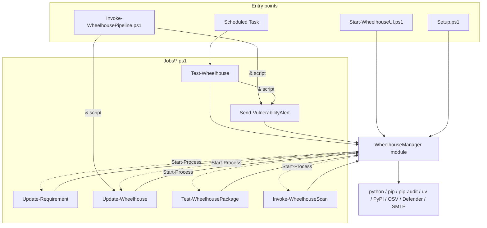

# Wheelhouse Manager - Architecture

This is the maintainer's reference: how the code is built, why it is built that way, the rules
it must keep, and how to change it safely. It is written for developers and for AI coding agents.
For what the tool does and how to operate it, read [README.md](README.md); for planned work, read
[REFACTOR_PLAN.md](REFACTOR_PLAN.md). `CLAUDE.md` is the short version of sections 4, 13 and 14.

**Before changing code, read [section 4 (invariants)](#4-invariants) and
[section 13 (Windows PowerShell 5.1 rules)](#13-windows-powershell-51-rules).** Most past bugs
were violations of one of them.

Contents

1. [System overview](#1-system-overview)
2. [Repository layout](#2-repository-layout)
3. [Runtime layout and data stores](#3-runtime-layout-and-data-stores)
4. [Invariants](#4-invariants)
5. [Layers and dependency rules](#5-layers-and-dependency-rules)
6. [Module internals](#6-module-internals)
7. [Scripts](#7-scripts)
8. [Module function reference](#8-module-function-reference)
9. [Core flows](#9-core-flows)
10. [Web UI](#10-web-ui)
11. [Data contracts](#11-data-contracts)
12. [Errors, fail-closed behaviour and exit codes](#12-errors-fail-closed-behaviour-and-exit-codes)
13. [Windows PowerShell 5.1 rules](#13-windows-powershell-51-rules)
14. [Tests and CI](#14-tests-and-ci)
15. [How to extend](#15-how-to-extend)
16. [Workflow traces](#16-workflow-traces)
17. [Known gaps and glossary](#17-known-gaps-and-glossary)

---

## 1. System overview

The product maintains an offline pip/uv package index - a folder of `.whl` files on a share,
the *wheelhouse* - for Windows clients that may not reach PyPI.

| Part | Code | Runs on | Coupling |
|---|---|---|---|
| Client install | `Client Install\UV_Installer.ps1`, `Client Install\Startup_UV.ps1` | Clients (deployment tool, GPO startup script as SYSTEM) | Reads the wheelhouse path only. Standalone scripts, no module. `Startup_UV.ps1` must not be changed. |
| Manager | `Setup.ps1`, `Invoke-WheelhousePipeline.ps1`, `Jobs\` | One manager server | Owns every file in the wheelhouse. |

```mermaid
flowchart LR
    subgraph Manager server
        IN[Input\requirements.in] -->|Update-Requirement.ps1<br/>uv pip compile + pip dry-run| TXT[Input\requirements.txt]
        TXT -->|Update-Wheelhouse.ps1<br/>merge plan + Invoke-CandidateIntake| STG[staging\]
        STG -->|Publish-StagedWheel| WH
        SCHED[Scheduled Task] -->|Test-Wheelhouse.ps1| WH
        UI[Start-WheelhouseUI.ps1<br/>HttpListener on localhost] -->|child processes / module calls| WH
    end
    EXT[(pypi.org / files.pythonhosted.org<br/>api.osv.dev / Defender)] -.-> Manager server
    WH[(Wheelhouse share<br/>*.whl, requirements-N.txt,<br/>manifest.json, reports\, _quarantine\)]
    WH -->|flat index, read only| CL[Clients: uv]
```

Technology: PowerShell targeting **Windows PowerShell 5.1** (also runs on 7), one script module,
plain HTML/JS/CSS for the UI (no build step), Pester 5+ tests. External tools: `python` (pip,
pip-audit), `uv`, Defender cmdlets (`Start-MpScan`, `Get-MpThreatDetection`, `Get-MpThreat`),
`Send-MailMessage`.

---

## 2. Repository layout

```
.github/workflows/powershell-tests.yml   CI (section 14)
Client Install/UV_Installer.ps1          uv binaries + System32 hardlinks; Start-ProductInstall, Test-VersionStamp, Write-InstallLog
Client Install/Startup_UV.ps1            machine env vars + %ProgramData%\uv\uv.toml (frozen)
Setup.ps1                                deploys the manager (section 7.1)
Invoke-WheelhousePipeline.ps1            orchestrator: Update-Wheelhouse.ps1 -> Send-VulnerabilityAlert.ps1
Jobs/
    Update-Requirement.ps1               resolve: requirements.in -> requirements.txt
    Update-Wheelhouse.ps1                the worker: integrity, merge plan, intake, deployed audit, manifest, Defender
    Test-Wheelhouse.ps1                  scheduled re-check of everything published + alert
    Test-WheelhousePackage.ps1           audit all / chosen pins, no alert (UI "Audit")
    Invoke-WheelhouseScan.ps1            Defender scan of all / chosen wheels (UI "Scan")
    Send-VulnerabilityAlert.ps1          alert builder: email or HTML file
    Start-WheelhouseUI.ps1               starts the UI server
    WheelhouseManager/
        WheelhouseManager.psd1           manifest; FunctionsToExport must list every function
        WheelhouseManager.psm1           sets $script:ManagerRoot, dot-sources Functions\*.ps1
        Functions/<Domain>.ps1           all logic (section 8)
        Web/index.html, app.js, style.css
Tests/WheelhouseManager.Tests.ps1        every test (section 14)
PSScriptAnalyzerSettings.psd1            excluded rules (with reasons)
README.md / ARCHITECTURE.md / REFACTOR_PLAN.md / CLAUDE.md
```

`Jobs\` is deployed as one unit: scripts import the module and find each other through
`$PSScriptRoot`. The UI serves `Web\` relative to the module folder.

---

## 3. Runtime layout and data stores

### 3.1 Manager root (`$script:ManagerRoot`, default `C:\WheelHouseManager`)

The module computes it as two levels above `Jobs\WheelhouseManager`. In a repository checkout it
is the repo root; tests pass explicit paths (`-ManagerRoot`, `-StagingRoot`, `-SettingsPath`,
`-Path`/`-DenylistPath`) instead of relying on it.

| Path | Owner (writes) | Format | If damaged |
|---|---|---|---|
| `config\settings.psd1` | Setup.ps1, `Set-WheelhouseSetting` (UI) | psd1, keys sorted, written atomically | Warning, defaults are used (`Get-WheelhouseSetting`) |
| `config\denylist.json` | `Add-/Remove-WheelhouseDenylistEntry` | JSON array (section 11) | **Throws** - never read as empty |
| `Input\requirements.in` | User, `Add-RequirementInLine` (UI) | pip requirements, unpinned allowed | uv fails |
| `Input\requirements.txt` | Update-Requirement.ps1 (move of the candidate file) | uv output, exact pins | Unsupported lines are skipped with a warning |
| `Input\requirements.candidate.txt` / `.rejected.txt` / `.constraints.tmp` | Update-Requirement.ps1 | transient / last rejected result / denylist as `!=` constraints | - |
| `staging\<guid>\` | `Invoke-CandidateIntake` | downloads of one intake call; deleted in `finally` | - |
| `logs\ui\job<N>-step<M>.out.txt` / `.err.txt` | `Start-WheelhouseUiJobStep` | child stdout/stderr | - |

### 3.2 Wheelhouse (`WheelhousePath`)

| Path | Owner (writes) | Notes |
|---|---|---|
| `*.whl` | `Publish-StagedWheel` (create), `Remove-WheelhousePackage` (move/delete), `Restore-WheelhousePackage` (move back) | Served to clients. `*.whl.partial` exists only during a publish. |
| `requirements.txt` (legacy group 0), `requirements-<N>.txt` | `Add-RequirementToGroupFile` (append), `Remove-RequirementFromGroupFile` (atomic rewrite) | Other names (`requirements-torch.txt`) are not groups. Never rewritten wholesale. |
| `manifest.json` | `Save-WheelhouseManifest` (worker, remove, restore) | JSON array, atomic write. Damaged -> **throws**. |
| `.wheelhouse.lock` | `Enter-WheelhouseLock` | Exclusive, delete-on-close; content `pid=... user=... started=...` |
| `_quarantine\quarantine.json`, `_quarantine\<id>\*.whl` | Remove (`-Quarantine`) / Restore | Damaged record file -> **throws** |
| `reports\` | Every run | Retention by `Remove-ExpiredReport` (`Log_*.txt`, `Report_*.json`, `Alert_*.html`) |

---

## 4. Invariants

Each rule says where it is enforced. Breaking one is a bug even if tests pass.

1. **Nothing reaches the wheelhouse folder unchecked.** Downloads go to the staging folder and
   are copied to the share only by `Publish-StagedWheel`, after every intake check, as
   `<file>.partial` + hash re-check + rename. *Why:* clients read the folder directly (flat
   index); a half-checked or half-written file would be installable. *Where:* `Intake.ps1`.
2. **Staging is under the manager root, not `%TEMP%`.** `%TEMP%` can be an 8.3 short path
   (`AVYPO~1`), Defender reports long paths, and matching is by substring - a detection could be
   missed and the scan reported as clean. *Where:* `Invoke-CandidateIntake -StagingRoot` default.
3. **Group files only list pins whose wheel is published.** Intake is transactional per package:
   the worker appends a pin only for `Accepted` packages, after their `Published` entries were
   saved to the manifest. Pins already listed but without a wheel are fed back through intake.
   *Where:* `Update-Wheelhouse.ps1` step 3.
4. **The manifest only gains entries intake returns as `Published`** (verified against PyPI's
   sha256). The single exception is first-time setup (manifest empty at start): the wheels
   already in the folder are adopted by `Merge-WheelhouseManifest -PreRunFiles @()`. Untracked
   wheels are otherwise never added. New group numbers are max+1.
5. **Fail closed.** An audit is `Passed`/`Vulnerable`/`Error`; `Error` is never treated as clean.
   A Defender scan is `Clean`/`Threat`/`Error`; `Error` is never clean. Unverifiable PyPI data
   rejects at intake and is an error in the scheduled check. A damaged manifest, denylist or
   quarantine record throws. (Settings are the exception - see 3.1.)
6. **One writer at a time.** Anything that rewrites the manifest or group files holds
   `Enter-WheelhouseLock`: `Update-Wheelhouse.ps1`, `Remove-WheelhousePackage`,
   `Restore-WheelhousePackage`. A caller that already holds it passes `-LockHeld`.
7. **Removal is ordered and undoable.** Denylist -> quarantine record -> group files -> manifest
   -> move files; each step pushes an undo; a failure replays them in reverse. Deleting files is
   the last, non-undoable step, outside the undo `try`. *Why:* clients must never see a pin
   without a wheel, and a partial failure must not lose data.
8. **The denylist only blocks more.** `Invoke-CandidateIntake` rejects a denylisted pin before
   anything else. Remove/quarantine add `name==version` automatically (`source` `removed` /
   `quarantined`); restore lifts only the `quarantined` entry.
9. **Pinned groups use `--no-deps --only-binary=:all:`** for audit and download: exactly the
   pinned versions are checked and fetched, nothing unpinned is pulled in. pip stops at the first
   unresolvable pin, so `Invoke-PipPinRetry` drops the pin named in "No matching distribution
   found for X" and retries.
10. **Module functions never run `Jobs\*.ps1`.** A script run from a module function executes in
    module scope and breaks `$script:` state. The module returns parameters
    (`Get-VulnerabilityAlertParameter`) and the calling script runs the alert; the UI uses
    `Start-Process` child processes.
11. **Functions `throw`, scripts `exit`** - with the codes from `Get-WheelhouseExitCode`
    (section 12).
12. **Native commands go through `Invoke-NativeCommand`** (stderr merged into stdout as text) so
    5.1's transcript records pip's error lines.
13. **The worker sends no alerts.** It emits `Wheelhouse.AuditResult` and `Wheelhouse.Notice`
    objects; the pipeline (or the scheduled check) alerts once.
14. **Restrictions apply to wheelhouse packages only.** `Confirm-PythonAndTooling` upgrading
    pip/pip-audit on the manager is intended and outside cooldown/audit.
15. **UI input never reaches a command line unvalidated.** Names, versions and file names match
    strict patterns *and* exist in the manifest; `ConvertTo-UiArgument` refuses quotes.
16. **Defaults live only in `Get-WheelhouseDefaultSetting`.** Scripts resolve parameters with
    `Resolve-WheelhouseParameter`; nothing else hard-codes a default.

---

## 5. Layers and dependency rules



- Scripts are thin: parameters -> `Resolve-WheelhouseParameter` -> `Start-WheelhouseRun` ->
  `try { ... } catch { exit code } finally { Stop-WheelhouseRun }` -> output objects -> `exit`.
  `Update-Requirement.ps1` and `Send-VulnerabilityAlert.ps1` skip `Start-WheelhouseRun` (they may
  run without a wheelhouse) and log to the console only.
- Only orchestrating scripts call other scripts, with `&` (in-process, so result objects are
  returned).
- `Write-Log` writes to the host (console + transcript) only, never to the output stream - result
  objects stay clean.
- Within the module, files are domains, not layers: any function may call any other. Keep I/O
  wrappers small and mockable (`Invoke-MpScan`, `Get-PyPIReleaseInfo`, `Invoke-NativeCommand`,
  `Get-WheelhouseThreatDetection`).

---

## 6. Module internals

**Loading.** `WheelhouseManager.psm1` sets `$script:ManagerRoot` and dot-sources `Common`,
`Settings`, `Requirements`, `Manifest`, `Audit`, `Intake`, `Alert`, `Run`, `Denylist`, `Package`,
`Scan`, `Ui` (order is for readability; calls resolve at run time). The psd1's
`FunctionsToExport` is the public surface; CI fails if a listed function is missing.

**Module-scope state** (`$script:`):

| Variable | File | Purpose |
|---|---|---|
| `ManagerRoot` | psm1 | Default for every manager-relative path |
| `GroupFilePattern` (`^requirements-(\d+)\.txt$`), `LegacyGroupFileName` | Requirements | What counts as a group file |
| `AuditReportPattern` | Audit | The single definition of audit report names (writer and readers) |
| `DenylistNamePattern`, `DenylistVersionPattern` | Denylist | Entry validation |
| `QuarantineFolderName` (`_quarantine`), `PackageSpecPattern` | Package | Quarantine location; what `requirements.in` lines the UI may add |
| `UiWebRoot`, `UiStaticFiles`, `UiMimeTypes` | Ui | Static file whitelist |
| `UiJobs`, `UiJobCounter`, `UiMaxJobHistory` (30), `UiShutdown` | Ui | In-memory job list and server state (one UI process) |
| `UiPackageNamePattern`, `UiPackageVersionPattern`, `UiWheelFilePattern` | Ui | Request validation |

**Settings resolution.** `Resolve-WheelhouseParameter -BoundParameters $PSBoundParameters -Name a, b`
returns a hashtable; per name: bound parameter > non-empty setting (empty string / empty array /
`$null` count as unset) > `Get-WheelhouseDefaultSetting`. `-SettingName` maps a parameter to a
different key (`To` -> `MailTo`, `RequirementsTxtPath` -> `LocalRequirementsPath`). Names that are
not script parameters (e.g. `RequireDefenderScanAtIntake`) resolve from settings/defaults only.

**Package names** are normalized everywhere with `Get-NormalizedPackageName` (PEP 503: lower
case, runs of `-_.` -> `-`). Manifest, denylist, group-file parsing and comparisons all use the
normalized form.

---

## 7. Scripts

### 7.1 `Setup.ps1`
`-DestinationPath` (default `C:\WheelHouseManager`), `-WheelhousePath`. Copies `Jobs\*.ps1`,
replaces `Jobs\WheelhouseManager` as a whole (so deleted function files do not linger; skipped if
source = destination), copies the orchestrator to the root, creates `config\settings.psd1` from
`Get-WheelhouseDefaultSetting` if missing, sets `WheelhousePath` if passed, creates
`Input\requirements.in`/`.txt` if missing (`Initialize-ManagerFile`). Idempotent.

### 7.2 `Invoke-WheelhousePipeline.ps1`
Forwards only bound parameters: to the worker `WheelhousePath, LocalRequirementsPath,
PythonVersion, Platform, MinimumPackageAgeDays, VulnerabilityServices, ExpeditePackage,
ExpediteReason`; to the alert `WheelhousePath, SmtpServer, To, From, OutputHtmlPath`. Collects
the worker's output by PSTypeName (`Wheelhouse.AuditResult`, `Wheelhouse.Notice`); none -> no
alert (aborted run). `Get-VulnerabilityAlertParameter` -> `& Send-VulnerabilityAlert.ps1`. Exit:
worker code if non-zero, else the alert's.

### 7.3 `Update-Requirement.ps1`
Resolves `RequirementsInPath`, `RequirementsTxtPath` (setting `LocalRequirementsPath`),
`PythonVersion`, `Platform`, `MinimumPackageAgeDays`.
1. `uv pip compile <in> --exclude-newer "<N> days" --python-version <v> --python-platform
   <ConvertTo-UvPythonPlatform> --only-binary :all: --custom-compile-command
   .\Update-Requirement.ps1 [--constraints requirements.constraints.tmp] -o requirements.candidate.txt`
   (constraints = `Get-DenylistConstraintLine`: exact denylisted versions as `name!=version`).
2. `Test-RequirementWheelAvailability` (pip dry-run with the download's rules, every bad pin
   listed via `Invoke-PipPinRetry`). uv ignores upper `Requires-Python` bounds; this catches them.
3. Pass -> move candidate to `requirements.txt`, delete `.rejected.txt`. Fail -> move candidate to
   `requirements.rejected.txt`, keep `requirements.txt`.

Exit: 0 written; 1 uv or the pip check rejected the result; 2 missing input / python / platform.

### 7.4 `Update-Wheelhouse.ps1` (the worker)
Parameters: `WheelhousePath`, `LocalRequirementsPath` (`""` = no merge), `PythonVersion`,
`Platform`, `MinimumPackageAgeDays`, `VulnerabilityServices`, `ExpeditePackage` (`name==ver`,
array or comma string), `ExpediteReason` (required with it). Also resolves
`ReportRetentionMonths`, `RequireDefenderScanAtIntake`. Full sequence in
[9.2](#92-the-worker-update-wheelhouseps1). Output: AuditResults then Notices. Exit: 0; 1
rejection / vulnerable deployed audit / Defender threat / Defender-removed wheel; 2 aborted or any
audit `Error`; 3 lock busy.

### 7.5 `Test-Wheelhouse.ps1` (Scheduled Task)
Parameters: `WheelhousePath`, `VulnerabilityServices`, `DefenderScan` (switch), `SmtpServer`,
`MailTo`, `MailFrom` (renamed to `To`/`From` for the alert). Also resolves `PythonVersion`,
`Platform`, `ReportRetentionMonths`, `DefenderScanInScheduledCheck`. No lock, no writes except
reports. Sequence in [9.3](#93-the-scheduled-re-check-test-wheelhouseps1). Exit: 0; 1 findings;
2 aborted, a check incomplete, or the alert failed.

### 7.6 `Test-WheelhousePackage.ps1`
`-Package` pins (validated by regex, must be in the manifest) -> `Invoke-PackageAudit -Stage
Manual` (report group `selection`); none -> `Invoke-GroupAudit -Stage Manual` per group. Emits
AuditResults, no alert. Exit 1 vulnerable, 2 audit error or abort.

### 7.7 `Invoke-WheelhouseScan.ps1`
`-File` bare `*.whl` names that exist in the wheelhouse, or the whole folder. Emits a
`Wheelhouse.ScanResult`. Exit 1 `Threat`, 2 `Error` or abort.

### 7.8 `Send-VulnerabilityAlert.ps1`
`-ReportPaths`, `-AuditErrors`, `-Notices` (at least one), `-WheelhousePath`, `-SmtpServer`,
`-To`, `-From`, `-OutputHtmlPath`. `Get-VulnerabilityFinding` + `ConvertTo-VulnerabilityAlertHtml`;
subject by content (vulnerabilities / notices / errors only). SMTP set -> `Send-MailMessage`,
else HTML file. Exit 0 sent/saved/nothing to report, 2 no input or delivery failed. Invoked
in-process only (notices are objects).

### 7.9 `Start-WheelhouseUI.ps1`
`-Port` (1024-65535, default 8765), `-NoBrowser` -> `Start-WheelhouseUiServer`. Exit 2 on error.

---

## 8. Module function reference

Columns: purpose | returns / side effects | callers. All are exported.

### 8.1 `Common.ps1`

| Function | Purpose | Returns | Callers |
|---|---|---|---|
| `Write-Log` | `[ts] [LEVEL] message` to the host (`INFO`/`OK`/`WARN`/`ERROR`) | - | everything |
| `Get-NormalizedPackageName` | PEP 503 normalization | string | everywhere names are compared |
| `ConvertTo-HtmlSafe` | HTML-encode | string | alert HTML |
| `Write-TextFileAtomic` | write `<path>.tmp`, move over target | file | JSON/settings/group rewrites |
| `Write-JsonFile` | `ConvertTo-Json` (arrays stay arrays, null -> `[]`) + atomic write | file | manifest, reports, denylist, quarantine |
| `Invoke-NativeCommand` | run exe, stderr merged as text, lines echoed; `-PassThru` returns lines (`-NoEnumerate`); `$LASTEXITCODE` kept | lines | pip, pip-audit, uv callers |
| `Enter-WheelhouseLock` | open `.wheelhouse.lock` exclusively, delete-on-close; busy -> `InvalidOperationException` with `Data['WheelhouseLockBusy']` | `FileStream` | worker, Remove, Restore |
| `Exit-WheelhouseLock` | dispose (null-safe) | - | same |
| `Get-WheelhouseExitCode` | `-Outcome Ok/Attention/Error/Busy` -> 0/1/2/3; `-ErrorRecord` -> 3 if lock busy else 2 | int | every job script |
| `ConvertTo-UtcDateTime` | JSON date (text on 5.1, `[datetime]` on 7) -> UTC `[datetime]` | datetime | PyPI parsing, intake |

### 8.2 `Settings.ps1`

| Function | Purpose | Returns | Callers |
|---|---|---|---|
| `Get-WheelhouseDefaultSetting` | the only defaults (paths relative to `-ManagerRoot`) | hashtable | `Resolve-WheelhouseParameter`, Setup |
| `Get-WheelhouseSettingsPath` | `<root>\config\settings.psd1` | string | defaults, UI context |
| `Get-WheelhouseSetting` | `Import-PowerShellDataFile`; missing/unreadable -> `@{}` + warning | hashtable | resolution, Setup, UI |
| `Resolve-Setting` | one value: bound > non-empty setting > fallback | value | `Resolve-WheelhouseParameter` |
| `Resolve-WheelhouseParameter` | resolve many names (`-SettingName`, `-Default`, `-Settings`) | hashtable | scripts, UI context |
| `ConvertTo-Psd1Literal` | value -> psd1 literal (string, number, bool, array) | string | `Save-WheelhouseSetting` |
| `Save-WheelhouseSetting` | write whole table, keys sorted, atomic | file | Setup, `Set-WheelhouseSetting` |
| `Set-WheelhouseSetting` | merge updates into the file | file | Setup, UI |
| `Initialize-ManagerFile` | create a file only if absent | file | Setup |
| `Get-WheelhouseSettingSchema` | UI-editable settings: key, type (`path`, `file`, `string`, `choice`, `multichoice`, `int`, `bool`), label, help, options, min/max | objects | UI |
| `ConvertTo-WheelhouseSettingValue` | validate/convert one UI value; `ArgumentException` with a readable message | value | UI `POST /api/settings` |

### 8.3 `Requirements.ps1`

| Function | Purpose | Returns | Callers |
|---|---|---|---|
| `Read-RequirementFile` | exact pins only; comments, extras, markers, `--hash` accepted and dropped; other lines skipped with a warning | hashtable name -> version | worker, merge plan, wheel check, inventory, remove/restore, UI |
| `Get-GroupFileNumber` | `requirements-N.txt` -> N, `requirements.txt` -> 0, else -1 | int | group listing, merge plan, worker |
| `Get-WheelhouseGroupFile` | group files in number order (`-NoEnumerate`) | string[] | worker, checks, inventory, remove |
| `Get-RequirementMergePlan` | duplicate / first group without the name / new group max+1; name order | `@{ Additions; Duplicates }` | worker |
| `Add-RequirementToGroupFile` | append `name==version` (create file if needed) | file | worker, restore |
| `ConvertTo-UvPythonPlatform` | pip platform tag -> uv triple; throws if unknown | string | Update-Requirement, settings validation |
| `Invoke-PipPinRetry` | run pip over pins; drop the pin named in "No matching distribution found for X"; retry. A failure naming no pin -> `Error` | `@{ Succeeded; Failed; Error }` | wheel check, intake download |
| `Test-RequirementWheelAvailability` | `pip install --dry-run --no-deps --ignore-installed --only-binary=:all: --python-version --platform --implementation cp --target <tmp>` | `@{ Passed; Unavailable; Error }` | Update-Requirement |

### 8.4 `Manifest.ps1`

| Function | Purpose | Returns | Callers |
|---|---|---|---|
| `Get-WheelFileInfo` | parse a wheel file name (PEP 427) | `{Name; Version; PythonTag; AbiTag; PlatformTag}` / `$null` | publish, merge |
| `Get-WheelhouseManifestPath` | `<wh>\manifest.json` | string | manifest functions, logs |
| `Read-WheelhouseManifest` | entries (`-NoEnumerate`); missing/empty -> empty; invalid -> throws | object[] | many |
| `Save-WheelhouseManifest` | write the array | file | worker, remove, restore |
| `Test-ManifestIntegrity` | per entry: malformed `file`, missing, unreadable, hash mismatch; `-ExcludeFile` skips explained files | string[] (`-NoEnumerate`) | `Assert-WheelhouseIntegrity` |
| `Get-UntrackedWheelFile` | `*.whl` not in the manifest | string[] (`-NoEnumerate`) | integrity, inventory |
| `Assert-WheelhouseIntegrity` | throw on problems (writes `Report_Integrity_*`), warn on untracked. `-AllowDefenderRemoved`: missing files matched by `Find-DefenderRemovedWheel` are returned instead | `{Entry; ThreatName; Resource}` with the switch | worker, scheduled check |
| `Merge-WheelhouseManifest` | old entries + wheels not in `-PreRunFiles` (hashed now); bootstrap adds all | object[] (`-NoEnumerate`) | worker (first-time setup only) |
| `Compare-RequirementsAgainstManifest` | pins without a manifest entry matching the target tag (`cpXY`/`py*`/`abi3`, platform or `any`) | `@{ Descriptions; Packages }` | worker, `Get-UndownloadedPin` |
| `Get-QuarantineFileName` | wheel names for a pin from the manifest, or an estimated glob | string[] | alert HTML |
| `Get-UndownloadedPin` | per group: listed pins without a matching wheel | `{Group; Package; Version}` | scheduled check |

### 8.5 `Audit.ps1`

| Function | Purpose | Returns | Callers |
|---|---|---|---|
| `Confirm-PythonAndTooling` | require python; upgrade outdated pip/pip-audit; install pip-audit (throws on failure) | - | worker, checks |
| `Get-AuditReportPath` / `Get-AuditReportInfo` | build / parse `Report_<Stage>-<Group>-<SERVICE>_<ts>.json` | string / object | `Invoke-PipAudit` / findings, status |
| `Get-PipAuditReport` | read flat-array or `{dependencies}` report; throws if missing/empty/invalid | objects (`-NoEnumerate`) | audit, intake, findings, status |
| `Get-VulnerableDependencyCount` | dependencies with vulns | int | `Invoke-PipAudit` |
| `Invoke-PipAudit` | `python -m pip_audit -r <file> --no-deps --disable-pip --vulnerability-service <s> --format json --output <report>`; exit 0 -> `Passed`, non-zero with vulns -> `Vulnerable`, else `Error` | `Wheelhouse.AuditResult` | `Invoke-GroupAudit` |
| `Show-PipAuditFixSuggestion` | `pip-audit --fix --dry-run`, informational | console | `Invoke-GroupAudit` |
| `Invoke-GroupAudit` | one audit per service, fix suggestions if vulnerable | AuditResult[] (`-NoEnumerate`) | worker, checks, intake, `Invoke-PackageAudit` |
| `Get-PyPIReleaseInfo` | PyPI JSON API (TLS 1.2 on 5.1): files with sha256, upload time, yanked; release yanked flag; throws if unreadable/empty | `{Files; FirstUploadUtc; Yanked; YankedReason}` | `Test-PackageAge`, `Get-DeployedPackageNotice` |
| `Test-PackageAge` | release first upload vs. minimum age; `-Expedite` names pass; results carry `EligibleUtc`, `Yanked`, `Release`; unreadable -> failed with `Error` | `@{ TooNew; Results }` | intake |
| `Get-DeployedPackageNotice` | published versions vs. denylist and PyPI yanked flag (release or deployed file); unreadable -> one aggregated error | `@{ Notices; Errors }` | scheduled check |

### 8.6 `Intake.ps1`

| Function | Purpose | Returns | Callers |
|---|---|---|---|
| `Invoke-CandidateIntake` | the per-package gate (section 9.1) | `@{ Accepted; Rejected (Name, Version, Reason, Category); AuditResults; Published }` | worker |
| `Publish-StagedWheel` | copy as `.partial`, re-hash, rename; identical untracked file kept, different one throws | `{Entry; Created}` | intake |

### 8.7 `Alert.ps1`

| Function | Purpose | Returns | Callers |
|---|---|---|---|
| `New-WheelhouseNotice` | `Wheelhouse.Notice` with a default `Action` per `Kind` | object | worker, scheduled check, `Get-DeployedPackageNotice` |
| `Get-VulnerabilityFinding` | one finding per `name|version|vulnId` across reports; `Deployed` = seen in a non-candidate report; unreadable reports -> `Errors` | `@{ Findings; Errors }` | alert script |
| `ConvertTo-VulnerabilityAlertHtml` | sections: notices, findings with recommended actions, failed audits/checks | string | alert script |
| `Get-VulnerabilityAlertParameter` | AuditResults + `-Notice` + `-CheckError` -> alert parameters; `$null` if nothing to report | hashtable / `$null` | pipeline, scheduled check |

### 8.8 `Run.ps1`

| Function | Purpose | Callers |
|---|---|---|
| `Remove-ExpiredReport` | delete `Log_*.txt`, `Report_*.json`, `Alert_*.html` older than N months | `Start-WheelhouseRun` |
| `Start-WheelhouseRun` | require a reachable wheelhouse, create `reports\`, start transcript `<LogPrefix>_<ts>.txt`, retention; returns the reports folder | worker, checks, scan |
| `Stop-WheelhouseRun` | final log line with outcome, stop transcript (safe if none) | same |

### 8.9 `Denylist.ps1`

| Function | Purpose | Callers |
|---|---|---|
| `Get-WheelhouseDenylistPath` | `<root>\config\denylist.json` | defaults, UI |
| `Read-WheelhouseDenylist` | entries (plain array - fine inside `@()`); damaged -> throws | worker, resolve, checks, UI |
| `Get-DenylistMatch` | first entry blocking `name==version` (`*` = all) | intake, inventory, remove, add, notices |
| `Add-WheelhouseDenylistEntry` | validate, replace same name+version, write sorted | remove, UI |
| `Remove-WheelhouseDenylistEntry` | remove name+version, optionally only for `-OnlySource` | remove undo, restore, UI |
| `Get-DenylistConstraintLine` | exact versions as `name!=version` (`-NoEnumerate`) | Update-Requirement |

### 8.10 `Package.ps1`

| Function | Purpose | Callers |
|---|---|---|
| `ConvertTo-IsoTimestamp` | dates for the UI as ISO text on 5.1 and 7 | inventory, UI |
| `Get-WheelhouseQuarantinePath` | `<wh>\_quarantine` | quarantine functions |
| `Get-PackageAuditStatus` | latest audit per pin from report files (newest first, <= 300 files, stops when every pin was seen by every `-Services`); default `Unknown` | inventory |
| `Get-PackageScanStatus` | latest Defender result per file from `Report_Scan_*` (<= 50, `Error` reports skipped; covered = file or wheelhouse folder scanned) | inventory |
| `Get-WheelhousePackage` | inventory rows (manifest x groups x audit x scan x denylist) + groups + untracked | UI `GET /api/packages` |
| `Invoke-PackageAudit` | audit chosen pins via a temporary `selection.txt` | Test-WheelhousePackage |
| `Remove-RequirementFromGroupFile` | remove one pin and its `--hash` continuation lines, atomically | remove |
| `Read-QuarantineRecord` / `Save-QuarantineRecord` / `Get-QuarantinedPackage` | `quarantine.json` | remove, restore, UI |
| `Remove-WheelhousePackage` | section 9.5; `-Quarantine`, `-Reason`, `-NoDenylist`, `-DenylistPath`, `-LockHeld` | UI, worker (Defender-removed) |
| `Restore-WheelhousePackage` | section 9.5; `-KeepDenylist` | UI |
| `Test-PackageSpec` | allowed `requirements.in` line (name, extras, version operators; <= 200 chars) | `Add-RequirementInLine` |
| `Add-RequirementInLine` | append valid, new, non-denylisted specs | UI add |

### 8.11 `Scan.ps1`

| Function | Purpose | Callers |
|---|---|---|
| `Test-WheelhouseDefenderAvailable` | `Start-MpScan` exists | scan, UI state, `Find-DefenderRemovedWheel` |
| `Invoke-MpScan` | `Start-MpScan -ScanType CustomScan` (mock seam) | scan |
| `Get-WheelhouseThreatDetection` | detections since a time, per resource, with threat name (mock seam) | scan, `Find-DefenderRemovedWheel` |
| `Find-DefenderRemovedWheel` | missing manifest files that a detection names; unreadable history -> none (fail closed) | integrity |
| `Invoke-WheelhouseDefenderScan` | scan paths, match detections (5 s margin) by substring of the scanned path; `Threat` > `Error` > `Clean`; optional `Report_Scan_*` | worker, checks, scan script, intake |

### 8.12 `Ui.ps1`
See [section 10](#10-web-ui). Functions: `Get-WheelhouseUiContext` (effective settings, read per
request), `Assert-WheelhouseUiConfigured`, `Get-UiBodyValue`, `Resolve-UiPackageSelection`,
`ConvertTo-UiArgument`, `Get-WheelhouseUiRunningJob`, `Start-WheelhouseUiJobStep`,
`Start-WheelhouseUiJob`, `Sync-WheelhouseUiJob`, `Stop-WheelhouseUiJob`, `Read-UiLogFile`,
`ConvertTo-WheelhouseUiJobSummary`, `Get-WheelhouseUiRandomToken`, `Test-WheelhouseUiRequest`,
`Invoke-WheelhouseUiApi`, `Send-WheelhouseUiResponse`, `Invoke-WheelhouseUiRequest`,
`Start-WheelhouseUiServer`.

---

## 9. Core flows

### 9.1 Intake (`Invoke-CandidateIntake`)

Input: one group's candidates (`name -> version`). Each stage only sees packages that survived the
previous ones; `$reject` moves a package from `$remaining` to `Rejected` with a category.

| # | Stage | Reject category | Notes |
|---|---|---|---|
| 0 | Denylist (`Get-DenylistMatch`) | `denylist` | before any network call |
| 1 | Audit: temp `<group>-candidates.txt`, `Invoke-GroupAudit -Stage PreDownload` | `vulnerability` (named packages), `audit-error` (all remaining) | reports `Report_PreDownload-<group>-candidates-*` |
| 2 | `Test-PackageAge` (PyPI release data) | `pypi-metadata`, `yanked`, `cooldown` (with eligible date) | `-Expedite` pins skip cooldown; `Report_PackageAge-*` (without the `Release` objects) |
| 3 | `pip download -d <staging> --no-deps --only-binary=:all: --python-version --platform --implementation cp` via `Invoke-PipPinRetry` | `no-wheel`, `download` | staging = `<StagingRoot>\<guid>` |
| 4 | Each staged file vs. the release's PyPI file list: listed, sha256 equal, not yanked, own upload date vs. cooldown (unless expedited) | `integrity`, `yanked`, `cooldown`, `pypi-metadata` | files claimed by no package are discarded |
| 5 | `Invoke-WheelhouseDefenderScan` of the staging folder | `defender` | `Threat`: reject the package whose file path the detection names; an unmatched detection rejects all staged; `Error`: reject all with `-RequireDefenderScan`, else warn; a file that vanished during the scan is rejected |
| 6 | `Publish-StagedWheel` per file | `publish` | on failure, files this call created are deleted |

`finally` removes the staging folder. Returns `Published` = manifest entries (sha256 = verified
hash, `downloaded_utc` = now).

### 9.2 The worker (`Update-Wheelhouse.ps1`)

```
Start-WheelhouseRun; parse/validate -ExpeditePackage (+ reason); Enter-WheelhouseLock
Confirm-PythonAndTooling; Read-WheelhouseDenylist
Read-WheelhouseManifest; isBootstrap = (count == 0)
Assert-WheelhouseIntegrity -AllowDefenderRemoved
    each returned pin -> Remove-WheelhousePackage -LockHeld (delete mode, reason "removed by Microsoft Defender")
                         + DefenderRemoved notice; re-read manifest
Get-WheelhouseGroupFile; Read-RequirementFile(local); Get-RequirementMergePlan -> additions per group
foreach group (existing first, then new by number):
    candidates = additions + Compare-RequirementsAgainstManifest(listed vs manifest).Packages
    Invoke-CandidateIntake (Expedite, RequireDefenderScan)
    manifest += Published; Save-WheelhouseManifest          <- before touching the group file
    Add-RequirementToGroupFile for accepted *additions*
    rejections -> list (+ IntakeBlocked notice for integrity/defender; audit-error => incomplete)
    if group existed and lists pins: Invoke-GroupAudit -Stage Deployed
warn about unused -ExpeditePackage; write Report_Rejected_*
if isBootstrap and something published: Merge-WheelhouseManifest -PreRunFiles @() (adopt pre-existing wheels)
Invoke-WheelhouseDefenderScan(wheelhouse): Threat -> DefenderThreat notices
exit: incomplete -> 2, any failure -> 1, else 0; catch -> Get-WheelhouseExitCode -ErrorRecord
finally: Exit-WheelhouseLock; Stop-WheelhouseRun; emit AuditResults, Notices
```

### 9.3 The scheduled re-check (`Test-Wheelhouse.ps1`)

The answer to "a package passed intake, then fails a check later":

```
Start-WheelhouseRun; Confirm-PythonAndTooling; Read-WheelhouseDenylist; Read-WheelhouseManifest
if manifest not empty: Assert-WheelhouseIntegrity -AllowDefenderRemoved -> DefenderRemoved notices
                       (read only: the worker cleans up); published = manifest minus those
Get-WheelhouseGroupFile (always - also with an empty manifest); Get-UndownloadedPin -> warnings
Get-DeployedPackageNotice(published, denylist) -> Denylisted / Yanked notices, PyPI errors
Invoke-GroupAudit -Stage Scheduled per group
if -DefenderScan or DefenderScanInScheduledCheck: scan -> DefenderThreat notices / check error
Get-VulnerabilityAlertParameter(AuditResults, Notice, CheckError) -> & Send-VulnerabilityAlert.ps1
exit: incomplete or alert failed -> 2; findings -> 1; else 0
```

It never changes the wheelhouse; acting on findings is an administrator decision.

### 9.4 Alerting

`Get-VulnerabilityAlertParameter` maps: `Vulnerable` -> `ReportPaths`; `Error` +
`CheckError` -> `AuditErrors` (`"<group> / <SERVICE>: <message>"`); notices -> `Notices`.
`Send-VulnerabilityAlert.ps1` -> `Get-VulnerabilityFinding` (group from the report name,
`-candidates` suffix => blocked before download) -> HTML: notices table, findings table (deployed:
line to remove + exact wheel files from the manifest; blocked: change `requirements.in`), errors
list. Integrity failures abort before any alert (they surface as exit code 2 and
`Report_Integrity_*`).

### 9.5 Remove, quarantine, restore

`Remove-WheelhousePackage` (lock unless `-LockHeld`), undo action in brackets:

1. denylist entry (`removed`/`quarantined`) [remove it, only if it did not exist before]
2. quarantine record, quarantine mode [restore previous records]
3. pin out of each affected group file [rewrite original content]
4. manifest without the entries [save previous manifest]
5. quarantine mode: move files to `_quarantine\<yyyyMMdd_HHmmss>_<name>_<version>\` [move back]
6. outside the undo block: delete mode deletes the files; release the lock

`Restore-WheelhousePackage`: under the lock, verify everything first (destination absent, not in
manifest, quarantined file present, SHA256 unchanged) -> move back -> manifest += recorded entries
-> re-add pins to the recorded groups (if missing) -> drop record and empty folder -> remove the
`quarantined` denylist entry unless `-KeepDenylist`.

### 9.6 Resolve (`Update-Requirement.ps1`)
See 7.3. It never touches the wheelhouse and takes no lock.

### 9.7 UI request and job lifecycle

```
HttpListener (localhost:<port>, 127.0.0.1:<port>), loop: GetContextAsync + WaitOne(500ms) -> Sync-WheelhouseUiJob
Invoke-WheelhouseUiRequest: token from X-Wheelhouse-Token (API) or ?t= (page)
    Test-WheelhouseUiRequest (host, token, origin, content type, method) -> deny | continue
    /api/*: body <= 1 MB, JSON -> Invoke-WheelhouseUiApi -> ConvertTo-Json -Depth 8
    else: static whitelist (/, /app.js, /style.css)
Jobs: Start-WheelhouseUiJob(steps) -> Start-WheelhouseUiJobStep: Start-Process <current host exe>
      -NoProfile -File Jobs\<script> <validated args>, hidden, stdout/err -> logs\ui
      Sync: step exit 0 -> next step / Succeeded; 1 -> Attention; 3 -> Failed (busy); other -> Failed
      Cancel: taskkill /PID /T /F -> Cancelled. Shutdown cancels the running job.
```

---

## 10. Web UI

### 10.1 Request security (`Test-WheelhouseUiRequest`)

- `Host` must be `localhost:<port>` or `127.0.0.1:<port>` (DNS rebinding) -> else 403.
- `/api/*` needs the session token (case-sensitive) -> 401. Non-GET API calls need
  `application/json` (415) and, if `Origin` is sent, the same origin (403).
- Non-API paths: GET only (405); `/` needs `?t=<token>` (403).
- Responses: `Cache-Control: no-store`, `X-Content-Type-Options: nosniff`,
  `Content-Security-Policy: default-src 'self'; frame-ancestors 'none'`, `Referrer-Policy: no-referrer`.
- `Invoke-WheelhouseUiApi` maps `ArgumentException` -> 400, `KeyNotFoundException` -> 404,
  `InvalidOperationException` -> 409 (includes the busy lock and "a job is running"), other -> 500.

### 10.2 API

| Route | Body | Action | Status |
|---|---|---|---|
| `GET /api/state` | - | path, configured, reachable, defender, is_admin, python/platform, running job | 200 |
| `GET /api/packages` | - | `Get-WheelhousePackage` (denylist, configured services) | 200 |
| `POST /api/packages/audit` | `{all}` or `{packages:[{name,version}]}` (<= 500) | job `Test-WheelhousePackage.ps1 [-Package ...]` | 202 |
| `POST /api/packages/scan` | `{all}` or `{files:[...]}` | job `Invoke-WheelhouseScan.ps1 [-File ...]` | 202 |
| `POST /api/packages/add` | `{specs:[...] (<= 100), publish:bool}` | `Add-RequirementInLine`; job `Update-Requirement.ps1` (+ `Update-Wheelhouse.ps1` only if `publish:true`) | 200 |
| `GET /api/requirements` | - | resolved `LocalRequirementsPath` (<= 1 MB) for review | 200 `{path, text, modified_utc, pin_count}` |
| `POST /api/wheelhouse/update` | `{confirm:true}` | job `Update-Wheelhouse.ps1` | 202 / 400 |
| `POST /api/packages/remove` | `{packages (<= 200), mode:'quarantine'\|'delete', reason (<= 400), confirm}` | `Remove-WheelhousePackage` per package; refused while a job runs | 200 `{results}` |
| `GET /api/quarantine`, `POST /api/quarantine/restore` | `{id, keep_denylist}` | list / `Restore-WheelhousePackage` | 200 |
| `GET /api/denylist`, `POST /api/denylist/add`, `POST /api/denylist/remove` | `{name, version, reason}` | list (+ `installed`) / add (`manual`) / remove | 200 / 400 / 404 |
| `GET /api/settings`, `POST /api/settings` | `{updates:{...}}` | schema + values / validate all, then save | 200 / 400 |
| `GET /api/rejected` | - | newest `Report_Rejected_*.json` | 200 |
| `GET /api/jobs`, `GET /api/jobs/<id>`, `POST /api/jobs/<id>/cancel` | - | list / detail with log / cancel | 200 / 404 |
| `POST /api/shutdown` | - | stop the loop | 200 |

### 10.3 Browser client (`Web/app.js`)

One IIFE, ES5, no dependencies. `api()` adds the token header and JSON content type; `h()`
builds DOM nodes (never `innerHTML` with data). Tabs: Packages (`loadPackages`, `renderPackages`,
`runAudit`, `runScan`, `removeSelected`), Add (`renderAdd`, `loadRequirements`, `loadRejected`),
Quarantine (`loadQuarantine`), Denylist (`loadDenylist`), Settings (`loadSettings`, a form
generated from the schema), Jobs (`loadJobs`, `watchJob`, `pollJob` every 1.5 s, `jobKind`/
`jobLabel` for Succeeded/Running/Attention/Failed/Cancelled). The CSP forbids inline scripts and
external resources - keep everything in these three files. Node is not required; to syntax-check
`app.js` without a browser, parse it with an ES5 parser (e.g. Python `esprima` in a throw-away
folder) - Windows' JScript cannot, because the code uses ES5 reserved-word properties (`.catch`,
`class:`).

---

## 11. Data contracts

**Manifest entry** (`manifest.json` is an array of these):
```json
{ "name": "numpy", "version": "2.3.1", "file": "numpy-2.3.1-cp314-cp314-win_amd64.whl",
  "sha256": "ABC...", "python_tag": "cp314", "abi_tag": "cp314", "platform_tag": "win_amd64",
  "downloaded_utc": "2026-10-01T06:00:00.0000000Z" }
```

**`Wheelhouse.AuditResult`**: `Stage`, `Group`, `GroupFile`, `Service`, `Status`
(`Passed`/`Vulnerable`/`Error`), `ExitCode`, `ReportPath`, `Message`.

**`Wheelhouse.Notice`**: `Kind` (`Denylisted`, `Yanked`, `DefenderThreat`, `DefenderRemoved`,
`IntakeBlocked`), `Package`, `Version`, `Files[]`, `Message`, `Action`.

**`Wheelhouse.ScanResult`**: `Status` (`Clean`/`Threat`/`Error`), `Message`, `ScanTime`,
`ScannedPaths[]`, `Threats[{Resource; ThreatName; ThreatId; ActionSuccess}]`, `ReportPath`.

**Rejection** (`Report_Rejected_<ts>.json`): `Group`, `Package`, `Version`, `Kind`
(`new`/`listed`), `Category`, `Reason`. Categories: `denylist`, `vulnerability`, `audit-error`,
`pypi-metadata`, `yanked`, `cooldown`, `no-wheel`, `download`, `integrity`, `defender`, `publish`.

**Package age row** (`Report_PackageAge-*`): `Package`, `Version`, `UploadDateUtc`, `AgeDays`,
`MinimumRequiredDays`, `EligibleUtc`, `Expedited`, `Passed`, `Yanked`, `YankedReason`, `Error`.

**PyPI release** (`Get-PyPIReleaseInfo`): `Name`, `Version`, `Files[{FileName; Sha256;
UploadTimeUtc; Yanked; YankedReason}]`, `FirstUploadUtc`, `Yanked`, `YankedReason`.

**Denylist entry**: `name`, `version` (`*` = all), `reason`, `added_utc`, `added_by`, `source`
(`manual`/`removed`/`quarantined`).

**Quarantine record**: `id`, `name`, `version`, `files[<manifest entries>]`, `groups[<file names>]`,
`reason`, `quarantined_utc`, `quarantined_by`, `denylisted`.

**Audit report name**: `Report_<Stage>-<Group>-<OSV|PYPI>_<yyyyMMdd_HHmmss>.json`, Stage in
`PreDownload`, `Deployed`, `Scheduled`, `Manual`. Defined once in `$script:AuditReportPattern`.

---

## 12. Errors, fail-closed behaviour and exit codes

| Code | `Get-WheelhouseExitCode` | Meaning |
|---|---|---|
| 0 | `Ok` | success |
| 1 | `Attention` | finished with findings / rejections / threats / notices |
| 2 | `Error`, or any `-ErrorRecord` | aborted, or an audit/check could not be completed |
| 3 | `Busy`, or `-ErrorRecord` with `Data['WheelhouseLockBusy']` | lock held by another operation |

Rules: throw typed exceptions where callers distinguish them (`ArgumentException` for bad input,
`KeyNotFoundException` for "not found", `InvalidOperationException` for state conflicts);
scripts catch at the top and map with `Get-WheelhouseExitCode -ErrorRecord $_`. UI jobs map exit
codes in `Sync-WheelhouseUiJob`. When a check cannot run, report it (AuditResult `Error`, scan
`Error`, `CheckError`), never as a pass.

---

## 13. Windows PowerShell 5.1 rules

- **Keep every source file ASCII** - 5.1 reads a BOM-less `.ps1` as ANSI. CI's analyzer does not
  catch this; check by hand (`[System.IO.File]::ReadAllBytes(...) -gt 127`).
- **`ConvertFrom-Json` emits a top-level JSON array as one object** - flatten with `foreach`, not `@()`.
- **PowerShell 7's `ConvertFrom-Json`/`Invoke-RestMethod` turn ISO strings into `[datetime]`**; 5.1
  keeps text. Use `ConvertTo-UtcDateTime` for computations and `ConvertTo-IsoTimestamp` for the UI.
- **Enable TLS 1.2** via `[Net.ServicePointManager]` before web requests (`Get-PyPIReleaseInfo` does).
- **Don't wrap `-NoEnumerate` readers in `@()`** (`Read-WheelhouseManifest`, `Get-WheelhouseGroupFile`,
  `Get-UntrackedWheelFile`, `Test-ManifestIntegrity`, `Merge-WheelhouseManifest`,
  `Get-DenylistConstraintLine`) - assign them to a variable (or a `[string[]]`) first. Plain-array
  readers (`Read-WheelhouseDenylist`, `Read-QuarantineRecord`) are fine in `@()`.
- **A one-element array inside `$(if ...)` unrolls to a scalar** and serializes as a string - build
  lists with plain assignments before putting them in objects for JSON.
- **`$PSBoundParameters.ContainsKey()`, not `.Contains()`.**
- **Splat from a variable** (`$p = ...; Cmd @p`); `Cmd @(expr)` passes an array argument, not a splat.
- **With `$ErrorActionPreference = 'Stop'`, 5.1 turns a native stderr line into an error** -
  `Invoke-NativeCommand` sets `Continue` locally.
- Touch `$process.Handle` after `Start-Process -PassThru`, or 5.1 may lose the exit code.

---

## 14. Tests and CI

All tests are in `Tests/WheelhouseManager.Tests.ps1` (Pester 5+; CI installs the latest, 6.x).

```powershell
Invoke-Pester -Path .\Tests
Invoke-Pester -Path .\Tests -FullNameFilter '*Invoke-CandidateIntake*'
powershell -NoProfile -Command "Invoke-Pester -Path .\Tests"      # also run under 5.1
```

Conventions:

- **Mock bodies run in module scope** and cannot see test functions or variables - exchange data
  through `$global:Whm*` variables, and add every new one to the `Remove-Variable` list in
  `AfterAll`.
- **No `Assert-MockCalled`** (removed in Pester 6): record calls in globals and assert on them.
- A global `python` stub is defined when Python is missing, because Pester can only mock existing
  commands.
- **Intake tests** use `New-TestRelease` (a fake PyPI release whose wheel content and sha256 are
  known) and the shared mock bodies `$script:intakeAgeMock`, `$script:intakeDownloadMock`,
  `$script:intakeScanMock`, driven by `$global:WhmReleases`, `WhmNoWheel`, `WhmWheelOverride`,
  `WhmScanStatus`, `WhmThreatPackage`. Always pass `-StagingRoot` inside the test folder.
- Defender is faked through `Test-WheelhouseDefenderAvailable`, `Invoke-MpScan`,
  `Get-WheelhouseThreatDetection` (or `Invoke-WheelhouseDefenderScan` as a whole); PyPI through
  `Get-PyPIReleaseInfo` or `Invoke-RestMethod`.
- **UI API tests** call `Invoke-WheelhouseUiApi` directly with a temp manager root and mock
  `Start-WheelhouseUiJob`. **UI job tests** start real child processes from throw-away scripts.
- Use `Get-TestFolder` / `Get-TestWheelhouse` (two tracked wheels in `requirements-1.txt`) for
  isolated folders under `$TestDrive`.

CI (`.github/workflows/powershell-tests.yml`, `windows-latest`, matrix Windows PowerShell 5.1 and
PowerShell 7): Pester; every `FunctionsToExport` name is exported; every `.ps1`/`.psm1` parses;
PSScriptAnalyzer on `Jobs`, `Tests`, `Setup.ps1`, `Invoke-WheelhousePipeline.ps1` at
Warning/Error with **zero** findings. Excluded rules (`PSScriptAnalyzerSettings.psd1`):
`PSAvoidUsingWriteHost` (intentional `Write-Log`), `PSAvoidOverwritingBuiltInCmdlets`
(`Write-Log` only clashes with a 6.1 profile), `PSUseCmdletCorrectly` (false positive on
`Write-Output -NoEnumerate`). Functions that only build objects but have a state-changing verb
(`New-WheelhouseNotice`) suppress `PSUseShouldProcessForStateChangingFunctions` explicitly; real
writers use `[CmdletBinding(SupportsShouldProcess)]`.

Manual end-to-end check (not in CI): run `Update-Wheelhouse.ps1` and `Test-Wheelhouse.ps1` against
a throw-away wheelhouse with a small `requirements.txt` (e.g. `six==1.16.0`), with a temporary
venv first on `PATH` so `Confirm-PythonAndTooling` does not change the system Python.

---

## 15. How to extend

**A new function.** Put it in the matching `Functions\<Domain>.ps1`, add it to
`FunctionsToExport`, add tests. Use `[CmdletBinding(SupportsShouldProcess)]` if it writes.
Throw, don't exit. Return `-NoEnumerate` only if callers need an always-array result, and then
list it in section 13.

**A new setting.** Add the default to `Get-WheelhouseDefaultSetting`; if the UI may edit it, add it
to `Get-WheelhouseSettingSchema` (type, label, help) and to the name list in
`Get-WheelhouseUiContext`; add a branch to `ConvertTo-WheelhouseSettingValue` for a new type and to
`loadSettings` in `app.js`; resolve it in the script with `Resolve-WheelhouseParameter`; document
it in the README's settings table.

**A new script.** Place it in `Jobs\`, import the module via `$PSScriptRoot`, follow the shape in
section 5, emit result objects, use `Get-WheelhouseExitCode`. Take the lock if it writes the
manifest or group files. If the UI runs it, start it only through `Start-WheelhouseUiJob` with
validated arguments. Add it to `Setup.ps1`'s description and the README's script table.

**A new intake check.** Add a stage to `Invoke-CandidateIntake` in the right order (cheap checks
before downloads), reject with a new category, document the category (README rejection table,
section 11), and test it with the intake mocks.

**A new "fails later" check.** Produce `Wheelhouse.Notice` objects (add the `Kind` to
`New-WheelhouseNotice`'s `ValidateSet` with a default `Action`), call it from
`Test-Wheelhouse.ps1`, report unreadable inputs as `CheckError`, and add the kind to the README's
alert table.

**A new API route.** Add a `switch -Regex` branch in `Invoke-WheelhouseUiApi`; validate input
(patterns + manifest), throw typed exceptions, refuse state changes while a job runs if they touch
the wheelhouse; add the client call in `app.js` with `api()` and `h()`; add an API test.

**Before you finish.** Tests under PowerShell 7 *and* 5.1, PSScriptAnalyzer at Warning/Error, the
ASCII check, and the README/ARCHITECTURE sections your change affects.

---

## 16. Workflow traces

Which code runs for each user scenario (user steps are in the README):

| Scenario | Code path |
|---|---|
| Deploy / upgrade | `Setup.ps1` -> `Save-/Set-WheelhouseSetting`, `Initialize-ManagerFile` |
| Resolve | `Update-Requirement.ps1` -> uv -> `Test-RequirementWheelAvailability` -> `Invoke-PipPinRetry` |
| Publish | `Update-Wheelhouse.ps1` -> 9.2 -> `Invoke-CandidateIntake` (9.1) -> `Publish-StagedWheel` |
| Publish + alert | `Invoke-WheelhousePipeline.ps1` -> worker -> `Get-VulnerabilityAlertParameter` -> alert script |
| Urgent fix | worker `-ExpeditePackage` -> intake `-Expedite` -> `Test-PackageAge -Expedite` + file cooldown skip |
| Weekly check | `Test-Wheelhouse.ps1` -> 9.3 -> `Get-DeployedPackageNotice`, `Invoke-GroupAudit`, optional scan -> alert |
| Defender removed a wheel | check: notice only; worker: `Assert-WheelhouseIntegrity -AllowDefenderRemoved` -> `Remove-WheelhousePackage -LockHeld` |
| Audit / scan from the UI | `POST /api/packages/audit` or `/scan` -> job -> `Test-WheelhousePackage.ps1` / `Invoke-WheelhouseScan.ps1` |
| Add from the UI | `POST /api/packages/add` -> `Add-RequirementInLine` -> job `Update-Requirement.ps1`; then `GET /api/requirements` -> `POST /api/wheelhouse/update` |
| Quarantine / delete / restore | `POST /api/packages/remove` / `/api/quarantine/restore` -> 9.5 |
| Denylist edit | `/api/denylist/*` -> `Add-/Remove-WheelhouseDenylistEntry` |
| Package table | `GET /api/packages` -> `Get-WheelhousePackage` -> `Get-PackageAuditStatus`, `Get-PackageScanStatus` |

---

## 17. Known gaps and glossary

Known gaps (tracked in `REFACTOR_PLAN.md`): no persistent per-package state - the UI rebuilds
status from report files; untracked wheels are only warned about; no accepted-risk waivers, no
severity or deadlines; alerts are not de-duplicated between runs; `Update-Wheelhouse.ps1` holds the
lock for the whole run; the worker logic lives in the script rather than a module function;
integrity re-hashes every file every run; `Send-MailMessage` has no authentication; expedite does
not reach the resolver (`Update-Requirement.ps1` still needs `-MinimumPackageAgeDays 0` for a
too-new fix).

| Term | Meaning |
|---|---|
| Pin | exact `name==version` |
| Group file | `requirements.txt` / `requirements-<N>.txt` in the wheelhouse; one version per name |
| Candidate | a pin about to enter a group (new from the merge plan, or listed without a wheel) |
| Intake | `Invoke-CandidateIntake`: the checks a candidate passes before publishing |
| Published | the wheel is in the wheelhouse and the manifest |
| Notice | `Wheelhouse.Notice`: a non-audit finding for the alert |
| Bootstrap | a worker run that starts with an empty manifest |
| Manager root | the folder with `Jobs\`, `config\`, `Input\` (`$script:ManagerRoot`) |
