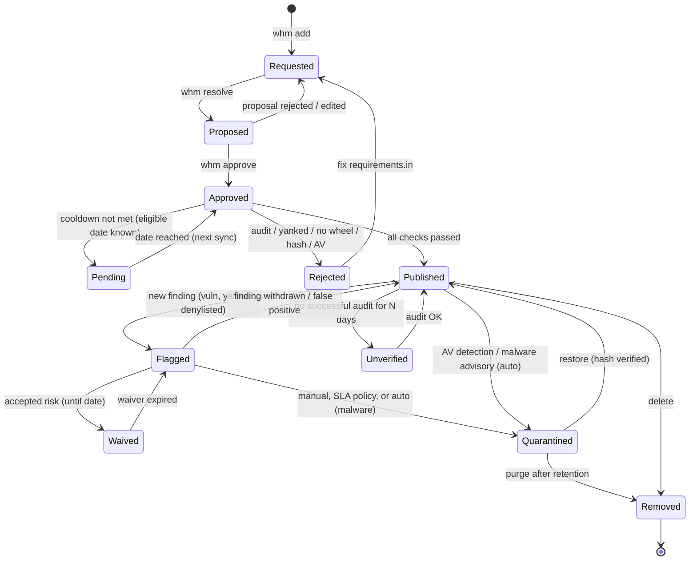

# Wheelhouse Manager - Review and Refactoring Plan

Status: proposal, 2026-10-31. Based on `ARCHITECTURE.md` and the code on branch `Claude-UI-Build`.

Goal: turn the manager into a utility that is **obvious to use** and that **manages a
package for its whole life**, not only at the moment it enters the wheelhouse. A package
that passes every check today can become vulnerable, yanked, flagged as malware or
denylisted tomorrow, and the tool has to notice that, say clearly what needs to happen,
and make the safe action easy.

Contents

1. [Summary](#1-summary)
2. [Review findings](#2-review-findings)
3. [Target design](#3-target-design)
4. [Package lifecycle and continuous re-evaluation](#4-package-lifecycle-and-continuous-re-evaluation)
5. [User experience](#5-user-experience)
6. [Code structure and performance](#6-code-structure-and-performance)
7. [Phased plan](#7-phased-plan)
8. [Compatibility and migration](#8-compatibility-and-migration)
9. [Decisions needed](#9-decisions-needed)

---

## 1. Summary

What works well and should be kept:

- The checks are fail-closed throughout. A failed audit is never treated as clean, a damaged JSON file is never read as empty, and a cooldown whose publish date can't be verified fails.
- Intake is transactional per package, and group files only list pins whose wheel was downloaded.
- One module holds all logic, and every setting is resolved in one place, by one precedence rule.
- The UI is secured carefully (token, origin check, strict validation, child processes).
- Tests run under both 5.1 and 7, and CI enforces lint and exports.

The main gaps:

1. **Checks happen at intake, then mostly stop.** The weekly task re-runs pip-audit only.
   It does not re-scan with new Defender signatures, does not notice yanked releases, does not
   flag deployed versions that were later denylisted, and has no "accepted risk" concept. As a
   result the same finding is alerted every week forever, or teams learn to ignore the mail.
2. **A flagged package stays installable** until someone quarantines it by hand, and nothing
   tracks how long it has been exposed.
3. **There is no package state.** "Is X safe?" is answered by re-parsing up to 300 report
   files on every UI page load. History (who added it, when, why it was removed) is spread
   across logs.
4. **"Approval" is a convention, not a control.** `Update-Wheelhouse.ps1` merges whatever is
   in `Input\requirements.txt`, and the UI's Add tab downloads straight away by default.
5. **Too many entry points with similar names** (`Update-Requirement`, `Update-Wheelhouse`,
   `Invoke-WheelhousePipeline`, `Test-Wheelhouse`, `Test-WheelhousePackage`, ...), plus
   footguns such as `-LocalRequirementsPath ""` and a global `-MinimumPackageAgeDays 0`.
6. **Group files are an internal workaround that leaks to users.** pip-audit cannot take two
   versions of one name, so the files exist, but users see opaque `requirements-N.txt` numbering.
7. **Wheels are published before they are fully checked.** They are downloaded straight into
   the share, scanned with Defender afterwards, and the downloaded bytes are never compared
   with PyPI's published hashes.

The plan is in six phases (section 7). Phase 0 adds safety fixes without changing any
format. Phases 1-2 add a package catalog and continuous re-evaluation: this is the core of
the "fails in the future" requirement. Phase 3 adds explicit proposals and approvals.
Phase 4 adds a single friendly CLI and a dashboard. Phase 5 covers internal restructuring
and performance. Each phase can ship on its own.

---

## 2. Review findings

Severity: **H** = safety or correctness, **M** = reliability or usability, **L** = cleanup.

### 2.1 Safety

| # | Sev | Finding | Where |
|---|---|---|---|
| S1 | H | Wheels are downloaded **directly into the published folder**. The Defender scan runs at the end of the run, so a detected wheel is already in the manifest and in a group file. Clients may install it in the meantime. | `Invoke-CandidateIntake` step 3, `Update-Wheelhouse.ps1` step 7 |
| S2 | H | If Defender **removes** a detected wheel itself, the next run's integrity check fails ("recorded file is missing") and blocks every later update until someone edits `manifest.json` by hand. | `Assert-WheelhouseIntegrity` |
| S3 | H | **Downloaded bytes are not verified against PyPI's sha256 digests.** The manifest hash records whatever arrived. | `Merge-WheelhouseManifest` |
| S4 | H | **The scheduled check never re-scans with Defender.** Signatures update daily, and a wheel that was clean at intake may be detected weeks later. | `Test-Wheelhouse.ps1` |
| S5 | H | **Yanked releases are never checked**, either at intake or afterwards. | `Test-PackageAge` reads the PyPI JSON but ignores `yanked` |
| S6 | H | A deployed version that is **denylisted later** (by hand, or because of a new advisory) is only *marked* in the UI. It stays published and the scheduled check does not report it. | `Test-Wheelhouse.ps1` |
| S7 | H | **Untracked wheels are installable by clients.** The flat index serves every `*.whl` in the folder, while the integrity check only warns about them. | `Assert-WheelhouseIntegrity` |
| S8 | M | `-MinimumPackageAgeDays 0` used for an urgent fix **turns off the cooldown for every candidate in that run**, not just the one being fixed. | `Update-Wheelhouse.ps1` |
| S9 | M | The UI Add tab runs `Update-Requirement` **and** `Update-Wheelhouse` by default, so a package goes from request to published with no review. | `POST /api/packages/add` |
| S10 | M | The cooldown uses `urls[0].upload_time`, which is the first file of the release, not necessarily the wheel that pip downloads (wheels can be uploaded days later). | `Test-PackageAge` |
| S11 | M | Nothing tracks **how long** a vulnerable version has been published. There is no severity, no deadline and no escalation. | Alert path |
| S12 | M | There is **no accepted-risk / waiver mechanism.** A finding that can't be fixed yet is re-alerted on every run. | Alert path |
| S13 | M | If audits keep failing (network, proxy), packages silently keep their old "Passed" status in the UI. There is no "audit is stale" state, and nothing notices that the scheduled task has stopped running. | `Get-PackageAuditStatus` |
| S14 | M | A crash (not an exception) part-way through remove/quarantine skips the in-memory undo stack, which can leave group files, manifest and files inconsistent. | `Remove-WheelhousePackage` |
| S15 | L | The manifest sits on the same share it protects. Anyone who can swap a wheel can also rewrite `manifest.json`. | Design |

### 2.2 Correctness and reliability

| # | Sev | Finding | Where |
|---|---|---|---|
| C1 | M | `Test-Wheelhouse.ps1` skips **all** group audits when the manifest is empty, even if group files exist. | `Test-Wheelhouse.ps1` |
| C2 | M | Package status is rebuilt from report files. Retention deletes them, the scan is capped at 300 files, and the early exit assumes exactly two services (`Count -eq 2`). | `Get-PackageAuditStatus` |
| C3 | M | The worker holds the lock for the **whole run**, including audits and downloads (minutes to hours), so UI remove/restore are blocked the whole time. | `Update-Wheelhouse.ps1` |
| C4 | L | The worker labels its audit of deployed groups `Stage 'Scheduled'`, the same label the scheduled task uses, so reports can't tell the two apart. | `Update-Wheelhouse.ps1:294` |
| C5 | L | Exit code `1` means "findings", "rejected", "aborted" and "lock busy" alike, so the Scheduled Task and the orchestrator cannot tell them apart. | All scripts |
| C6 | L | `Update-Requirement.ps1` and `Send-VulnerabilityAlert.ps1` don't follow the run pattern (no transcript in `reports\`). | Scripts |
| C7 | L | The UI Add job merges the **whole** re-resolved `requirements.txt`, not only the new lines. | `POST /api/packages/add` |

### 2.3 Usability

| # | Finding |
|---|---|
| U1 | There are eight scripts and the user must know the right order: resolve, approve (by convention), update, maybe the pipeline. The names don't say what they do (`Update-Requirement` vs `Update-Wheelhouse`, `Test-Wheelhouse` vs `Test-WheelhousePackage`). |
| U2 | Nothing gives a one-screen answer to "is the wheelhouse healthy, and what needs my attention?". |
| U3 | A rejection says *why* but not *what to do or when*. For example, a cooldown rejection doesn't give the date the package becomes eligible. |
| U4 | Group numbering means nothing to people. The README doesn't say whether clients should use group files at all. (`ARCHITECTURE.md` section 10.5 assumes they install with `-r requirements-N.txt`; that assumption needs confirming, see section 9.) |
| U5 | Client users have no way to learn that a package they installed last month is now vulnerable or quarantined. |
| U6 | There is no setup check ("doctor"). Missing elevation for Defender, an unregistered Scheduled Task or an unwritable share each show up as a different failure later. |

### 2.4 Code structure

| # | Finding |
|---|---|
| A1 | `Update-Wheelhouse.ps1` holds about 200 lines of orchestration logic, which contradicts the "scripts are thin" rule and leaves the core flow untestable without running the script. |
| A2 | `Ui.ps1` (856 lines) routes every request through one large `switch -Regex`. |
| A3 | Name and version patterns are duplicated in five places (`Read-RequirementFile`, `Remove-RequirementFromGroupFile`, Denylist, Ui, `Test-WheelhousePackage.ps1`). |
| A4 | Domain logic (merge plan, intake decisions) is mixed with I/O (pip, PyPI, filesystem) in the same functions, so tests need many mocks. |
| A5 | Every run re-hashes every wheel over SMB, which is slow on large shares. |
| A6 | All 1200 lines of tests are in one file. |
| A7 | `Send-MailMessage` is obsolete and supports neither authentication nor modern TLS. There is no other alert channel. |

---

## 3. Target design

### 3.1 Principles

1. **Every package version has exactly one current state**, stored durably, with a history
   that says who changed it, when, why and with what evidence.
2. **Every check runs continuously**, not only at intake: vulnerability, malware advisory,
   antivirus, yanked, denylist, integrity.
3. **Only fully verified bytes are published.** The pipeline is download to staging, then
   verify, then scan, then publish atomically.
4. **Changes go through a proposal.** A proposal shows the diff, and only an approved proposal
   whose content hash still matches can be applied.
5. **Every message ends with a next step** ("run `whm approve 12`", "eligible on 2026-11-09").
6. **Defaults are safe, automation is reversible, and every automatic action is logged and alerted.**

### 3.2 Data model: separate the bytes from the policy

| File (share) | Purpose | Change |
|---|---|---|
| `manifest.json` | Integrity of bytes: file, sha256, tags | **Unchanged format.** Adds a `pypi_sha256_verified` flag. |
| `catalog.json` (new) | One record per `name==version`: state, reasons, findings, waivers, timestamps, SLA deadline, last audit and scan results | New. This becomes the source of truth for the UI and status. |
| `events.jsonl` (new) | Append-only audit trail of every state change and every admin action | New |
| `requirements-N.txt` | **Generated** from the catalog (published versions only), regenerated atomically. Used for audit chunking and for compatibility. | No longer edited directly. Header comment says it is generated. |
| `advisories.json` + `index.html` (new) | Client-facing list of available packages, plus flagged and quarantined versions | New, generated |
| `_staging\` (new) | Downloads waiting for verification | New, not served (verify, see 9) |
| `_untracked\` (new) | Wheels that appeared without going through intake | New |

`config\` (manager-local) gains `waivers.json` and `policy.psd1` (or new keys in `settings.psd1`).

Example catalog record:

```json
{
  "name": "requests", "version": "2.32.3",
  "state": "Flagged",
  "state_since": "2026-10-28T06:00:00Z",
  "requested_by": "jdoe", "approved_by": "asmith", "proposal": 14,
  "published_utc": "2026-09-12T10:04:00Z",
  "files": ["requests-2.32.3-py3-none-any.whl"],
  "checks": {
    "audit":   { "status": "Vulnerable", "last_ok": "2026-10-21T06:00:00Z", "last_run": "2026-10-28T06:00:00Z" },
    "scan":    { "status": "Clean", "last_run": "2026-10-28T06:10:00Z" },
    "yanked":  { "status": "No", "last_run": "2026-10-28T06:00:00Z" }
  },
  "findings": [
    { "id": "GHSA-xxxx", "aliases": ["CVE-2026-1234"], "severity": "High",
      "fix_versions": ["2.32.4"], "first_seen": "2026-10-28T06:00:00Z",
      "due": "2026-11-04T06:00:00Z", "waiver": null }
  ]
}
```

### 3.3 Intake pipeline (new order)

```
request -> resolve -> PROPOSAL (diff) -> APPROVE -> for each package:
  denylist -> PyPI metadata (yanked, per-file upload date = cooldown, digests)
  -> vulnerability audit (incl. malware advisories) -> download to _staging
  -> sha256 == PyPI digest -> Defender scan of staging files
  -> [lock] move to share, manifest, catalog=Published, regenerate group files [unlock]
```

The cheap metadata checks run before the audit. The lock is held only for the
publish step, which takes seconds. A file never becomes visible to clients until it has
passed every check.

---

## 4. Package lifecycle and continuous re-evaluation

This section answers the main question: **a package that passed every check and then
fails one later.**

### 4.1 States



Every state shows its next step in the CLI and the UI. For example:
**Pending** - *"cooldown: eligible 2026-11-09, picked up by the next sync"*;
**Flagged** - *"High, fix 2.32.4 available, due 2026-11-04: run `whm remediate requests`"*.

### 4.2 Signals and default actions

The scheduled `whm monitor` (the evolution of `Test-Wheelhouse.ps1`) evaluates every
signal for every published version on every run.

| Signal | Detected by | Default action | Configurable |
|---|---|---|---|
| New vulnerability (GHSA, PYSEC, CVE) | pip-audit (osv, pypi), with severity from the OSV API (cached) | **Flag**, set a due date by severity, alert once, then escalate on breach | SLA days per severity; optional auto-quarantine at Critical |
| Malicious package advisory (OSV `MAL-*`) | pip-audit osv | **Auto-quarantine** + denylist `*`, alert immediately | Can be lowered to Flag |
| Defender detection (new signatures) | Scheduled rescan of published files | **Auto-quarantine** (or record "removed by AV" if Defender already deleted it), alert | Can be lowered to Flag |
| Release yanked on PyPI | PyPI JSON (`yanked`, `yanked_reason`) | **Flag** (Medium), alert | Severity |
| Version added to denylist by hand | Catalog vs denylist | Ask in the UI: quarantine now? Otherwise **Flag** | - |
| Integrity mismatch | Hash check | **Auto-quarantine that file only** (it is evidence, never deleted), alert. Do not block the whole wheelhouse. | Strict mode: abort everything, as today |
| Untracked wheel appears | Folder vs manifest | Move it to `_untracked\`, alert | Warn-only mode |
| Audit failed / stale | Last successful audit older than N days | Set **Unverified**, warn; alert after N days | `AuditFreshnessDays` (default 8) |
| Monitor not running | Heartbeat file older than N days | UI/CLI banner; alert from the next run of any command | Days |
| Waiver expired | `waivers.json` | Back to **Flagged**, alert | - |
| Fix version published | pip-audit `fix_versions` + PyPI | Add "fix available" to the alert and propose `whm remediate` | - |

Automatic actions are always **quarantine, never delete**. They are always reversible with
`whm restore`, always written to `events.jsonl`, and always alerted.

### 4.3 Severity and deadlines

- pip-audit JSON has no severity. Enrich each new finding ID from `https://api.osv.dev/v1/vulns/<id>`
  (CVSS vector or `database_specific.severity`), cached in `reports\vulndb-cache.json`. Unknown
  severity is treated as High.
- Default due dates: Critical 3 days, High 7, Medium 30, Low 90 (settings).
- Alerts become **stateful** (`alert-state.json`). The tool notifies on a *new* finding, on a
  *breached* deadline, on a *resolved* finding, plus an optional weekly digest of everything
  still open. This replaces "everything, every week".

### 4.4 Waivers (accepted risk)

`config\waivers.json` entries contain package, version, vulnerability ID (never a blanket
"all"), reason, approver and an expiry date (at most 90 days by default). A waived finding
is passed to pip-audit as `--ignore-vuln <id>` and shown as **Waived** with its expiry. An
expired waiver reverts to Flagged and alerts. Waivers are managed with `whm waive` or in
the UI, and every change is logged.

### 4.5 Remediation helper

`whm remediate <name> [--version x]`:

1. Reads the finding's fix versions.
2. Finds the lowest fixed version that passes cooldown, is not yanked and has a wheel for the target.
3. Writes a **proposal**: upgrade `name` (and any dependency change the resolver requires), with the old version marked for quarantine once the new one is published.
4. After approval, sync publishes the new version, then quarantines the old one.

An urgent fix uses `--expedite --reason "..."`. This skips the cooldown **for this package
only** and records the reason and approver. It replaces the global `-MinimumPackageAgeDays 0`.

### 4.6 Telling clients

- A generated `advisories.json` and `index.html` on the share list every package with its
  state, and flagged or quarantined versions with the advice "upgrade to X".
- New, optional client script `Client Install\Test-PythonEnvironment.ps1` (separate from the
  unchanged `Startup_UV.ps1`). It reads `advisories.json` and checks a venv or project
  (`uv pip list --format json`) **offline**, so users can see whether something they
  installed has since been flagged.

---

## 5. User experience

### 5.1 One front door: `whm`

Add one dispatcher, `whm.ps1`, in the manager root, backed by module functions with approved
verbs. The old scripts stay as thin wrappers so Scheduled Tasks and habits keep working.

| Command | Replaces | What it does |
|---|---|---|
| `whm status` | - | Health summary: last monitor run, counts per state, items needing action, deadlines, lock holder |
| `whm doctor` | - | Checks python/pip/pip-audit/uv, share read/write, elevation for Defender, settings validity, Scheduled Task registration, heartbeat. Prints a fix for each failure. |
| `whm add numpy "pandas>=2"` | edit `requirements.in`, UI Add | Validates, denylist pre-check, appends |
| `whm resolve` | `Update-Requirement.ps1` | Resolves and creates a **proposal** with a diff |
| `whm show proposal 14` | - | Human-readable diff: new, upgraded and unchanged packages, with cooldown dates |
| `whm approve 14` / `whm reject 14` | (convention) | Records approver and hash |
| `whm sync` | `Update-Wheelhouse.ps1`, pipeline | Applies approved proposals, retries pending ones, publishes, alerts. `-WhatIf` shows the plan. |
| `whm monitor` | `Test-Wheelhouse.ps1` | Re-evaluates every signal (section 4.2), applies the policy, sends stateful alerts |
| `whm audit [pkg==ver...]` | `Test-WheelhousePackage.ps1` | On-demand audit |
| `whm scan [pkg...]` | `Invoke-WheelhouseScan.ps1` | On-demand Defender scan |
| `whm list [--state Flagged]` / `whm info requests` | - | Catalog queries, including history |
| `whm remediate requests` | manual | Section 4.5 |
| `whm quarantine` / `whm restore` / `whm remove` | UI only today | Same operations from the CLI |
| `whm deny` / `whm allow` / `whm waive` | UI / hand edit | Denylist and waivers |
| `whm ui` | `Start-WheelhouseUI.ps1` | Starts the UI |
| `whm help [topic]` | - | Short task-oriented help ("add a package", "respond to an alert") |

Output conventions: one summary line, then details. Every error has a "Next step:" line.
`-Json` gives machine-readable output.

Exit codes: `0` OK, `1` findings or rejections (expected, needs attention), `2` error or
aborted, `3` busy (lock held).

### 5.2 Typical session

```text
PS> whm add "requests>=2.32" httpx
Added to requirements.in: requests>=2.32, httpx
Next step: whm resolve

PS> whm resolve
Proposal 15 created: 3 new, 1 upgrade, 0 removed
  + httpx==0.28.1          cooldown OK
  + anyio==4.6.2           cooldown: eligible 2026-11-03
  ~ requests 2.32.3 -> 2.32.4
Next step: whm approve 15   (or: whm show proposal 15)

PS> whm approve 15
PS> whm sync
Published 3, pending 1 (anyio: eligible 2026-11-03, retried automatically)
```

### 5.3 Web UI

- **Overview** tab (new landing page). Health tiles (Published / Flagged / Unverified /
  Quarantined / Pending), an "Needs your attention" list with one-click actions (Remediate,
  Quarantine, Waive), the last monitor run and heartbeat, and banners for missing elevation
  or a missing Scheduled Task.
- **Proposals** tab (new): the diff, Approve and Reject buttons. The Add tab creates a proposal
  only, so download-by-default goes away.
- **Packages** tab: a state column with a plain-language explanation and next step, a filter by
  state, and a detail drawer with findings, checks and timeline (from `events.jsonl`).
- **Waivers** tab (new), and the existing Quarantine, Denylist, Settings and Jobs tabs.
- A legend that explains every state. Settings grouped into sections (Paths, Target, Policy,
  Alerts) with inline help.

### 5.4 Setup

`Setup.ps1 -RegisterScheduledTask [-TaskAccount ...]` registers the monitor task (and,
when elevated, a separate scan task), runs `whm doctor` at the end, and prints the next three
commands. Fix the outdated deployment tree in `README.md`, and split the README into
Quick start, Concepts (states, proposals, waivers) and Reference (`ARCHITECTURE.md`).

---

## 6. Code structure and performance

### 6.1 Module layers

```
WheelhouseManager/
  Domain/        pure logic, no I/O: pins & patterns, merge/pack, policy evaluation,
                 state transitions, proposal diff, SLA
  Adapters/      Pip, Uv, PipAudit, PyPI, OSV, Defender, Notifier (SMTP/file/webhook),
                 Store (manifest, catalog, events, denylist, waivers - atomic + locked)
  Services/      Invoke-WhResolve, Invoke-WhSync, Invoke-WhMonitor, Invoke-WhRemediate,
                 Remove/Restore, Approve - each returns a result object
  Interfaces/    Ui (route table -> handlers), Cli (whm dispatcher)
```

- Move the worker logic from `Update-Wheelhouse.ps1` into `Invoke-WhSync` (A1).
- Put every name, version and file pattern in one place, `Domain\Patterns.ps1`, with
  `Test-WhPackageName`, `ConvertTo-WhPin` and so on (A3).
- Ui: a `$routes` table of `@{ Method; Pattern; Handler; NeedsWheelhouse; MutatesState }`, with one
  small handler function per endpoint (A2).
- Adapters are the only things tests mock. Domain functions are tested with plain data (A4).
- Keep all of today's guardrails: functions throw and scripts exit; module functions never run
  `Jobs\*.ps1` in-process; native commands go through `Invoke-NativeCommand`; source stays
  ASCII and 5.1-compatible.

### 6.2 Transactions

- **A journal instead of an in-memory undo stack** (S14). Every multi-step write
  (publish, remove, restore, regenerate groups) first writes `.\_journal\<op>.json` with
  its planned steps, then performs them, then deletes the journal. Each run starts by
  replaying or rolling back a leftover journal.
- Hold the lock only for the publish and edit steps (C3). Audits and downloads work in
  `_staging` without it.
- Readers (monitor, UI) take a short shared read of a consistent snapshot: catalog and manifest
  are written atomically and group files are regenerated atomically.

### 6.3 Performance

| Area | Today | Proposed |
|---|---|---|
| Integrity | SHA256 of every wheel on every run, over SMB | Cache `(size, mtime, sha256)`. Re-hash only changed files each run, plus a full verification on a schedule (weekly) |
| Package status | Parse up to 300 report files per page load | Read `catalog.json` |
| Audit | One pip-audit per group per service | Keep pip-audit, but pack the published set into the minimum number of chunks. Optionally query OSV `querybatch` directly, which also returns severity |
| PyPI metadata | One request per package per check | One cached request per run gives yanked, digests and upload dates together |
| Defender | Whole folder | New files in staging at intake; the whole folder on the scheduled scan |

### 6.4 Notifications

A notifier interface with three channels: `File` (today's HTML), `Smtp` (Send-MailMessage
by default, with an optional credential from Windows Credential Manager), and `Webhook`
(Teams or Slack JSON). Also optional Windows Event Log entries (source `WheelhouseManager`)
so a SIEM can pick up Flagged, AutoQuarantined and IntegrityFailure events.

### 6.5 Tests

- Split tests into `Tests\Domain\*.Tests.ps1`, `Tests\Services\*.Tests.ps1`, `Tests\Ui\*.Tests.ps1`.
- Add scenario tests that drive a whole lifecycle with fake adapters: publish, then a new
  vulnerability, then a waiver, then expiry, then remediation. Also: AV detection leads to
  auto-quarantine, and a stale audit leads to Unverified.
- Add migration tests: a v1 manifest plus group files becomes a catalog, with nothing lost.

---

## 7. Phased plan

Each phase is shippable and keeps the existing scripts working. Effort: S = days,
M = 1-2 weeks, L = 2-4 weeks (one developer).

### Phase 0 - Safety quick wins (S-M, no format change) - DONE 2026-10-31

Implemented as listed below, with these decisions:

- **Staging lives under the manager root** (`<root>\staging\`), not on the share and not in
  `%TEMP%`. Nothing new appears on the share, so D6 no longer blocks Phase 0. `%TEMP%` can be an
  8.3 short path, which would not match the long paths in Defender's detections.
- **A scan that cannot run publishes with a warning by default** (today's behaviour);
  `RequireDefenderScanAtIntake` rejects instead. A detection always rejects.
- **The scheduled Defender rescan is opt-in** (`DefenderScanInScheduledCheck` / `-DefenderScan`),
  because it needs an elevated task (D5).
- **Expedite applies to intake only.** If the fix is newer than the cooldown, the resolve step still
  needs `Update-Requirement.ps1 -MinimumPackageAgeDays 0`. Intake then rejects every other too-new
  pin, so safety holds, but a per-package resolver override (uv `--exclude-newer-package`, if the
  deployed uv supports it) is a follow-up.
- **Untracked wheels (S7) are still only a warning.** Moving them to `_untracked\` belongs to Phase 2,
  because it changes files on the share.
- **The alert now has a "Packages that need attention" section.** It is fed by `Wheelhouse.Notice`
  objects: `Denylisted`, `Yanked`, `DefenderThreat`, `DefenderRemoved`, `IntakeBlocked`.

| Item | Fixes |
|---|---|
| Download to `_staging`, verify sha256 against PyPI digests, Defender-scan the staged files, then move into the share | S1, S3 |
| Check `yanked`, and use the upload date of the file actually downloaded for the cooldown | S5, S10 |
| Per-package expedite (`-ExpeditePackage name==ver -Reason`) instead of a global 0 | S8 |
| UI Add defaults to "resolve only"; full intake needs an explicit option | S9 |
| Scheduled check reports deployed versions that are denylisted, reports yanked releases, and runs a Defender rescan when a setting allows it | S4, S5, S6 |
| Missing file whose path matches a Defender detection: record it as "removed by AV" instead of blocking every run | S2 |
| Fix the empty-manifest skip, the stage label (`Deployed`), and the two-service assumption | C1, C2, C4 |
| Exit codes 0/1/2/3 | C5 |
| Fix the README deployment tree | U-docs |

Acceptance: a wheel never appears in the share before its hash and AV checks pass, and the
existing tests plus new ones pass under 5.1 and 7.

### Phase 1 - Foundation: restructure + catalog (M-L) - DONE 2026-10-31

Implemented, with these decisions:

- **Group files are not generated from the catalog.** Clients install from them with
  `uv pip install -r` (decision D1), so they must stay stable. They remain the source of group
  membership; the catalog follows them on every write.
- **Catalog (`catalog.json`) and history (`events.jsonl`) live on the share next to the manifest.**
  The catalog is derived: it can always be rebuilt from manifest, group files and quarantine. It is
  created automatically on first use and imports the latest report results and quarantine records.
- **Locks are split in two.** A short write lock (`Open-WheelhouseWrite` = lock + journal repair)
  covers every change. A sync lock allows one update run at a time. Intake is split into
  `Invoke-CandidateIntake` (checks, unlocked) and `Publish-CandidateIntake` (write lock, re-reads
  manifest and denylist).
- **The journal covers publish, remove and restore, rolling them forward.** Publish and restore use
  the same `Complete-*` functions as the repair.
- **The worker moved into `Invoke-WheelhouseSync`.** `Update-Wheelhouse.ps1` is thin.
- **Shared validation** (`Test-WheelhousePackageName`, ..., `ConvertTo-WheelhousePin`) replaces five
  copies. The UI's `switch` became a route table (`Get-WheelhouseUiRoute`) with `Wheelhouse`/`Idle`
  flags.
- **UI additions (pulled forward from Phase 4):** a per-package History dialog
  (`GET /api/packages/<name>/<version>/history`), and a "yanked" badge and filter.
- **Not done:** the module folder reorganization into Domain/Adapters/Services (section 6.1). Files
  stay flat by domain; the layering is kept by convention.

- Move the worker into `Invoke-WhSync`. Centralize patterns. Add the Ui route table.
- Introduce `catalog.json` and `events.jsonl`. On first run, migrate them from manifest, group
  files, quarantine records, denylist and the latest reports.
- Generate group files from the catalog (atomically, with a "generated" header).
- Add the journal and the shorter lock scope.
- The UI reads status from the catalog.

Acceptance: behavior is unchanged for existing commands, migration is lossless (with a
backup), and a page load does no report parsing.

### Phase 2 - Continuous re-evaluation and policy (M-L) - **the core requirement**

Started 2026-10-31 with the antivirus scope decision (D5) and the automatic-quarantine switch (D2):

- **Removed:** the whole-share Defender scan at the end of every update, the scheduled rescan
  option (`DefenderScanInScheduledCheck`, `-DefenderScan`) and the Defender-history matching for
  missing files.
- **Added:** wheels removed or changed on the share become `FileMissing` / `FileModified` notices.
  With `AutoQuarantine` on (the default) they are taken out or quarantined, and denylisted, by the
  weekly check or the next update; with it off, they are only reported and updates stop. On-demand
  scans copy and hash-check wheels locally first. The intake scan result is recorded in the catalog.
- **Still to do in this phase:** OSV severity (needs D4), due dates and escalation, waivers, malware
  advisories (`MAL-*`) under `AutoQuarantine`, the Unverified state and heartbeat, stateful
  alerts, untracked wheels moved out.

- `Invoke-WhMonitor` with every signal in section 4.2, plus the policy settings.
- Severity enrichment and due dates; Unverified state, heartbeat, escalation.
- Waivers (`waivers.json`, `--ignore-vuln`).
- Auto-quarantine for malware advisories and AV detections (default on, see section 9);
  untracked wheels moved to `_untracked`.
- Stateful alerts (new / breached / resolved / digest) and a notifier interface.
- `advisories.json` and `index.html` on the share.

Acceptance: these scenario tests pass:
- clean -> new CVE -> Flagged with a due date -> breach escalates -> waiver silences -> waiver expiry re-alerts;
- MAL advisory -> quarantined within one monitor run;
- network outage for longer than the freshness window -> Unverified + alert.

### Phase 3 - Proposals, approval, remediation (M)

- Resolve creates a proposal (diff + content hash); approve and reject record the user; sync
  applies only approved proposals whose hash still matches.
- `remediate` (section 4.5), with expedite per package.
- Optional: named **sets** (`Input\sets\<name>.in` -> `<share>\sets\<name>.txt`), giving
  projects a consistent installable lock instead of numbered groups (see section 9).

### Phase 4 - User-facing tools (M)

- `whm` dispatcher with `status`, `doctor`, `list`, `info`, `help` and the rest; old scripts become wrappers.
- UI: Overview, Proposals, Waivers, package detail timeline, state legend.
- `Setup.ps1 -RegisterScheduledTask` plus doctor at the end; new README structure.
- `Client Install\Test-PythonEnvironment.ps1` (optional, offline).

### Phase 5 - Performance and hardening (S-M)

- Incremental integrity with a scheduled full check; batched audits and cached metadata.
- Event Log output and a webhook notifier.
- Optional: sign or HMAC `manifest.json`/`catalog.json`, with the key or a copy of the hash kept on the
  manager server (S15).
- Split the tests and add lifecycle scenario tests.

Suggested order: Phase 0 first (immediate risk reduction), then 1 and 2 together, since Phase 2
depends on the catalog. After that, 3, 4 and 5 can be reordered by priority.

---

## 8. Compatibility and migration

- **`Client Install\Startup_UV.ps1` stays unchanged.** Clients keep using the flat index.
  Every safety gain above works within that constraint, because unpublished files live in
  subfolders and untracked files are moved out.
- `Jobs\Test-Wheelhouse.ps1` keeps its path and becomes a wrapper for `whm monitor`, so
  existing Scheduled Tasks keep working.
- `manifest.json` keeps its format. `catalog.json` is created from it on first run, after a
  backup to `reports\migration-backup-<ts>\`.
- Group file names stay the same. They become generated, and a hand edit is detected (by
  comparing against the catalog) and reported instead of being silently overwritten.
- New settings keys get defaults in `Get-WheelhouseDefaultSetting`, so old `settings.psd1`
  files keep working.
- `ARCHITECTURE.md` is updated at the end of each phase.

---

## 9. Decisions needed

| # | Question | Recommendation |
|---|---|---|
| D1 | Do clients install with `-r requirements-N.txt`, or only by name against the flat index? This decides whether group files must stay stable and whether named sets are worth building. | **Answered:** clients do use `-r requirements-N.txt`. Group files stay stable and are never regenerated (Phase 1). |
| D2 | Should auto-quarantine be on by default? | **Answered:** yes, with a switch in the UI and on the command line: setting `AutoQuarantine` (default on), `-AutoQuarantine On|Off` per run. Today it covers wheels removed or changed on the share; Phase 2 adds malware advisories (and optionally a severity threshold) under the same switch. |
| D3 | Is a separate approver required (four-eyes), or can the requester approve their own proposal? | Configurable, default "same person allowed, recorded". |
| D4 | Can the manager server reach `api.osv.dev` (for severity) as well as `pypi.org`? | **Open.** Explained: pip-audit gives no severity; OSV returns it per advisory ID (only the ID is sent). With the default `osv` service, pip-audit already queries `api.osv.dev`. Without it, every advisory counts as High. |
| D5 | Should a scheduled task re-scan the wheelhouse with Defender? | **Answered: no.** Virus scanning of the share is the file server antivirus' job and out of scope. Defender scanning a share also runs as the computer account and may skip network files, so such scans were removed. The tool scans new downloads locally at intake, offers on-demand scans of hash-checked local copies, and detects wheels the file server's antivirus removed or changed (integrity check -> `FileMissing`/`FileModified`, taken out with `AutoQuarantine`). |
| D6 | Does uv's flat index ignore subfolders (needed for `_staging`, `_untracked`, `_quarantine`)? Today's `_quarantine` already relies on this. | Verify with the deployed uv version before Phase 0. |
| D7 | Should alerts also go to Teams/Slack or the Event Log? | Webhook + Event Log in Phase 5. |
| D8 | Should the CLI be one `whm.ps1` dispatcher, module cmdlets only, or both? | Both: cmdlets for scripting, `whm` for people. |
